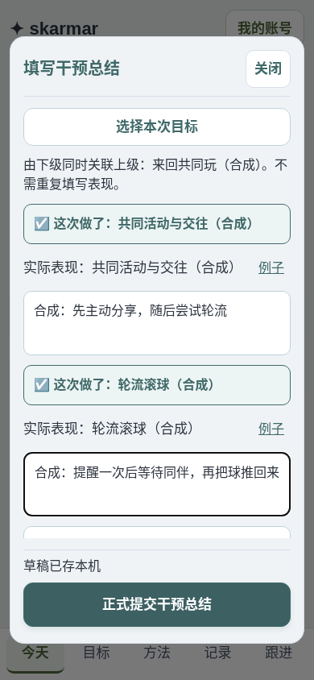
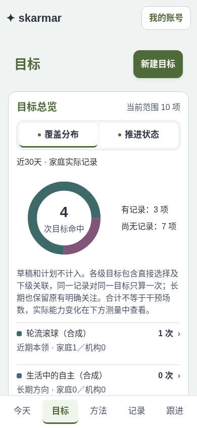

# 实际目标选择修复

2026-11-05，T70本机验收记录。对应用户提供的“选择本次目标”截图。

2026-11-06已通过T71上线，最终版本`965b6832-9b54-4a53-8711-df0ede5c0e3d`；
按用户后续授权移除两项目录条目并保留其历史，见[实际发布记录](goal-removal-release-2026-11-05.md)。
以下实现与截图是当时的验收记录，不改写其生成时证据。

## 已确认的问题

上一版把长期目标作为不可勾选的分组标题，服务端也拒绝将长期方向保存为实际目标。真实目标主要是长期方向时，只剩少数中短期条目可选，无法按家人实际活动记录。这是实现错误，不应要求先造一个短期目标才能记录长期目标。

旧选择器还包含已收起目标，目标页默认隐藏；编辑中的候选目录会固定快照，另外目标页的期限／搜索筛选会留在折叠区。这些规则会使两个位置看起来不一致。代码搜索未发现截图中两个陌生中短期名称的预设或生成逻辑；本轮未登录生产、读取具体业务记录，不能据此断言这两条是谁或哪次操作创建，当时也没有删除它们；之后按用户明确授权执行T71，结果见上方发布记录。

## 现在的行为

- 目标页和选择器共用已保存目录的可见性规则。默认不显示收起目标，已选项仍保留；可主动显示已收起目标。目标页有筛选时显示范围和“显示全部目标”，避免隐藏筛选造成误判。
- 打开选择器读取当前共享目录，可手动刷新；失败保留已读目录、选择和观察，提供重试。每项“详情”打开原目标详情及修改记录，返回保留当前选择，便于用户核对名称与来源。新增、改名、收起都按原ID处理，不使用参考／示例生成候选。跨账号和关窗后的迟到读取不应用；本机草稿键不变。
- 树以长期／中期／短期真实父子关系组织。各层级均可直接勾选；分支可展开／收起、全部展开／收起，搜索时保留上级路径。完成按钮固定在底部，不必滚到长列表末尾。
- 选择下级后，全部所属上级以“自动关联”与半选状态显示。自动关联没有额外的表现必填项，也不虚构一个实际训练目标。直接选择上级会单独保留；取消最后一个下级只移除自动关联，不取消独立选择。多个下级共用一个上级时去重。
- 只选长期目标也可以写表现、选择实际方法、沉淀经验并正式提交。直接选择的每个目标各写一句表现；自动关联的上级不用重复填写。取消后重新选择仍保留原观察，未选项不计实际目标。
- 总结可参考自动关联上级的经验／困难，直接／间接关系不被当成有效性判断。已有方法、经验关联、来源和权限不变。

## 存储与计数

不加schema迁移，不修改正式代际、账号、旧记录、草稿或未确认请求。实际目标快照允许长期方向；计划仍只写活动。下级的上级链保存在实际目标的`ancestors`快照中，详情可见；已完成记录后续改观察仍保留原层级，目标后来换上级不会重写旧记录。

保留原报告的`counts/direct/descendants/focus`分列含义；新的`linked`为直接目标、历史上级和旧明确长期关注的记录集合并集。环图使用该并集：同一次记录即使同时选了长期目标和其短期子目标，长期方向仍只算一次。原有长期关注入口和历史记录继续可用；新直接长期实际目标也属于明确关注。没有自动标目标达成或修改目标／方法的永久关联。

共享目录固定快照的更新判断同时修正为按ID／版本比较集合，避免仅因服务器排序与本机合并顺序不同，就反复显示“候选项有更新”。真正的新对象或新版本仍需核对，不能因此自动覆盖在填表单。

## 验证

当前81个客户端语义用例、172个Rust测试、类型检查／Web生产构建、原生与Wasm Clippy（warnings为error）、Worker构建、完整SQLite／Wasm DO合约及重启（无SKIP）通过。18组分组Web回归通过；最后对目录顺序假更新、原目标详情返回、方法／经验关联、搜索路径及三层树在320／430／1440px和固定完成按钮再验。原统计分列的附录D测试继续通过；新并集由两套真实运行环境验证。

6张已审合成截图及源文件／Web包／图片摘要见本轮产物目录，新增7项后176项产物SHA通过。测试使用独立本机SQLite与两个合成家人账号；没有把用户截图、真实账号、业务数据、数据库或私密配置提交到Git。

- 长期目标独立总结；方法／经验关联；不创建假的短期目标。
- 真实共享目录读取；新增／改名立即可选；收起目标与目标页一致；隐藏筛选可清除。
- 分支展开、层级搜索、多选、半选上级、兄弟节点去重、显式上级独立保留。
- 取消再选保留观察；网络失败保留目录与填写；丢响应按同一操作恢复，不重复计数。
- 原计划与实际快照分离；父子共同出现不重复计数；旧记录修改保留当时上级。
- 原生SQLite与Wasm DO使用同一业务实现，重启后原记录、关联和账号保留。

完整读屏、真机及Opus独立验收仍为原待办；合成数据浏览器测试不替代用户账号中的来源核对。本轮没有部署，线上仍为T69的`10ff3a07-ee68-4305-bc41-bb58a27f0812`。

## 合成截图

### 各期限目标可选

### 只选长期目标也能完成

### 真实树形与上级关联

### 只填写直接目标的观察

### 目录暂不可用时保留填写

### 关联去重后的覆盖总览

