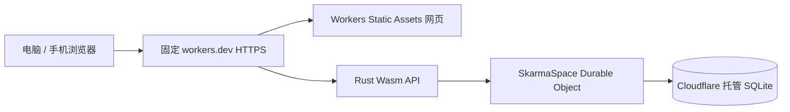

# 完整 Cloudflare 托管：部署、账号初始化与维护

日期：2026-10-18。此方案将网页、Rust API 和持久数据库全部放在 Cloudflare，
是本项目当前的上线方向。用户已确认先建立空白云端实例，待旧主机恢复后再迁移数据。
本手册中的账号 ID、网址等使用占位符；真实资源清单和私有配置保留在管理员本机。

2026-10-19：管理员已初始化、用户确认登录成功，临时初始化 secret 已删除。
用户要求先评估大陆无代理访问，新的发布暂缓；参见 [入口评估与验收](mainland-access-plan.md)。

## 1. 运行结构



运行不依赖 evo、Tailscale、Tunnel 或管理员电脑在线。Mac 只用于修改和发布代码。
账户审批、记录与会话都由云端同一实例管理；各成员使用各自账号，管理员审批注册。
当前实例是一个共享空间，正常成员能查看和填写该空间全部记录；尚无逐条记录或多孩子权限隔离。

Cloudflare 官方支持 [Rust Worker](https://developers.cloudflare.com/workers/languages/rust/)。
本项目沿用现有 Rust / Axum 路由、业务规则和 SQL，存储切换为 SQLite-backed Durable
Object。[官方定价](https://developers.cloudflare.com/durable-objects/platform/pricing/)
列出了 Workers Free 的 SQLite 对象额度；超过免费额度时相应操作可能失败。此次未升级
付费方案。管理员需在控制台留意 Worker 与对象的请求、运行及存储用量。

旧的 [Workers VPC 网关方案](cloudflare-workers-vpc-deployment.md) 保留作排障与历史记录。
它把请求转回旧主机，不能作为完整云端托管的发布入口。

## 2. 代码和配置文件

| 文件 | 用途 |
| --- | --- |
| `crates/worker/src/runtime.rs` | Rust Worker 与 `SkarmaSpace` 对象入口 |
| `crates/core/`、`crates/http/` | 两种运行环境共用的业务、SQL、认证和 HTTP 路由 |
| `apps/client/` | 网页源码 |
| `deploy/cloud-worker/wrangler.example.toml` | 可提交 Git 的完整云端配置模板 |
| `deploy/cloud-worker/wrangler.toml` | 实际账号、网址配置，被 Git 忽略 |
| `tools/check-runtimes.mjs` | 原生与 Wasm / DO 的同一套 API 验收 |
| `tools/auth-contract.mjs` | 注册审批、Cookie、来源和成员权限验收 |
| `tools/lesson-contract.mjs` | 两种存储下的独立上课记录验收 |

根目录 `wrangler.toml` 保持默认不发布，用于开发与预检查。正式发布始终指定
`--config deploy/cloud-worker/wrangler.toml`。`deploy/worker-gateway/` 则属于旧的主机代理。

## 3. 准备构建工具

本次使用 Rust `1.99.0`、`worker-build 0.8.7`、Wrangler `4.149.0`，Node 与依赖以
仓库锁文件为准。下面命令在仓库根目录运行：

```bash
npm ci
rustup target add wasm32-unknown-unknown
cargo install worker-build --version 0.8.7 --locked --root .local/worker-tools
export PATH="$PWD/.local/worker-tools/bin:$PATH"
npm run web:build
```

`.local/worker-tools` 不进入 Git。当前 Mac 需要现有 HTTP 代理时，可只对相关命令
设置 `HTTPS_PROXY=http://127.0.0.1:7890`，不要把代理凭证写进仓库。其他机器应使用
自己的可用网络，不必照搬本机端口。

Wrangler 继续使用管理员已授权账号的登录状态；凭证在管理电脑的加密配置与系统
钥匙串中。无需复制主机的 Tunnel token，也无需向云端应用提供 Tailscale 密钥。

## 4. 建立生产配置

```bash
cp deploy/cloud-worker/wrangler.example.toml deploy/cloud-worker/wrangler.toml
```

编辑复制文件，设置实际 `account_id`、Worker 名称与准确的 HTTPS `SKARMA_PUBLIC_URL`。
首次需确认本账号 `workers.dev` 子域名。重要配置如下：

```toml
name = "skarma-web"
account_id = "ACCOUNT_ID"
main = "../../crates/worker/build/index.js"
compatibility_date = "2026-10-18"
workers_dev = true
preview_urls = false

[build]
command = "worker-build --release"
cwd = "crates/worker"

[assets]
directory = "../../apps/client/dist"
not_found_handling = "single-page-application"
run_worker_first = ["/api", "/api/*"]

[vars]
SKARMA_STORAGE = "durable_object"
SKARMA_DEMO = "0"
SKARMA_SPACE = "default"
SKARMA_AUTH = "required"
SKARMA_PRODUCTION = "1"
SKARMA_PUBLIC_URL = "https://skarma-web.ACCOUNT_SUBDOMAIN.workers.dev"
SKARMA_INITIAL_ADMIN_USER = "owner"
SKARMA_INITIAL_ADMIN_NAME = "管理员"

[durable_objects]
bindings = [{ name = "SKARMA_DB", class_name = "SkarmaSpace" }]

[[migrations]]
tag = "v1"
new_sqlite_classes = ["SkarmaSpace"]
```

`main` 和 `assets.directory` 相对配置文件；本版本 Wrangler 的 `build.cwd` 相对执行
命令的当前目录，因此发布命令必须从仓库根目录运行。目录错误可能表现为误导性的
`spawn /bin/sh ENOENT`，先检查构建工作目录。

`SKARMA_SPACE` 决定对象身份，已有数据后保持稳定。修改它可能连接另一个空对象，
不会迁移原数据。`new_sqlite_classes` 明确使用 SQLite 对象，不能改成旧 KV 类型。
部署后保留相同 Worker 名称、对象类名及绑定；数据库迁移按新版本追加，不能通过删库重建更新。

## 5. 构建、验证和发布

```bash
export PATH="$PWD/.local/worker-tools/bin:$PATH"
npm run typecheck
npm run web:build
cargo clippy -p skarma-worker --target wasm32-unknown-unknown --locked -- -D warnings
(cd crates/worker && ../../.local/worker-tools/bin/worker-build --release)
```

API 验收还需要当前的原生调试程序；首次构建后运行：

```bash
cargo build -p skarma-api --locked
npm run test:runtimes
```

该检查创建独立的合成数据和临时数据库，验证迟发 SQL 错误回滚、并发幂等和版本冲突、
历史与归档、重启保留、注册审批／拒绝、会话撤销和权限、独立上课记录及十一表 Excel。
不连接生产数据库，测试结束删除临时存储。部署包检查与发布：

```bash
npx wrangler deploy --config deploy/cloud-worker/wrangler.toml --dry-run \
  --outdir .local/cloud-worker-dry-run
npx wrangler deploy --config deploy/cloud-worker/wrangler.toml
```

记录实际返回的网址和 Worker 版本 ID；不要只凭命令启动就认定发布成功。
本次产物约 3057 KiB，压缩后约 957 KiB，发布返回启动时间 4 ms。
具体线上验收结果与尚未完成项记录在 [任务清单](workspace-state.json) 的 T17。

## 6. 首个管理员初始化

云端空白实例没有旧主机的管理员，也没有默认密码。初始化用户名由私有配置中的
`SKARMA_INITIAL_ADMIN_USER` 设置，本次为 `owner`。首次由持有人在自己的终端运行：

```bash
npx wrangler secret put SKARMA_INITIAL_ADMIN_PASSWORD \
  --config deploy/cloud-worker/wrangler.toml
```

按提示隐藏输入至少 12 个字符的密码，最多 128 字节。不要在命令参数、聊天、TOML、
Git、前端代码或截图里写密码。该命令会创建带有私有 secret 的 Worker 版本。
随后在正式 HTTPS 页面用 `owner` 和刚设置的密码登录。

对象只在账号表为空时读取该私有 secret 创建管理员；没有公共的“首个访问者成为
管理员”或数据库管理端点。数据库保存 Argon2id 哈希；普通用户的注册必须审批。

确认首次登录成功后，从初始化 secret 中移除临时明文密码：

```bash
npx wrangler secret delete SKARMA_INITIAL_ADMIN_PASSWORD \
  --config deploy/cloud-worker/wrangler.toml
```

这不会删除已创建管理员或修改其数据库哈希。再次刷新、退出并登录，确认 secret 已移除
后账号仍有效。以后重置忘记的密码不能仅靠重新添加初始化 secret；已有账号时不会
再次执行 bootstrap，需要另行设计受控的管理员恢复流程。

## 7. 线上检查与使用

设置实际网址：

```bash
SKARMA_CLOUD_URL=https://skarma-web.ACCOUNT_SUBDOMAIN.workers.dev
curl --fail "$SKARMA_CLOUD_URL/api/health"
curl -sS -o /dev/null -w '%{http_code}\n' "$SKARMA_CLOUD_URL/api/state"
curl -sS -o /dev/null -w '%{http_code}\n' -X POST \
  -H "Origin: $SKARMA_CLOUD_URL" -H 'X-Skarma-Request: 1' \
  "$SKARMA_CLOUD_URL/api/auth/logout"
curl -sS -o /dev/null -w '%{http_code}\n' -X POST \
  -H 'Origin: https://untrusted.invalid' -H 'X-Skarma-Request: 1' \
  "$SKARMA_CLOUD_URL/api/auth/logout"
```

预期分别是健康 200 / `status=ok`、匿名 state 401、正确来源空会话 logout 200、
陌生来源 403；缺少请求标记也必须 403。`/api/*` 响应有 `Cache-Control: no-store`，
未知 API 是 JSON 404，不能被 SPA 回退变为 HTML。首页和实际 JS 文件应返回 200。

管理员登录后检查：注册申请进入待审批，批准后普通成员能登录；“今天”可直接记录
上课，课程与老师必填，其余可选；记录可回看修改，Excel 有十一张表。线上以真实使用
自然产生的数据为准，不自动创建测试账号或虚构训练记录。

Cookie 保持 `__Host-`、`Secure`、`HttpOnly`、`SameSite=Strict`。新网址与旧主机的会话和
本机草稿相互独立；使用空白云端不会自动带入旧管理员、记录、草稿或待审申请。
换设备访问不要求加入 Tailnet，但仍要求应用账号。

## 8. 日常更新与问题定位

后续从同一功能分支同步代码，保持工作区改动，核对版本后重复第 5 节。Worker 配置
中的变量会随发布应用；只在发布配置中保留非秘密设置，secret 单独管理。

| 现象 | 检查 |
| --- | --- |
| 新网址首页正常，但无法登录 | 区分新旧实例；检查管理员初始化 secret 是否已设置，账号名是否为配置值 |
| 页面 403 且提示来源不匹配 | 对照实际地址栏和 `SKARMA_PUBLIC_URL`；保持 HTTPS 精确来源及请求标记 |
| Worker 500 / 1101 | 在私有控制台查看对应版本错误，核对 DO 类导出、绑定和迁移，勿公开原始日志 |
| 1102 或配额错误 | 查看 Worker / DO 用量、CPU 与免费额度；评估后再决定优化或付费，不自动升级 |
| 只有某台设备报 TLS / DNS 错误 | 核对本机 DNS、现有代理和实际网络；无需为此重建数据库或降低证书验证 |
| 地址仍显示旧 `Service unavailable` | 确认打开的是新的完整云端 Worker，而非旧 VPC 网关 |
| 出现一套空数据 | 核对账号、Worker、绑定、空间名；先找回正确对象，不要继续覆盖或创建另一套数据 |

控制台日志、生产数据和账号信息保留私有。排障可记录状态码、版本 ID 与脱敏错误。
Worker 地址固定不等于所有地区和网络都能访问；手机 Wi-Fi 与蜂窝仍需各自验证。

## 9. 数据、备份与后续主机迁移

当前云端实例独立存储在 Cloudflare。应用的十一表 Excel 导出适合留存业务记录，
**不包含账号密码哈希及会话，不能当作完整系统恢复包**。Durable Object 的时间点恢复、
导出与生产恢复操作另按 [官方 SQLite 存储说明](https://developers.cloudflare.com/durable-objects/api/sqlite-storage-api/)
处理；仓库尚未提供经生产验收的一键整库云端恢复命令。

旧主机恢复后先建立 SQLite 一致性备份，再实现并演练受控迁移：核对表结构、稳定 ID、
关联、目标历史、版本和账号策略，处理新云端期间已新增记录的冲突。不能直接把本地
SQLite 文件当作 D1 文件上传，也不能靠改 `SKARMA_STORAGE` 或 `SKARMA_SPACE` 自动同步。

迁移 006 仍预留给腾讯文档导入，日常上课记录是 007。新云端也需遵守这一版本安排，
后续补跑 006 必须验证 007 已存在的情况。腾讯文档导出文件的导入和旧主机整库迁移
是两项工作，目前均不声明已完成。

## 10. 回退与 Git 管理

发布后先保留上一版 Worker 和实际版本 ID。需要回退代码时在 Cloudflare Deployments
选择通过验收的兼容版本，或从对应 Git 版本重新发布；回退代码不会回退数据库。
遇到不可兼容数据库迁移，先核对恢复方案，不能删除对象来“清空错误”。

提交配置模板、源码、测试和本手册；排除实际 `wrangler.toml`、`.dev.vars`、OAuth
配置、密码、生产数据与原始日志。按 [交接说明](handoff.md) 更新任务状态，检查 diff，
提交并推送到 `feat/tencent-informed-web`。历史测试与本次实际通过的测试分开记录。

## 参考

- [Cloudflare Rust 支持](https://developers.cloudflare.com/workers/languages/rust/)
- [SQLite-backed Durable Object Storage](https://developers.cloudflare.com/durable-objects/api/sqlite-storage-api/)
- [Durable Objects 定价与免费额度](https://developers.cloudflare.com/durable-objects/platform/pricing/)
- [Worker secrets](https://developers.cloudflare.com/workers/configuration/secrets/)
- [Worker 回滚](https://developers.cloudflare.com/workers/configuration/versions-and-deployments/rollbacks/)
