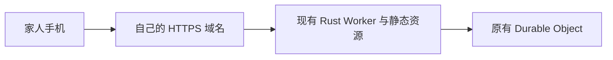
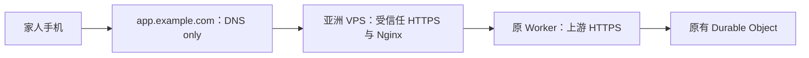

# 四份资料中的大陆访问方案核对

日期：2026-10-19，Asia/Singapore。只做公开资料研究、现有代码检查与验证计划；未购买资源、
改 DNS / 生产配置、登录生产账号或部署。生产发布继续暂停。

## 结论

这次增加了一个值得验证的中间方案：**大陆手机 → 亚洲 VPS 反向代理 → 原来的 Cloudflare
Worker → 原来的 SQLite Durable Object**。它可保留 Rust 后端、现有云端账号与数据，
不必先改小程序或实现多副本同步。它依赖可从家人网络访问的 VPS 公网入口，效果尚未实测。

若有可管理域名，先测试直接绑定原 Worker 的效果；仍不稳定时再加亚洲 VPS，保留直接入口作
对照。没有域名或可用 VPS 时，这只是待选路线，不能称为零成本已解决。之前故障、可能没有
公网 IP 的家庭电脑，不能直接当成这里的公网入口；本轮不连接旧 evo。

## 用户提供的四个链接

| 资料 | 实际读取情况与内容 | 对本项目的判断 |
| --- | --- | --- |
| [掘金：Cloudflare 中国大陆网络访问优化 — ０元成本](https://juejin.cn/post/7583933107689570367) | 网页返回验证页；通过公开文章接口成功读到全文。正文标注版本 2.0、2025-12-15。核心是 OCI 日本 VPS + Nginx → Worker | 结构可用作候选；免费、速度及长期可用结论依赖作者环境。Nginx 若干说明须修正，见下文 |
| [Cloudflare 中国网络产品页](https://www.cloudflare.com/zh-cn/application-services/products/china-network/) | 成功读取，介绍与京东云合作的大陆节点网络 | 是企业服务；不能把普通免费 Worker 当成已经接入中国网络 |
| [Cloudflare 社区答复](https://community.cloudflare.com/t/topic/714626) | 成功读取。2024-09-23 答复建议 Enterprise 客户加购 China Network | 可说明服务定位；不提供家庭项目免费接入方法，也不是报价或可用性承诺 |
| [Cloudflare 实战手册：国内访问](https://chendahuang.com/playbook/cloudflare/chapters/06-china-access) | 成功读取。强调自有域名、资源自托管、多运营商拨测及必要时国内部署 | 可采用方法；DNS、域名和备案的概括不是本项目实测。不能据此断言某 DNS 普遍受污染或某次失败的原因 |

公开网页和文章接口响应保存在忽略目录 `.local/research/cf-mainland-links-20261019/`，
未将第三方全文、页面 Cookie 或运行日志提交 Git。资料中的命令仅作核对对象，没有执行。

## 中国网络为何不作为当前首选

[官方入门](https://developers.cloudflare.com/china-network/get-started/)（页面更新于 2026-04-17）
明确要求 Enterprise、单独 China Network 订阅、接入根域名的 ICP 备案 / 许可证及京东云内容审核。
本次未取得公开固定总价；普通 Free / Pro / Business 或 Workers 计算套餐升级不自动包含大陆节点。

[官方产品列表](https://developers.cloudflare.com/china-network/reference/available-products/)
（页面更新于 2026-06-10）已经列出 Workers、Assets、KV 等，不能说中国网络完全不支持 Worker；
但没有列出当前应用依赖的 SQLite Durable Object，不能据此认定整套应用可以原样接入，
也不能反过来将「未列出」写成已确认不支持。
[FAQ](https://developers.cloudflare.com/china-network/faq/)另明确 Turnstile 在大陆不受支持。
当前前端源码没有检出 Turnstile、Google Fonts 或第三方 CDN URL；上线包的实际网络请求仍需验收。

## 建议的低改造路线

### A. 自有域名直接绑定现有 Worker



根据 [Custom Domains](https://developers.cloudflare.com/workers/configuration/routing/custom-domains/)，
需要自己管理的激活 Cloudflare zone；给现有 Worker 添加 Custom Domain 即可，由平台创建
相应 DNS 和证书。使用官方绑定方式，不能仅凭随手添加一条指向 `workers.dev` 的 CNAME
就认定 Worker 路由、Host 和证书都配置正确。

这一步改变访问主机名，有机会避开默认域名相关的问题，仍经过普通全球网络，不能保证解决
边缘 IP 或跨境路由问题。新增现金支出主要是尚未拥有域名时的注册 / 续费；本轮未核价或购买。
官方也[建议正式应用优先使用自有域名或 route](https://developers.cloudflare.com/workers/configuration/routing/workers-dev/)。

### B. 一个公开入口经亚洲 VPS 转发原 Worker



- 浏览器在同一入口加载页面、JS 和 `/api/*`，包括登录、保存和 Excel。不要让浏览器最后
  直接访问仍不可达的 `workers.dev`，也不要只加速首页。
- VPS 上游可先使用原 Worker 的完整 `workers.dev` 域名，前提是 VPS 能正常访问它。
  不必照文章拆成四个域名、两个独立前后端入口。若以后改自有上游域名，仍按官方方式绑定原 Worker。
- 公共入口 DNS only 指向 VPS，避免「Cloudflare → VPS → Cloudflare」回环。
  保留正确上游 Host、SNI 与 TLS 验证。VPS 是应用 HTTP 网关，不是让家人安装通用代理。
- 维持同一 Worker、`SKARMA_DB` namespace 与 `SKARMA_SPACE`。只新增访问入口，不建立
  第二个可写业务库、不改 DO 标识；新域名不自动造成数据迁移。
- 日本、韩国或香港只是候选地域。大陆到 VPS、VPS 到 Cloudflare、Worker 到 DO 的路径
  都会影响总时延；不能承诺文章中的 50–100 ms，也不能由 VPS 地域推断实际 Worker / DO 地域。

### OCI 免费条件

[Oracle Always Free 官方说明](https://docs.oracle.com/en-us/iaas/Content/FreeTier/freetier_topic-Always_Free_Resources.htm)
明确免费计算资源需在账号 home region 创建，并可能遇到可用容量不足。闲置实例可能被回收：
7 天内 CPU 第 95 百分位低于 20%、网络低于 20%，A1 还考虑内存低于 20%。
家庭低流量反代可能受该规则影响，不能承诺无人维护永久在线。

若已经获得合适区域的实例且计算、磁盘、网络等均在免费条件内，新增云资源费可以为 0；
域名、实际线路、证书续期监控和系统维护仍要考虑。本轮未确认用户已有 OCI 实例，
不将注册成功、拿到日本免费容量或大陆线路质量当成已完成。也不以制造无意义负载来规避闲置规则。

## 掘金 Nginx 配置中需要修正的部分

1. 它展示的是 **HTTPS 终止后重新发起上游 HTTPS 的 HTTP 反向代理**，并非仅透传 TLS 的
   四层 SNI 代理。SNI 要正确设置，仍需上游证书校验。
2. 单写 `resolver ... valid=300s`，再配固定主机名 `proxy_pass https://host`，不能笼统保证
   常见旧版 Nginx 会定时刷新上游 DNS。需要变量形式，或支持 `resolve` 的 upstream 配置。
   [proxy_pass 文档](https://nginx.org/en/docs/http/ngx_http_proxy_module.html#proxy_pass)、
   [upstream 文档](https://nginx.org/en/docs/http/ngx_http_upstream_module.html#server)。
3. Nginx 的 `proxy_ssl_verify` 默认 **off**；文章没有显式启用。需要配置可信 CA、正确名称
   和验证开关，不能只用 `proxy_ssl_server_name on` 代替验证。
   [官方说明](https://nginx.org/en/docs/http/ngx_http_proxy_module.html#proxy_ssl_verify)。
4. 「开橙云」「发生 301」「伪造头」与某个错误码不能一一机械对应。
   [官方 Error 1000](https://developers.cloudflare.com/support/troubleshooting/http-status-codes/cloudflare-1xxx-errors/error-1000/)
   列出了禁止 IP、二次代理回环、异常转发头和 SNI 等多种原因。
   本项目来源不匹配也会返回自己的 403，应和 Cloudflare 边缘拒绝分开识别。
5. 不采用文中清空全部防火墙规则的测试做法；不照抄优先信任任意客户端 `X-Real-IP` 的代码。
   当前账号逻辑不依赖这种修改；若未来确需用户 IP，应单独设计可信网关边界。

下面仅示意上游的关键设置，**不是完整可部署配置，未执行 `nginx -t` 或端到端验证**。
需补全固定入口、HTTPS 证书、HTTP 跳转与平台实际 CA 路径；将上游替换为自己的完整 Worker
主机名。DNS 服务器应从 VPS 实测可用，不要求家人修改 DNS，也不默认禁用 IPv6。

```nginx
location / {
    set $skarma_upstream existing-worker.account.workers.dev;
    resolver 1.1.1.1 8.8.8.8 valid=300s;
    proxy_pass https://$skarma_upstream$request_uri;
    proxy_ssl_server_name on;
    proxy_ssl_name $skarma_upstream;
    proxy_ssl_verify on;
    proxy_ssl_trusted_certificate /etc/ssl/certs/ca-certificates.crt;
    proxy_ssl_verify_depth 3;
    proxy_set_header Host $skarma_upstream;
    proxy_set_header X-Forwarded-Proto $scheme;
    proxy_set_header X-Forwarded-For $remote_addr;
    proxy_set_header CF-Connecting-IP "";
    proxy_http_version 1.1;
    proxy_set_header Connection "";
    proxy_cache off;
}
```

默认保留浏览器 Origin、`X-Skarma-Request`、Cookie 和响应 Set-Cookie。不要在代理层伪造
允许的 Origin，或缓存 `/api/*` 的登录、业务记录和 Excel。当前 API 自带 `Cache-Control: no-store`，
新网关应保留，不能套用文章针对静态网页的全站缓存思路。

## 现有项目需要配合的设置

- [前端 API](../apps/client/src/api.ts) 默认同源 `/api`。核对正式构建没有将
  `EXPO_PUBLIC_API_URL` 写死到旧的浏览器不可达域名。
- [登录配置](../crates/http/src/auth.rs)支持 `SKARMA_PUBLIC_URL` 和
  `SKARMA_ADDITIONAL_PUBLIC_URLS`，最多四个精确来源。后续将新的 HTTPS 公开入口加入，
  不使用 `*`、不关闭来源校验。新的域名需要重新登录；Host Cookie 不会从旧域名自动共享。
- [Worker 数据选择](../crates/worker/src/runtime.rs)由原 namespace 和 `space` 决定，
  与浏览器域名不直接绑定。保留它们就不需要因换入口而创建新库。
- 浏览器草稿按 origin 保存。换域名前应处理旧入口未提交的草稿，不能认为服务器记录没迁移
  就代表浏览器草稿也自动带过去。

## 后续验证顺序

1. **资源确认与对照**：确认是否已有可管理域名、带公网 HTTPS 能力的亚洲 VPS；没有时只比较
   续费 / 免费条件，不先开通。若能直接绑定域名，保留它与现有默认入口作对照。
2. **合成环境验证**：使用隔离测试实例和合成账号数据完成代理的登录、读取、保存、重新打开、
   注销、Excel 下载。生产继续暂停。保存操作的响应不确定时，不由网关盲目重试写请求。
3. **真实大陆无代理测试**：由设备持有人关闭测试设备的代理 / TUN / VPN，在实际移动、联通、
   电信网络比较直绑与中转入口，记录 DNS、TLS、首字节和总时延、成功率；至少覆盖 Wi-Fi、
   蜂窝及早晚时段。可借 ITDOG / 17CE 等对公开测试 URL 测首页与 health，不提交 Cookie 或业务数据。
4. **检查完整请求链**：网络请求不能跳回旧入口；页面、JS、`/api/health` 都通过还不够，
   必须完成合成记录的登录读写和 Excel。海外云端 curl 成功不等于大陆可用。
5. **通过后再决定生产接入**：若 A 已够用，不增加 VPS；A 不够而 B 稳定，再选择中转。
   若均不足，继续比较大陆托管或小程序。进入生产前核对来源、域名切换、草稿与回退步骤；
   不因本文研究而自动恢复生产发布。

本次完成的是四份资料的核对与项目适配计划；没有运行 Nginx、部署 OCI / 中转服务、
绑定域名或完成大陆真机验收。
