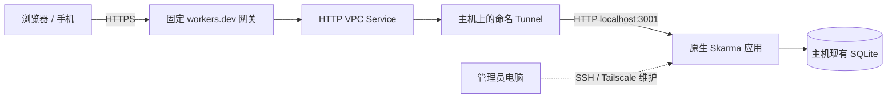

# 固定 Cloudflare 网址连接常开主机：部署与维护手册

核验日期：2026-10-18。本手册对应 `deploy/worker-gateway/`，适用于原生应用与 SQLite
已经运行在常开 Linux 主机、希望获得固定 `workers.dev` 网址的情况。账号 ID、资源 ID、
实际网址和主机地址用占位符表示，实际部署清单保存在管理员的私有记录中。

## 1. 访问链路与数据位置



Worker 转发网页和 API，不保存一套新的业务数据。主机上的应用仍负责账号、管理员审批、
会话、权限和请求来源校验。管理员电脑用于维护；完成部署后不参与请求转发。

| 项目 | 本方案 |
| --- | --- |
| 访问网址 | `https://WORKER_NAME.ACCOUNT_SUBDOMAIN.workers.dev` |
| Worker 配置 | `deploy/worker-gateway/wrangler.toml`，本机文件，被 Git 忽略 |
| VPC 目标 | HTTP，`localhost`，端口 `3001` |
| 主机应用 | 用户服务 `skarma.service`，仅监听 `127.0.0.1:3001` |
| 连接器 | 用户服务 `skarma-cloudflared.service`，出站 QUIC |
| 数据库 | 主机现有 SQLite，沿用既有备份机制 |
| 私有备用入口 | 已配置的 Tailscale Serve HTTPS |

这条路径无需购买自有域名。[Workers VPC 官方入门](https://developers.cloudflare.com/workers-vpc/get-started/)
描述了 Tunnel、私有 HTTP 服务与 Worker 绑定的配置。普通 Tunnel 的自定义公开域名、
随机 `trycloudflare.com` 测试地址和固定 Worker 地址是不同的入口配置。

`workers.dev` 名称保持不变的前提是保留同一账号子域名、Worker 名称及其发布配置。
它不保证主机永不掉线：电源、主机网络、所用代理及 Cloudflare 服务仍会影响访问。
Workers VPC 当前处于 Beta；[定价说明](https://developers.cloudflare.com/workers-vpc/platform/pricing/)
称 Beta 期间 VPC 免费，Worker 请求与计算仍按所用方案计量。操作前复核最新额度和价格。

## 2. 准备与凭证边界

开始前确认：

1. 主机 `curl --noproxy '*' --fail http://127.0.0.1:3001/api/health` 返回 `{"status":"ok"}`。
2. 已有可用管理员账号及一致性数据库备份；不通过新建生产测试账号来检查网络。
3. 主机安装官方 `cloudflared`，本次部署使用 `2026.10.1`；下载时核对官方发布校验值。
4. 主机能使用出站 UDP `7844`。Workers VPC 要求 QUIC；HTTP/2 不支持这条链路。
   [官方连接器要求](https://developers.cloudflare.com/workers-vpc/configuration/tunnel/)
   给出的最低版本是 `2025.7.0`。
5. 管理电脑已安装仓库锁定版本的 Node 依赖及 Wrangler；在仓库根目录执行后续命令。

两种凭证分别保存：

| 凭证 | 用途 | 保存位置 |
| --- | --- | --- |
| Wrangler OAuth | 发布 Worker、创建或绑定 VPC Service | 管理电脑的 Wrangler 加密配置与系统钥匙串 |
| Tunnel 连接 token | 仅让主机连接指定 Tunnel | 主机 `~/.config/skarma/cloudflared-token`，权限 `0600` |

本次 OAuth 使用 `account:read`、`user:read`、`workers_scripts:write`、`connectivity:admin`。
可以通过下面的命令发起同类授权，再由账号持有人在 Cloudflare 页面批准：

```bash
npx wrangler login --browser=false --scopes account:read user:read workers_scripts:write connectivity:admin --use-keyring
npx wrangler whoami
```

OAuth 的 VPC 管理权限不等于普通 Tunnel 创建／读取 token 的权限。本次通过控制台创建
Tunnel，由持有人将连接 token 输入主机，避免扩大 OAuth 权限。
不要将 token、完整安装命令、OAuth 配置、真实 `.env`、数据库或原始日志提交 Git。

## 3. 创建命名 Tunnel，保存专用 token

在 Cloudflare 的 Workers VPC / Tunnels 页面创建命名 Tunnel，例如 `skarma-evo`。
选择主机实际系统与架构，例如 Debian / 64-bit。主机已经安装 `cloudflared` 时无需重复
执行页面上的安装软件步骤。记录非秘密的 Tunnel ID，随后用于创建 VPC Service。

连接 token 应由持有人直接输入主机终端；不要经聊天传递，也不要放进 shell 命令参数。
可使用下面的隐藏输入方式保存**纯 token**，不要粘贴整条安装命令：

```bash
python3 - <<'PY'
import getpass, os
from pathlib import Path
p = Path.home() / '.config/skarma/cloudflared-token'
p.parent.mkdir(mode=0o700, parents=True, exist_ok=True)
token = getpass.getpass('Tunnel token（隐藏输入，仅粘贴 token）: ').strip()
if not token or any(c.isspace() for c in token):
    raise SystemExit('输入为空或包含空白；未保存。')
fd = os.open(p, os.O_WRONLY | os.O_CREAT | os.O_EXCL, 0o600)
with os.fdopen(fd, 'w') as stream:
    stream.write(token + '\n')
print('Token saved securely')
PY
```

`O_EXCL` 会拒绝覆盖已有 token。更换凭证时先在控制台轮换，再在主机私有目录备份旧
文件并交互输入新的 token，重启连接器；不要通过 `cat` 将凭证显示出来。
本次部署使用过能识别整条连接命令的私有输入助手；它只提取 token，绝不执行粘贴内容。

## 4. 安装常驻连接器

以下操作在 Linux 主机执行，`SKARMA_REPO` 设置为主机上已拉取本仓库的绝对路径：

```bash
mkdir -p ~/.config/systemd/user
install -m 600 "$SKARMA_REPO/deploy/worker-gateway/cloudflared.service.example" \
  ~/.config/systemd/user/skarma-cloudflared.service
systemctl --user daemon-reload
systemctl --user enable --now skarma-cloudflared.service
systemctl --user is-active skarma-cloudflared.service
curl --noproxy '*' --fail http://127.0.0.1:20251/ready
```

模板假定二进制位于 `~/.local/bin/cloudflared`，token 位于上一节路径。
`/ready` 应为 HTTP 200 且 `readyConnections` 大于 0；仅看到 systemd `active` 不足以
证明已连通。正常连接器会建立多条连接，本次曾观察到 4 条。

服务配置了 `Restart=always` 和 10 秒重试。要在退出 SSH 后及主机启动后继续运行，核对：

```bash
loginctl show-user "$USER" -p Linger
```

需要时由主机管理员启用 `loginctl enable-linger USERNAME`。这不保证代理也会自动启动；
如果代理依赖桌面会话，必须另行确认开机后的桌面与代理状态。不要把服务重启验收写成
整机断电重启验收。

### 4.1 已有代理使用 fake-IP DNS 时

本次主机的代理会把 `region1.v2.argotunnel.com` 和 `region2.v2.argotunnel.com` 解析为
`198.18.0.x` 虚拟地址，连接器尝试对这些地址建立 QUIC，结果超时。实际公共节点 IP
经主机既有 IPv4 TUN 路由可以建立 QUIC。单独设置 `HTTP_PROXY` 不会使 QUIC 改走 HTTP
代理；切换 HTTP/2 也不满足 Workers VPC 要求。

仓库提供可选的进程专用修复，**仅适用于上述已确认的网络**：

- `refresh-edge-hosts.py` 经现有本机 HTTP 代理请求 Cloudflare DNS-over-HTTPS；只接受
  两个固定区域域名的公共 IPv4 答案，每次连接器启动前刷新。
- `bubblewrap` 只在连接器的文件系统视图中替换 `/etc/hosts`，保留主机网络空间。
- `GODEBUG=netdns=go` 让静态 Go 连接器使用该进程视图；系统的 NSS 解析顺序可能先查询
  `systemd-resolved`，因此普通 `getent` 仍可能显示虚拟地址。
- 不修改全局 `/etc/hosts`、系统 DNS 或代理订阅文件；不关闭证书校验。

主机需已有 Python 3 和 `bubblewrap`。下面例子使用已存在的 `127.0.0.1:7890` HTTP
代理；先把 drop-in 中端口调整为实际值：

```bash
install -m 700 "$SKARMA_REPO/deploy/worker-gateway/refresh-edge-hosts.py" \
  ~/.local/bin/skarma-refresh-edge-hosts
mkdir -p ~/.config/systemd/user/skarma-cloudflared.service.d
install -m 600 "$SKARMA_REPO/deploy/worker-gateway/cloudflared-fake-ip.conf.example" \
  ~/.config/systemd/user/skarma-cloudflared.service.d/edge-dns.conf
systemctl --user daemon-reload
systemctl --user restart skarma-cloudflared.service
curl --noproxy '*' --fail http://127.0.0.1:20251/ready
```

启动前刷新失败时服务会重试，不使用陈旧地址冒充正常启动。代理恢复、DNS-over-HTTPS
可用后才能重新建立连接。普通网络不需要此 drop-in；恢复时移除 `edge-dns.conf`，重新
加载 systemd 并重启连接器即可。该方案需要主机允许无特权用户命名空间。

## 5. 创建限定目标的 HTTP VPC Service

下面命令在管理电脑的仓库根目录执行。替换账号和 Tunnel ID；先列出现有资源，避免
重复创建：

```bash
CLOUDFLARE_ACCOUNT_ID=ACCOUNT_ID npx wrangler vpc service list
CLOUDFLARE_ACCOUNT_ID=ACCOUNT_ID npx wrangler vpc service create skarma-evo-http \
  --type http --tunnel-id TUNNEL_ID --hostname localhost --http-port 3001
```

记录返回的 Service ID。`localhost` 指连接器所在主机。这里不需要把应用端口绑定公网，
也不需要把 SQLite、SSH 或整个 Tailnet 授权给 Worker。Workers VPC 通过 Service 配置
路由；没有自定义域名时无需额外填写 Published application hostname。

## 6. 配置并发布 Worker 网关

```bash
cp deploy/worker-gateway/wrangler.example.toml deploy/worker-gateway/wrangler.toml
```

编辑复制文件，填入 `account_id` 与真实 `service_id`。保留：

```toml
name = "skarma-gateway"
main = "gateway.mjs"
account_id = "ACCOUNT_ID"
compatibility_date = "2026-10-18"
workers_dev = true
preview_urls = false

[[vpc_services]]
binding = "VPC_SERVICE"
service_id = "VPC_SERVICE_ID"
remote = true
```

发布前后都显式指定该配置：

```bash
node --test deploy/worker-gateway/test.mjs
npx wrangler deploy --config deploy/worker-gateway/wrangler.toml --dry-run \
  --outdir .local/worker-gateway-dry-run
npx wrangler deploy --config deploy/worker-gateway/wrangler.toml
```

首次发布时按提示注册账号的 `workers.dev` 子域名。保存 CLI 实际返回的 HTTPS 网址与
Worker 版本 ID。根目录的 `wrangler.toml` 属于另一套 Rust / Durable Object 应用，
不能用于发布本代理，否则会得到不同的存储路径。

网关保持请求方法、路径、查询、正文、`Origin`、Cookie 和 `X-Skarma-Request`，将
目标固定到 VPC Service 的 `http://localhost:3001`，不允许用户指定其他上游。API
响应强制 `Cache-Control: no-store`，上游重定向原样返回，连接异常返回通用 503。

## 7. 允许精确来源，保留生产登录保护

主机私有配置 `~/.config/skarma/app.env` 至少保持：

```dotenv
SKARMA_PRODUCTION=1
SKARMA_AUTH=required
SKARMA_PUBLIC_URL=https://HOST.TAILNET.ts.net
SKARMA_ADDITIONAL_PUBLIC_URLS=https://WORKER_NAME.ACCOUNT_SUBDOMAIN.workers.dev
```

编辑前在私有目录备份此文件，文件和备份均设为 `0600`。额外来源用逗号分隔，最多
三个，必须是精确 HTTPS origin；不要使用通配符、路径或临时关闭来源检查。

```bash
systemctl --user restart skarma.service
curl --noproxy '*' --fail http://127.0.0.1:3001/api/health
```

应用重启有短暂中断。Tailscale 与 Worker 域名各自保存 host-only 会话；换入口后重新
登录是正常行为。Cookie 保持 `Secure`、`HttpOnly`、`SameSite=Strict` 和 `__Host-` 前缀。
浏览器本机草稿属于各自域名，换入口前先保存为正式记录。

## 8. 验收顺序与退出旧入口

将下面变量设为实际 Worker 网址，再执行检查：

```bash
SKARMA_WORKER_URL=https://WORKER_NAME.ACCOUNT_SUBDOMAIN.workers.dev
curl --fail "$SKARMA_WORKER_URL/api/health"
curl -sS -o /dev/null -w '%{http_code}\n' "$SKARMA_WORKER_URL/api/state"
curl -sS -o /dev/null -w '%{http_code}\n' -X POST \
  -H "Origin: $SKARMA_WORKER_URL" -H 'X-Skarma-Request: 1' \
  "$SKARMA_WORKER_URL/api/auth/logout"
curl -sS -o /dev/null -w '%{http_code}\n' -X POST \
  -H 'Origin: https://untrusted.invalid' -H 'X-Skarma-Request: 1' \
  "$SKARMA_WORKER_URL/api/auth/logout"
```

预期：health 200 / `status=ok`、无会话的 state 401、合法来源无会话 logout 200、陌生
来源 logout 403。这组检查不创建真实账号或训练记录。还需验证首页 JS 资源和 API
响应的 `no-store`。持有人在浏览器登录，检查现有数据；手机关闭 Tailscale 后分别用
Wi-Fi 与蜂窝检查。登录密码不交给自动化检查脚本。

然后重启主机连接器，等待 `/ready` 恢复 200，再检查同一个 Worker 网址。成功后停止
旧 Mac Quick Tunnel，移除应用配置中旧 `trycloudflare.com` 来源，重启应用再验收。
不要在旧入口仍有未保存草稿时强行关闭它。保留 Tailscale 私有维护入口。

## 9. 日常检查与故障定位

主机常用命令：

```bash
systemctl --user status skarma.service skarma-cloudflared.service
systemctl --user is-enabled skarma-cloudflared.service
curl --noproxy '*' http://127.0.0.1:20251/ready
curl --noproxy '*' http://127.0.0.1:3001/api/health
journalctl --user -u skarma-cloudflared.service --since '10 minutes ago' --no-pager -n 60
```

日志只在私有终端检查，按需摘录脱敏错误；不要整份放进 Git。

| 现象 | 下一步 |
| --- | --- |
| systemd active，但 `readyConnections=0` | 检查节点解析地址、QUIC UDP 7844、代理与 TUN；等待重试不能替代网络修复 |
| 真实 IP 能 QUIC，域名却指向 `198.18.x.x` | 检查 fake-IP 情形，按 4.1 使用进程覆盖 |
| HTTP/2 / API 预检失败，但 QUIC 已注册且 ready 200 | 逐项记录；不因此切换到 Workers VPC 不支持的 HTTP/2。二进制更新需另走可用下载路径 |
| Worker 返回通用 503 | 先看连接器 ready，再看 VPC Service ID、目标主机和端口及应用健康；Worker 地址存在不代表主机在线 |
| 页面打开，但保存 403 且有应用来源提示 | 对照地址栏 origin、额外允许来源、请求标记；更改后重启应用 |
| Cloudflare `error code: 1010` | 是边缘拒绝而非应用的 403；对照正常浏览器或 curl，检查客户端标识与 Cloudflare 配置 |
| 仅某台电脑报 TLS 错误，另一路网络能访问 | 对照 DNS 答案、代理及 IPv4/IPv6路径，保留 HTTPS 证书验证 |
| 换域名后需要登录 | 两个域名会话独立，使用原应用账号重新登录 |
| SSH 退出后不恢复，或重启主机后不可用 | 核对服务 enable、用户 Linger、主机电源与代理启动方式 |

本次 Mac 曾把 `workers.dev` 名称解析到与 Cloudflare DNS-over-HTTPS 不一致的地址，
普通直连 TLS 失败；单次请求使用正确公共 IPv4 后可以到达 Worker。不要把节点 IP
长期写死在全局 hosts 中；CDN 地址会变化，客户端网络也需要独立验证。

### 9.1 Tailscale 显示在线，但 SSH 不通

“在线”及默认 `tailscale ping` 成功不足以证明应用可达。按层检查，避免将 DISCO 与
TSMP 混淆：

| 检查 | 验证范围 |
| --- | --- |
| `tailscale netcheck` | 当前设备的 UDP、NAT 和中继可用性 |
| `tailscale ping HOST` | 默认 DISCO：两个 Tailscale 进程的发现路径 |
| `tailscale ping --tsmp HOST` | WireGuard 加密数据层，绕过目标操作系统 IP 栈 |
| `tailscale ping --peerapi HOST` | 对方 Peer API 的 HTTP 路径 |
| `tailscale ping --icmp HOST` | 经加密链路测试目标 IP 连通性 |
| SSH 与私有 HTTPS | 目标应用、主机路由与防火墙的实际可用性 |

含义以 [Tailscale ping 官方说明](https://tailscale.com/docs/reference/ping-types) 和
[两设备 TCP 排障](https://tailscale.com/docs/reference/troubleshooting/network-configuration/tcp-connection-two-devices)
为准。本次默认 DISCO 能经中继回复，而显式 TSMP、Peer API 和 SSH 均无回复；本机
看到 WireGuard 等待握手、目标接收为 0。管理页节点密钥有效，既有访问策略允许连接。
这比“SSH 服务可能没开”更早一层，尚不能确定主机端的最终根因。

可先保留设置，断开并重连**当前维护电脑**上的 Tailscale：

```bash
tailscale down
tailscale up
```

无参数 `up` 保留已有设置；不要加 `--reset`、退出账号或删除设备。若重连后依然没有
数据握手，需要通过主机本机、已经连接的远程桌面或其他可用管理通道检查；在主机运行：

```bash
sudo systemctl restart tailscaled
```

再从维护电脑检查 TSMP、SSH 和原有私有应用。密码只在本机终端隐藏输入。当前 SSH
已经不通时，不能把“再 SSH 进去重启”当作可执行的恢复方案。本次尚未取得主机重启
服务后的结果。

网页另有一项独立检查：保留 Mac 当前代理绕过列表，追加主机的精确 `*.ts.net` 名称
和目标 IP。不要覆盖用户既有绕过项；新网络或代理重新启动后也需核对。网页绕过项
不会修复 WireGuard 握手。与其他 VPN 并用时，按
[官方兼容性说明](https://tailscale.com/docs/reference/faq/other-vpns)检查路由和地址冲突。

## 10. 更新、备份与回滚

### 更新应用

按 [主机部署手册](host-deployment.md) 先备份、在独立 release 目录构建并预演数据库
迁移，再切换 `current` 和重启应用。Worker 代理无需随每次前端或 Rust 更新重新发布。
迁移失败时恢复已验证的数据库备份与兼容应用版本，不能只切换旧二进制忽略 schema。
每日上课记录使用迁移 007；尚未合并的导入迁移 006 需按交接说明处理。

### 更新网关

保持账号、Worker 名称、Service ID 与生产私有配置，检查 diff、运行五项网关测试和
dry-run，再按第 6 节发布。记录新版本 ID，并重复第 8 节不产生业务数据的验收。
需要回退 Worker 时在 Cloudflare Deployments 选择此前通过验收的版本重新部署；
也可检出对应 Git 版本并用相同私有配置重新发布。回退网关不回退 SQLite。

### 暂停公开入口

主机执行 `systemctl --user disable --now skarma-cloudflared.service` 可停用该连接器；
此后 Worker 可能返回 503。要彻底关闭网址，在 Worker 控制台关闭 `workers.dev`
路由或删除该 Worker，并从应用配置移除该额外来源。只在确认无需继续访问后删除
VPC Service、Tunnel 和专用凭证；Tailscale Serve 可以继续用于私有维护。

### 凭证轮换与恢复

Tunnel 连接 token 泄漏时，在 Cloudflare 轮换并更新主机私有文件、重启连接器，确认旧
凭证失效。OAuth 失效时在管理电脑重新登录，不把管理凭证复制给主机。机器重建需要
恢复应用、数据库、私有配置及经安全输入的新凭证；Git 中的模板本身不包含这些内容。

## 11. Git 管理范围与记录

提交 `gateway.mjs`、测试、服务模板、可选 DNS 辅助脚本与本手册。实际
`deploy/worker-gateway/wrangler.toml` 被该目录 `.gitignore` 排除；仍应逐个核对暂存
文件。同步流程见 [handoff.md](handoff.md)。建议提交前运行：

```bash
git status --short
git diff --check
node --test deploy/worker-gateway/test.mjs
npm run sync:status
```

只暂存选定的代码与文档，提交、推送同一功能分支。部署记录应区分已验证结果与待验证
事项；不要因为文档列出某一步就写成该步已执行。实际线上验收摘要见任务 T09 与当前
交接文件，资源 ID、URL 与配置备份位置保存在私有运维记录。

## 12. 官方参考

- [Workers VPC 入门与绑定](https://developers.cloudflare.com/workers-vpc/get-started/)
- [私有 API / 网站代理示例](https://developers.cloudflare.com/workers-vpc/examples/private-api/)
- [Tunnel 版本与 QUIC 要求](https://developers.cloudflare.com/workers-vpc/configuration/tunnel/)
- [workers.dev 路由和子域名](https://developers.cloudflare.com/workers/configuration/routing/workers-dev/)
- [VPC Beta 定价](https://developers.cloudflare.com/workers-vpc/platform/pricing/)
