# skarmar 全功能自测与图文审核（2026-10-29）

本轮已完成当前Web功能的回归和逐页走查，供你审核。**52张真实界面截图，全部为独立本机合成数据；没有部署。**

**后续发布更新：**用户随后已授权发布，本报告对应的应用现已上线，见[2026-10-29发布记录](cloudflare-release-2026-10-29.md)。下文“未部署”描述取证当时；截图中的合成记录未上传生产。

**审核反馈后续：**本轮导出的25条批注已按[2026-10-30整改记录](review-feedback-2026-10-30.md)处理，并提供17张新版截图复审；原52图保留取证时状态。新修改尚未部署。

[打开可筛选、批注的单文件图文版](artifacts/review-2026-10-29/review.html)。HTML已内嵌全部截图，下载这一个文件即可打开；批注只留在你的浏览器，可导出审核意见JSON，不会写入应用。

## 本轮范围与结果

以PRD 0.9和`d583e47`为基线，加上本轮QA01的小修复。受测应用文件摘要：`28effa0107e3455216e499bc90b8367b2b0c371f418dd404fc8b659bd897ffab`。截图不是线上当前页面。

当前测试范围没有发现新的阻断问题。59条正式AC中，**57条在本机范围通过、2条部分验证**（真机／完整可访问性待补）；这不替代你或Opus的正式验收。

| 范围 | 本轮覆盖 | 结果 |
| --- | --- | --- |
| 今天 | 空库、有初始内容、长期关注、两个主入口、当天记录、到期提醒、瞬间 | 通过；0/3/6方向及小屏首屏均另有断言 |
| 目标与方法 | 新建、编辑、观察模板、层级、关联、版本、状态及收起／停用 | 通过；目录当前为全部期限，排序偏好仍可评审 |
| 家庭干预 | 计划、改主目标、共享草稿、总结、实际方法、经验困难、修订、取消和管理员删除 | 通过；计划不算实际完成，历史方法版本保留 |
| 机构课程 | 课程老师下拉和新增、历史排序、补充观察、家人查看、关联整理、撤销及删除保护 | 通过；补充观察不增加课时 |
| 记录与统计 | 按老师／课程核对、月历、时间分布、目标／方法／活动覆盖、来源切换 | 通过；节数不换算分钟，覆盖不等于能力进展 |
| 跟进与复盘 | 经验困难新建编辑、层级多选、反馈及附注、可比观察、复盘队列、下一步、摘要下载 | 通过；只消费已查看依据，并发完成受保护 |
| 账号和数据 | 注册审批、拒绝、成员创建／停用／恢复／密码、设备、大字、参考、目录、Excel导出导入 | 通过；Excel实际下载重读，导入显式映射／去重 |
| 可靠性与权限 | 离线队列、响应丢失重试、账号切换、多个窗口、共享冲突、版本门禁、返回与输入保留 | 通过；不承诺网页关闭后继续上传 |
| 真实手机与可访问性 | iOS/Android真机、软键盘、系统缩放、系统返回手势、完整读屏 | 未验／部分桌面模拟；不能计为全量正式验收 |

## 我建议你优先审核的地方

| 项目 | 状态 | 观察／建议 |
| --- | --- | --- |
| QA01 | 已修复并复验 | 干预表单的“更多干预操作”遗留全局帮助入口；移除后帮助集中到账号问号。补断言，最终25组及新增账号流程通过。  |
| UX01 | 待你评审 | 总结保存后，今天卡片与“已记下”提示重复描述同一内容；建议只保留一处确认。 [图18](artifacts/review-2026-10-29/18-today-saved.png) |
| UX02 | 待你评审 | 经验库的搜索框偏高，首屏条目偏少；建议改为单行搜索或收起。 [图32](artifacts/review-2026-10-29/32-library.png) |
| UX03 | 待你评审 | 管理员删除确认使用整张表单高度，留白较多；建议改为紧凑确认框。 [图30](artifacts/review-2026-10-29/30-admin-delete.png) |
| UX04 | 待你评审 | Excel导入预览部分字段仍为英文内部名称；建议补齐中文标签，原始字段放可展开区。数据映射与原文保留已通过。 [图49](artifacts/review-2026-10-29/49-import.png) |
| UX05 | 待你评审 | 目标默认全部期限，长期与近期混排；建议评审是否默认近期本领、把长期管理另分组。此处未擅自更改已定PRD。 [图09](artifacts/review-2026-10-29/09-goals.png) |
| S01 | 已核正任务快照 | 历史T10仍写家庭实际方法／版本未实现；当前已实现并经两运行环境、浏览器及本轮截图验证。状态更新，不新增重复功能。 [图16](artifacts/review-2026-10-29/16-summary.png) [图29](artifacts/review-2026-10-29/29-member.png) |

请按图号给出修改意见即可，例如“图14：把方法入口再前移”。下面的“通过”指数据与操作检查，不表示这些界面已经足够简洁。

## 本轮实际验证

| 检查 | 结果 |
| --- | --- |
| Rust 全套 | 162项通过 |
| 客户端逻辑 | 61项通过 |
| 规划与工作流 | 14＋6项通过 |
| Web 浏览器回归 | 26组通过（原25组＋新增账号全流程） |
| 图文取证流程 | 49张主流程＋3张账号截图，实际保存断言通过，JS异常0 |
| 原生 SQLite／Rust Worker DO | 两套完整合约及重启持久化均通过，无SKIP |
| 类型检查／Web构建 | 通过 |
| 发布配置保护 | 29项通过，仅本机合成配置测试 |
| 同步工具 | 通过 |

现有25组在移除残留帮助后完整重跑；新增账号组单独通过并已加入默认回归入口。图文流程另从空库运行，实际完成计划、总结、记课、关联、反馈、复盘、测量、删除和Excel下载。导入截图停在预览；实际提交、去重、丢回执重试、来源原文和导出往返由导入浏览器组及双运行环境合约覆盖。

## 截图目录

### 今天

重点看长期关注是否易读、两个主入口是否足够直接，以及保存后的提示是否过多。

#### 图03：首次进入空库

没有自动创建正式目标、课程或训练记录；两个主入口保留。

尺寸：390×844；独立合成测试数据。

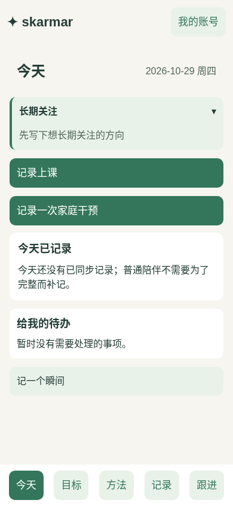

#### 图06：长期关注与当天入口

前三个长期方向逐项分隔，其余方向可展开；今天只列当天内容。

尺寸：390×844；独立合成测试数据。

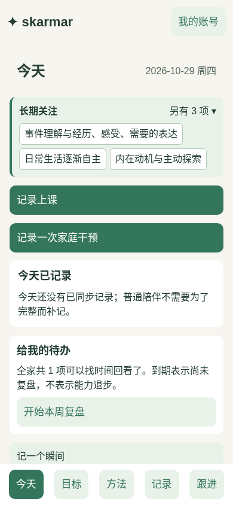

#### 图07：小屏首屏仍可记课或计划

360×640桌面手机尺寸下，六个真实长度的参考方向不会挤走两个主按钮；不是手机真机截图。

尺寸：360×640；独立合成测试数据。

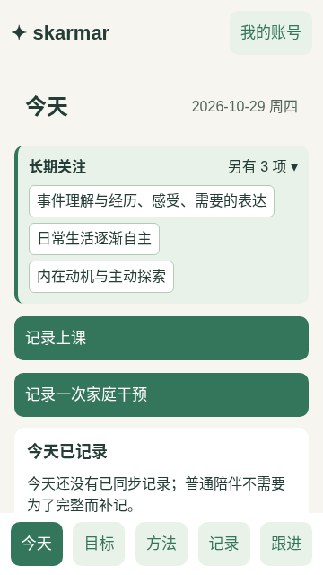

#### 图08：长期方向详情与关联

显示意义、按明确目标筛选的最近观察，以及关联的方法、经验和困难。

尺寸：390×844；独立合成测试数据。

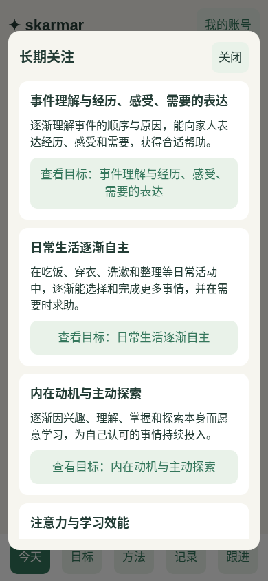

#### 图18：今天的已同步记录

总结提交后当天列表显示作者与时间；历史记录不混入今天。

尺寸：390×844；独立合成测试数据。

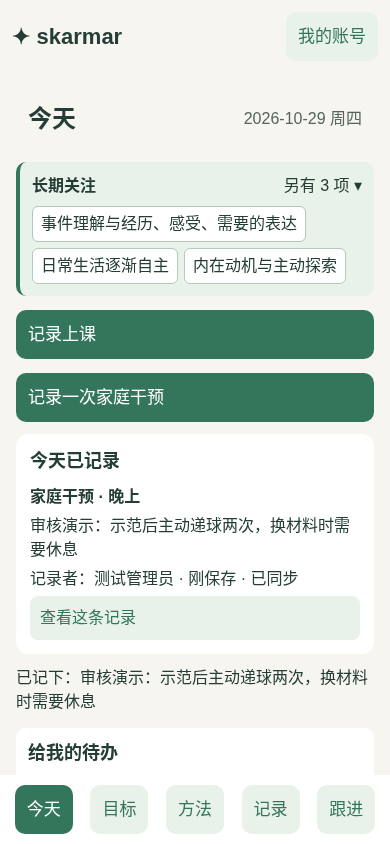

### 家庭干预

重点看计划和总结是否顺手，经验／困难提醒是否有帮助，覆盖图是否容易理解。

#### 图14：干预计划与重点提醒

选中目标后显示相关困难和经验；主要练、顺便练和复习可调整，计划不计实际次数。

尺寸：390×844；独立合成测试数据。

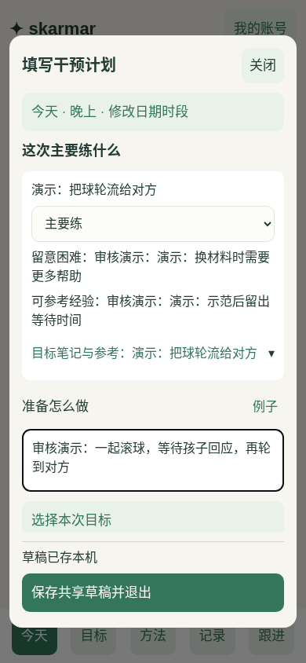

#### 图15：计划中的均衡覆盖提示

目标、实际方法、活动可切换；来源分家庭、机构和合计。环图表示覆盖数量，不表示能力百分比。

尺寸：390×844；独立合成测试数据。

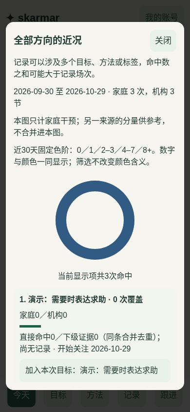

#### 图16：训练后填写实际表现与方法

实际表现先填；实际方法必须明确确认，不把计划方法自动当成用过。

尺寸：390×844；独立合成测试数据。

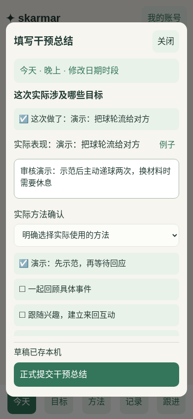

#### 图17：总结沉淀新困难

实际情况、成人回应、原因猜测和条件分开；新内容默认关联本次明确目标，可调整。

尺寸：390×844；独立合成测试数据。

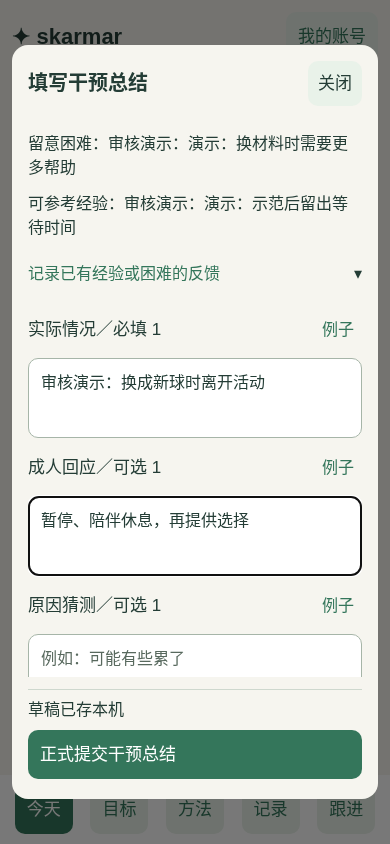

### 机构课程

重点按老人视角看能否快速记课，再按父母视角看观察能否转为后续行动。

#### 图19：课程下拉、新增与历史排序

已有选项可选、可搜索新增；选课程后老师按组合历史频次排序，不自动替换另一个字段。

尺寸：390×844；独立合成测试数据。

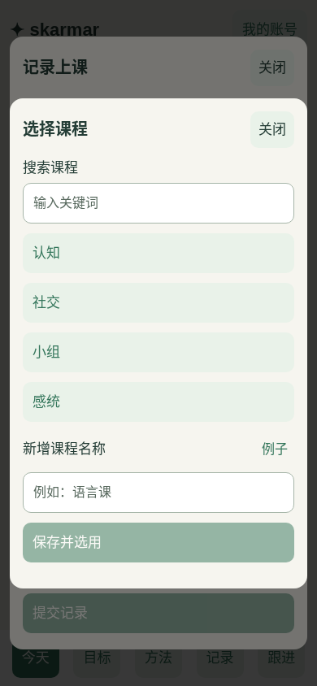

#### 图20：老人快速记课

默认当天，课程与老师必填；选完可以直接提交，观察不是必填。

尺寸：390×844；独立合成测试数据。

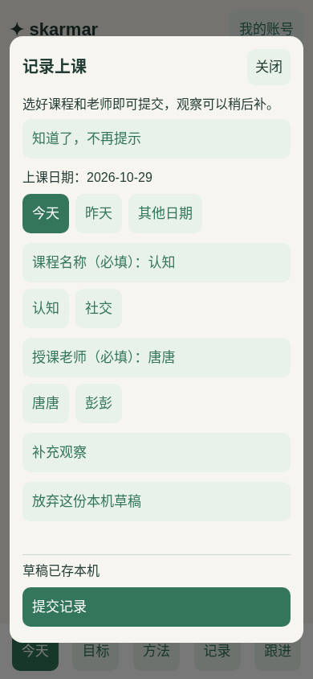

#### 图21：记课后的首屏确认

服务器回执后才显示已记下，补充观察入口在前面，补充不新增课时。

尺寸：390×844；独立合成测试数据。

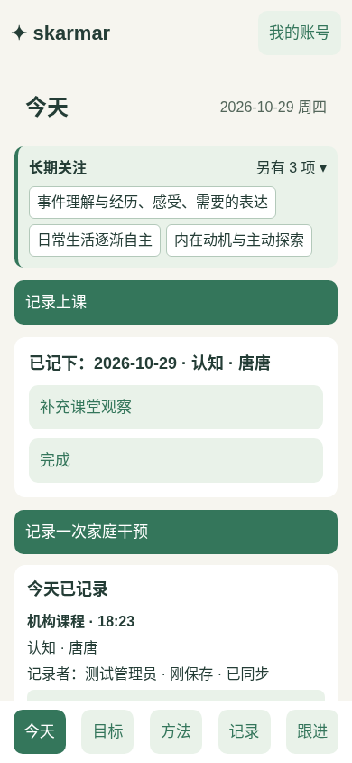

#### 图22：可选课堂观察与家人待办

自由观察先填，主题按需展开；老师建议不会自动变成下一步，须由家人明确整理。

尺寸：390×844；独立合成测试数据。

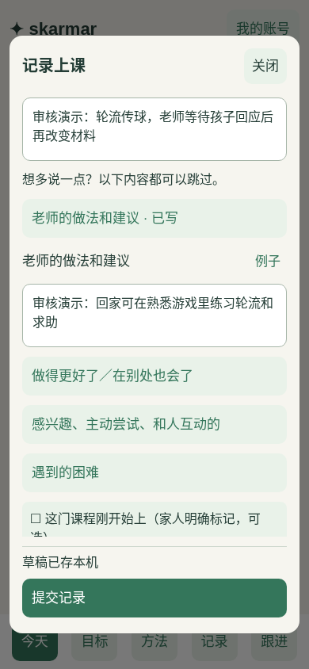

#### 图23：课堂记录关联目标与实际方法

整理和原观察独立保存版本；机构覆盖与家庭覆盖分列，不能把方法适用关系当成实际使用。

尺寸：390×844；独立合成测试数据。

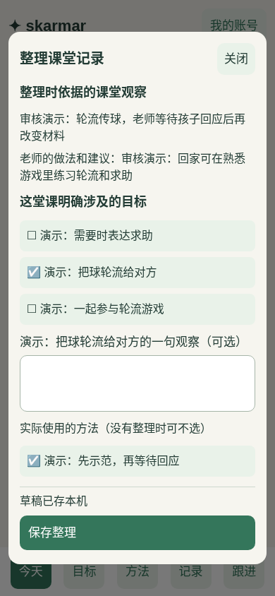

### 目标与方法

重点看管理是否费力、层级和关联是否清楚，以及默认全部期限的顺序是否符合习惯。

#### 图05：目标录入与观察模板

名称和类型即可保存；意义、标准、帮助条件、上级和领域按需补充，示例不替代输入。

尺寸：390×844；独立合成测试数据。

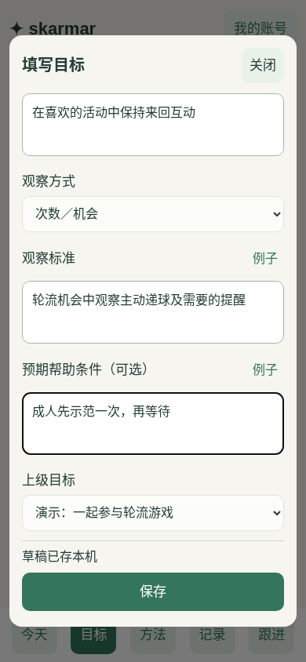

#### 图09：目标目录

首屏直接看到目标及覆盖；搜索和期限、来源等筛选默认折叠。

尺寸：390×844；独立合成测试数据。

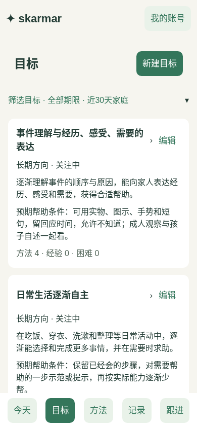

#### 图10：电脑宽屏目标目录

同一组数据在1440×900宽屏检查；内容限宽，避免输入和卡片无限拉伸。

尺寸：1440×900；独立合成测试数据。

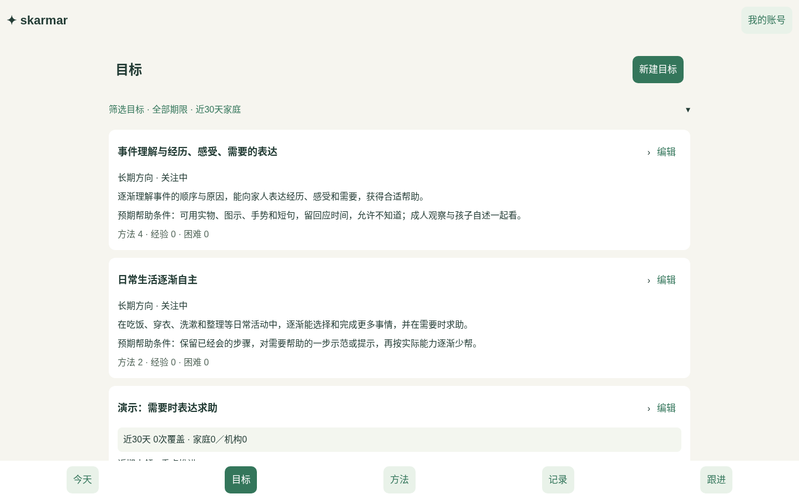

#### 图11：目标详情与方法、经验、困难

核对目标下能看到已关联方法、经验和困难，并可打开原记录和复盘。

尺寸：390×844；独立合成测试数据。

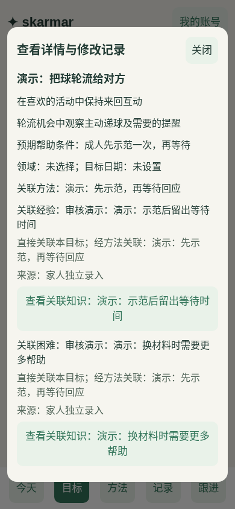

#### 图12：方法按近况排列

方法显示关联目标和排序原因；困难优先提示检查与调整。

尺寸：390×844；独立合成测试数据。


#### 图13：方法编辑保留目标关联

方法名称、具体做法与目标关系可修改，做法调整及文字纠错区分处理。

尺寸：390×844；独立合成测试数据。

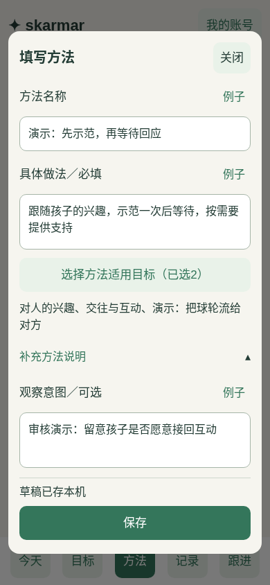

### 记录与统计

重点看老师／课程两种节数口径和明细、月历及目标时间分布。

#### 图24：机构课堂记录

当前自然月按课程分组，保留原课堂观察和老师建议，可打开原记录。

尺寸：390×844；独立合成测试数据。

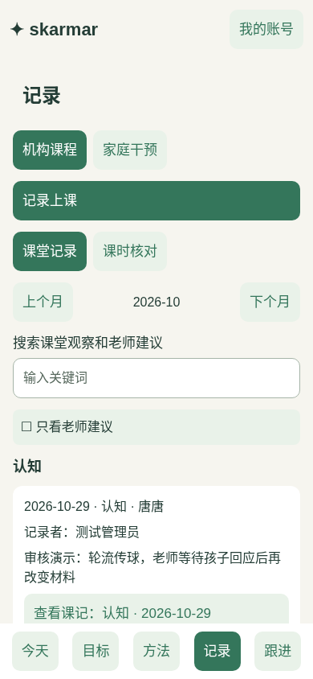

#### 图25：上月按老师核对课时

默认上个自然月、按老师汇总节数，点击分组看明细；金额线下算。

尺寸：390×844；独立合成测试数据。

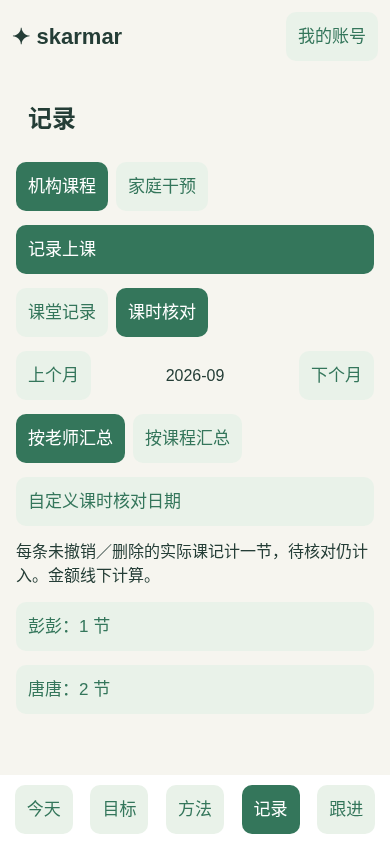

#### 图26：同一时期按课程汇总及明细

同一批三条上月记录，按课程计认知2节、社交1节；没有把节数换算为分钟。

尺寸：390×844；独立合成测试数据。

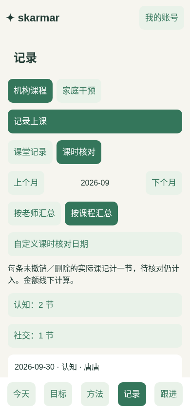

#### 图27：家庭干预月历

向下滚动后的完整月份区域；按月展示已完成次数，待总结与完成分开，空白表示未记录，瞬间不计入。

尺寸：390×844；独立合成测试数据。

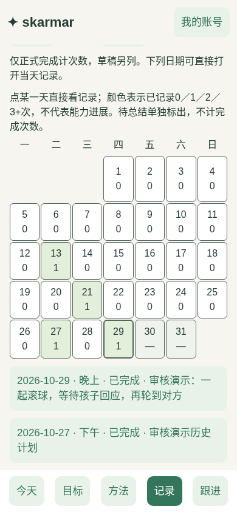

#### 图28：目标的频次与时间远近

手机用13周小条和最近日期；可展开近90天或最近30次，历史层级和方法版本保留。

尺寸：390×844；独立合成测试数据。

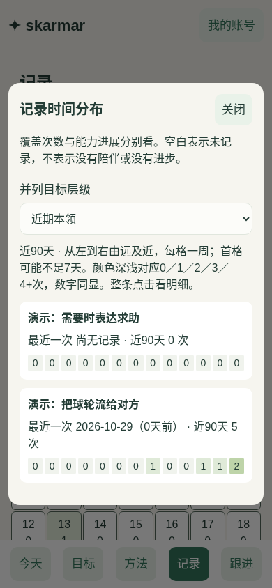

### 跟进与复盘

重点看经验沉淀与困难解决是否形成闭环，复盘的依据、决定及下一步是否够清楚。

#### 图31：跟进待处理事项

待办、课堂请求和到期困难集中显示；这个分段不出现新建经验／困难入口。

尺寸：390×844；独立合成测试数据。

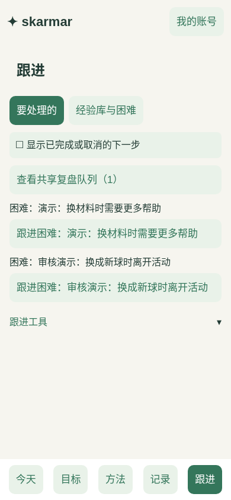

#### 图32：经验库与困难

新建入口在此分段；经验阶段、困难状态、条件与来源分别保留。

尺寸：390×844；独立合成测试数据。

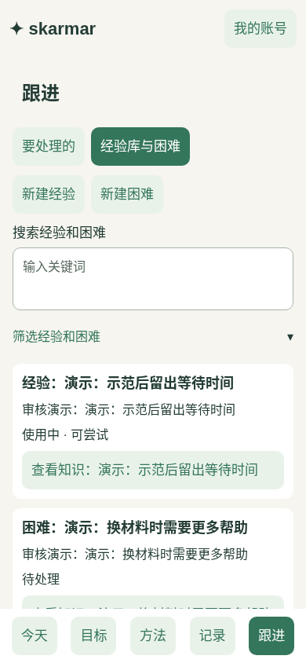

#### 图33：独立录入经验

经验可记录已有做法或待验证想法，阶段由家人明确选择；名称、依据和关联不会通过示例自动填写。

尺寸：390×844；独立合成测试数据。

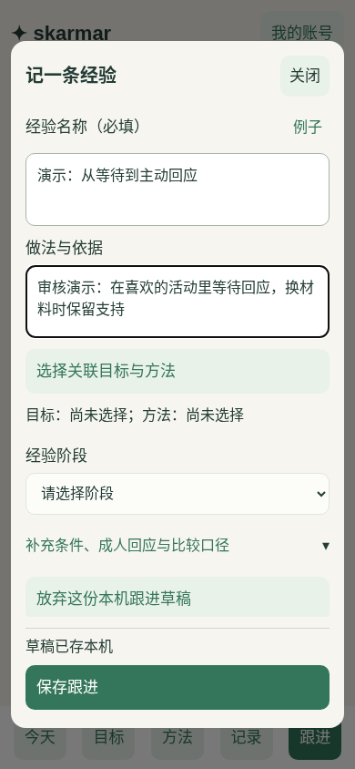

#### 图34：父子目标与方法分层多选

长中短目标按真实父子关系展开；同一方法出现在多个目标下，勾选状态共用，不自动勾选上下级。

尺寸：390×844；独立合成测试数据。

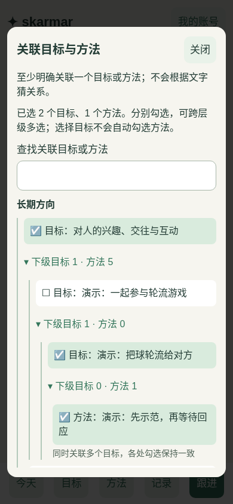

#### 图35：经验的实际反馈

有帮助、不确定、没帮上同等可选；每次保留条件和来源，其他家人可补看法，不靠点赞判断有效。

尺寸：390×844；独立合成测试数据。

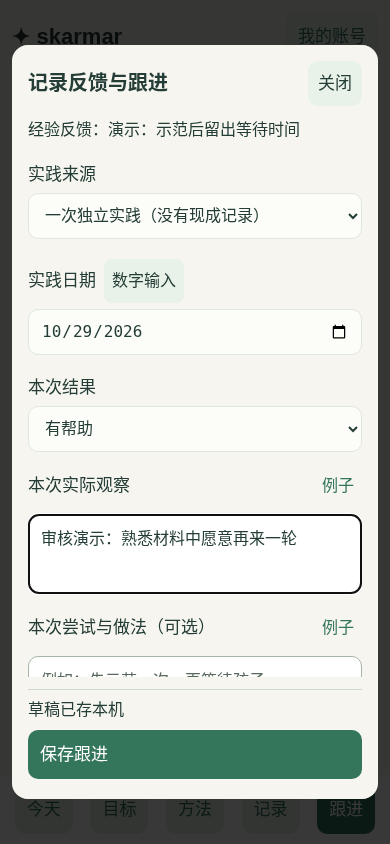

#### 图36：困难跟进与可比条件

记下尝试、成人回应和实际变化；原因猜测不当成事实，可比观察不足不自动升优先级。

尺寸：390×844；独立合成测试数据。

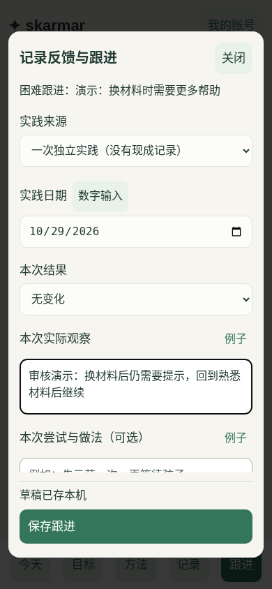

#### 图37：复盘实际依据与下一步

逐项回看已读取的记录，明确继续、调整或暂停；保存后才生成下一次安排，未读依据不会被自动消耗。

尺寸：390×844；独立合成测试数据。

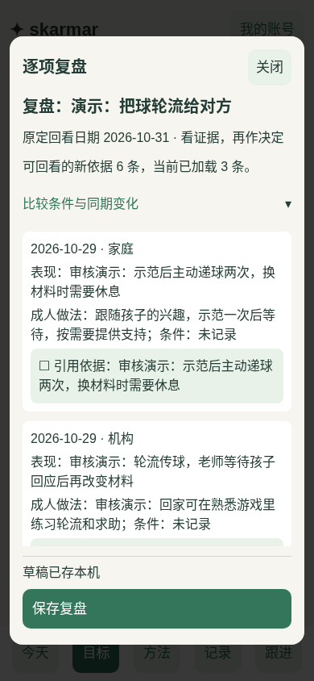

#### 图38：复盘决定与调整说明

看过依据后再决定继续、调整或暂停，说明与下一步需明确保存；可选日程和家人负担不会阻碍记录。

尺寸：390×844；独立合成测试数据。

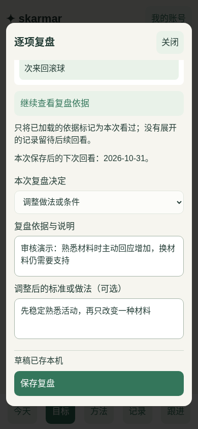

#### 图39：下一步、负责人及状态

下一步可指派、排日期、纳入共享计划；已经在计划中的行动受占用保护。

尺寸：390×844；独立合成测试数据。

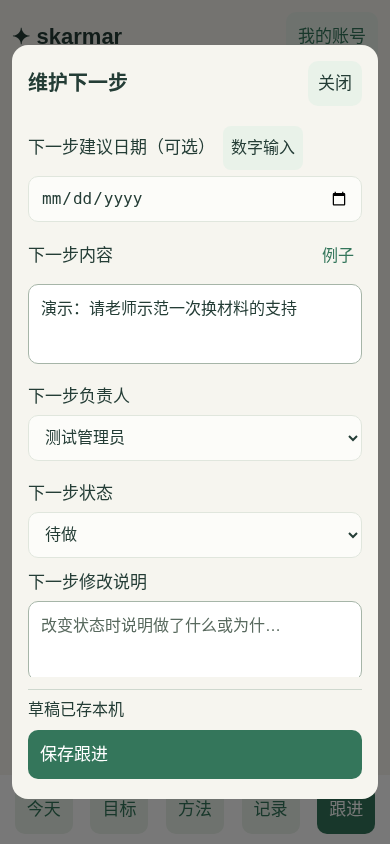

### 观察与可靠性

这些是实际冲突、离线、成员权限和删除确认状态；判断提示是否能让家人安心操作。

#### 图29：普通家人可修改总结，不能删除

用独立成员账号实际登录；保留修改已完成总结，管理员删除入口不出现。API权限拒绝另由完整测试验证。

尺寸：390×844；独立合成测试数据。

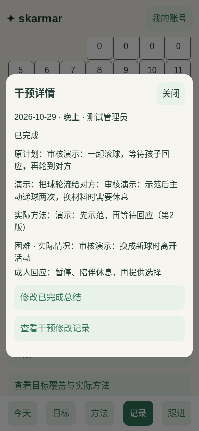

#### 图30：管理员删除前明确确认

本次真实删除一条专门生成的合成干预；删除不连带清除沉淀内容，原来的示例总结和机构记录保持原样。

尺寸：390×844；独立合成测试数据。

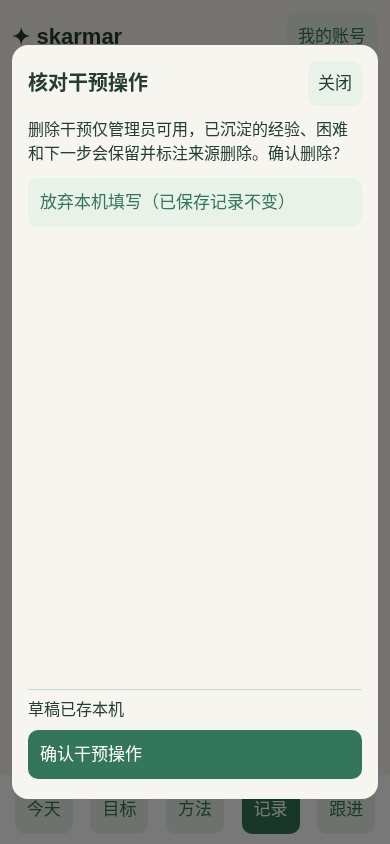

#### 图40：实际测量与口径分段

3/5仅表示这次机会内的比例；记录次数不是能力进展，标准或帮助条件改变后分开看。

尺寸：390×844；独立合成测试数据。

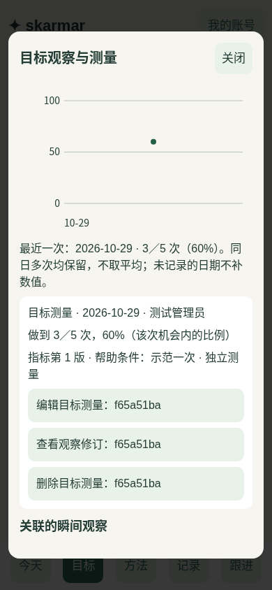

#### 图41：随手记一个瞬间

单文本配日期与可选目标；正式保存可作观察依据，但不增加家庭干预次数。

尺寸：390×844；独立合成测试数据。

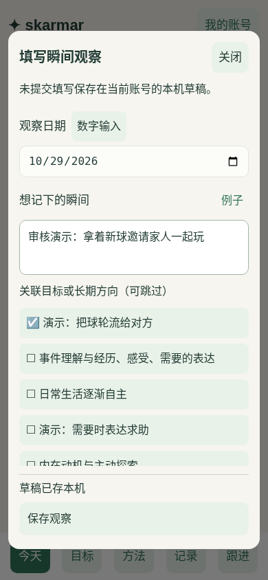

#### 图42：多人修改冲突保护

服务器新版本和本窗口输入并列保留，禁止静默覆盖；须明确采用最新或合并。

尺寸：390×844；独立合成测试数据。

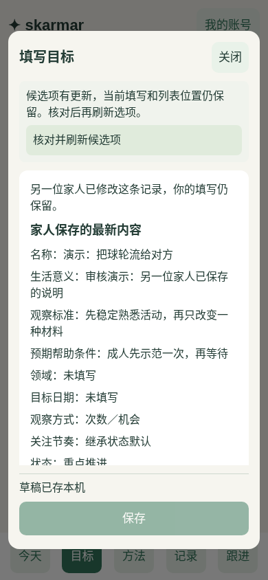

#### 图43：离线仅保存在本机，联网补传

待上传单独提示且不计正式课时；联网后核对原账号、目录依赖及同一次请求，再显示服务器确认。

尺寸：390×844；独立合成测试数据。

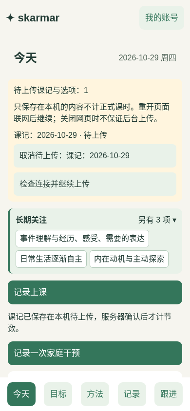

#### 图48：放弃本机填写需确认

空名称不能保存；放弃只清除本机未提交输入，已保存数据不变，结果未知请求不提供直接丢弃。

尺寸：390×844；独立合成测试数据。

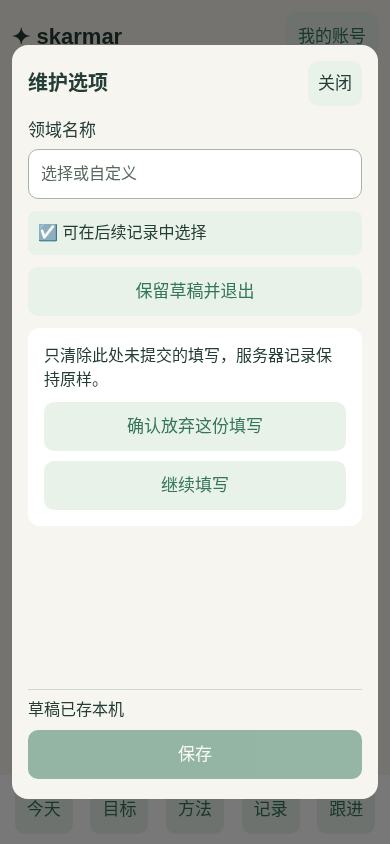

### 账号与初始设置

重点看常用业务之外的设置是否集中，参考、Excel和账号维护是否易找。

#### 图01：登录与家庭设备选项

登录页保留受信任家庭设备和申请注册入口。图中没有填写密码。

尺寸：390×844；独立合成测试数据。

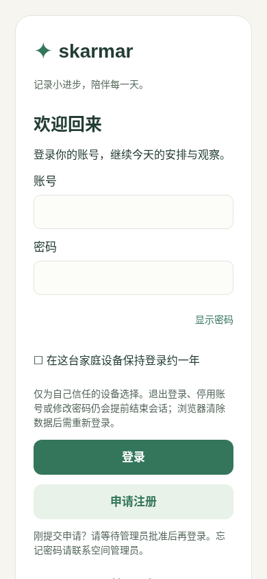

#### 图02：申请注册

管理员审批的注册表单；密码没有12位下限。注册、审批与停用另有完整认证测试。

尺寸：390×844；独立合成测试数据。

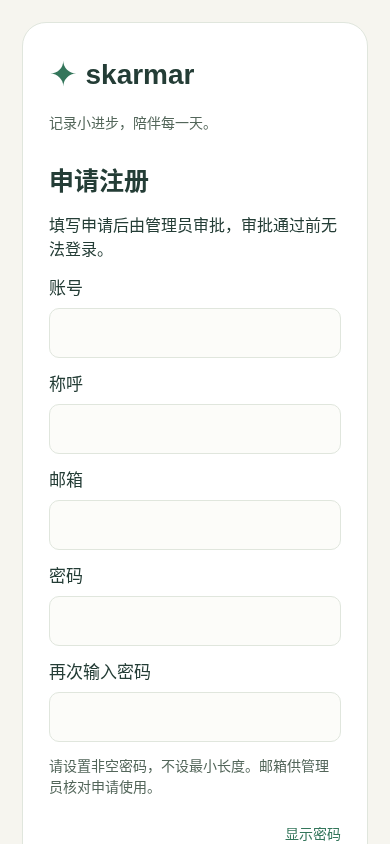

#### 图04：初始内容须先预览确认

演示明确选择六个长期方向、十种参考方法、六位老师和四门课程；预览前没有写入。

尺寸：390×844；独立合成测试数据。

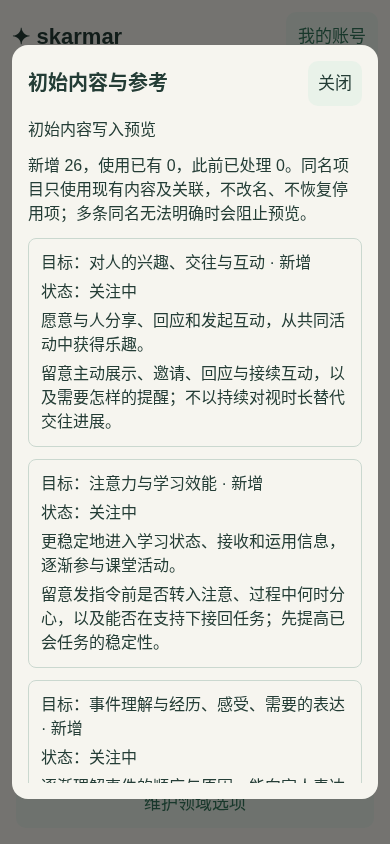

#### 图44：我的账号与数据导出

数据导出、导入、登录设备和本机显示集中在账号，避免占据今天页。

尺寸：390×844；独立合成测试数据。

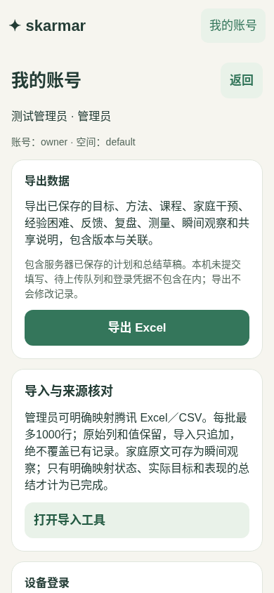

#### 图45：Excel实际下载确认

本次点击实际产生Excel下载并重新读取检查；本机未提交草稿、待上传和登录凭据不导出。

尺寸：390×844；独立合成测试数据。


#### 图46：账号角落的问号说明

帮助集中在账号问号，保留方法证据边界、家庭帮助说明与手机桌面入口。

尺寸：390×844；独立合成测试数据。

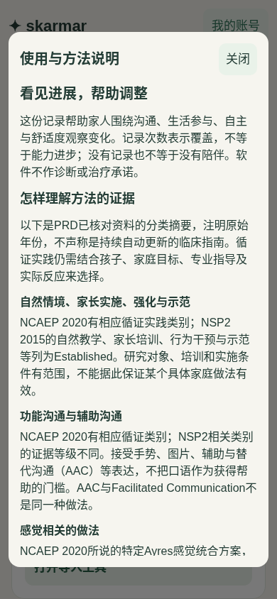

#### 图47：课程与老师选项维护

新增、改名、停用和恢复由这里维护；历史课程保留当时名称。

尺寸：390×844；独立合成测试数据。

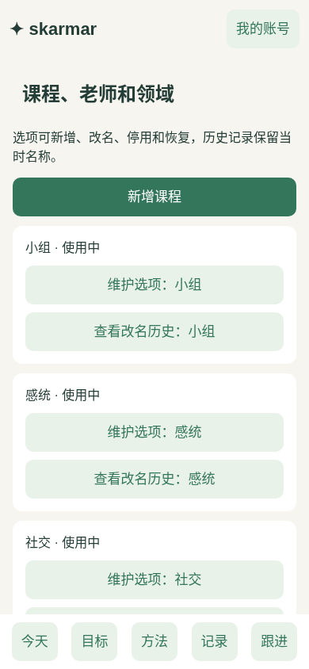

#### 图49：Excel显式映射与写入预览

本次只到预览，不自动写入。实际导入、重复去重、原文来源与回执重试另有完整合约及浏览器验收。

尺寸：390×844；独立合成测试数据。

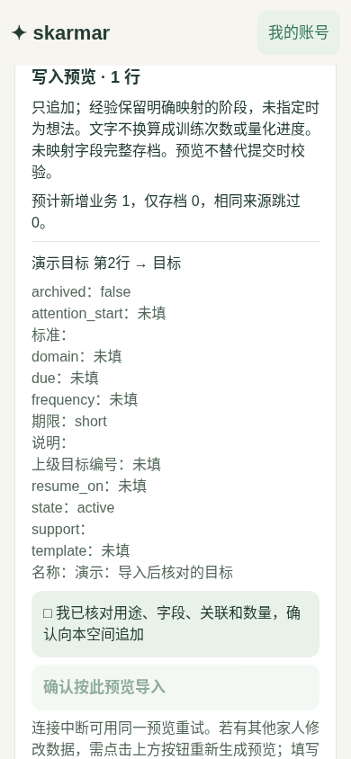

#### 图50：注册实际提交与待审批

实际用单字符合成密码提交成功，没有12位限制；审批前不能登录，邮箱仅作申请人提供的信息。

尺寸：390×844；独立合成测试数据。


#### 图51：管理员审批注册申请

管理员实际批准申请后，原密码可登录；拒绝和账号停用／恢复均有独立验证。

尺寸：390×844；独立合成测试数据。


#### 图52：普通成员账号与本机大字模式

普通成员没有账号管理入口；本机大字设置重载后保留，其他设备不受影响。

尺寸：390×844；独立合成测试数据。

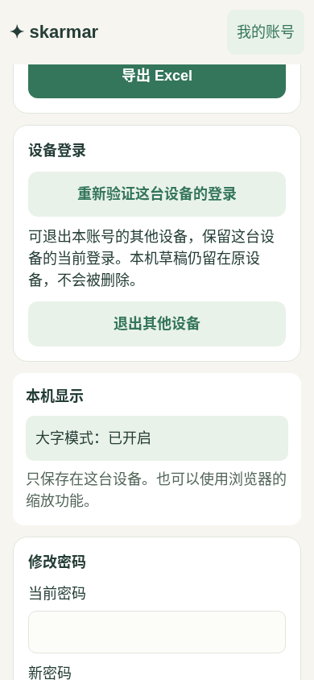

## 未完成的验收与边界

- 这是一轮本机Web自测和界面走查，等待用户审核；不是Opus独立验收结论，T46继续保留待办。
- 没有iPhone／Android真机；200%缩放和键盘避让只作桌面模拟，原生日期控件外观仍可能受操作系统语言影响。
- 没有部署、登录生产账号或读取真实业务数据；线上仍为T54版本，截图包含尚未上线的T55修复和本轮QA01。
- 主要大陆网络、真实手机移动网络、后台关闭网页上传、真实工作簿迁移未在本轮验收。
- 原生App、语音、游戏、家庭电脑同步节点不是本期已交付Web功能；旧主机恢复不作为本轮前置。
- 机构课时当前以节数统计，没有实际时长字段，不能把一节课当成固定分钟。目标／方法采用收起或停用管理，不把这称为清空数据库。

## PRD 59条AC逐项核对

详细结构化证据见[checks.json](artifacts/review-2026-10-29/checks.json)，原图SHA见[screenshots.json](artifacts/review-2026-10-29/screenshots.json)。下表中的源文件均为本轮执行过的测试／合约或其统计fixture。

| AC | 操作与期望 | 本轮结果 | 验证依据 |
| --- | --- | --- | --- |
| AC-R01-01 | 长期方向0／3／6个，标准360×640；两个主按钮无需滚动可见 | 本机通过 | [smoke_prd_today_web.py](../tools/smoke_prd_today_web.py) |
| AC-R01-02 | 用户主动展开长期方向详情；详情先展示意义与最近观察 | 本机通过 | [smoke_prd_today_web.py](../tools/smoke_prd_today_web.py) |
| AC-R01-03 | 同日两个待总结计划；家庭入口先选择待总结记录，不覆盖任何计划 | 本机通过 | [smoke_prd_today_web.py](../tools/smoke_prd_today_web.py) |
| AC-R02-01 | 已有目标，使用默认日期时段；三次点击加一句话可保存计划 | 本机通过 | [smoke_prd_polish_web.py](../tools/smoke_prd_polish_web.py)、[smoke_prd_simplified_web.py](../tools/smoke_prd_simplified_web.py)、[prd-planning-contract.mjs](../tools/prd-planning-contract.mjs) |
| AC-R02-02 | 重点9天未记，维持20天未记；按9/7与20/30排序，重点靠前 | 本机通过 | [smoke_prd_polish_web.py](../tools/smoke_prd_polish_web.py)、[smoke_prd_simplified_web.py](../tools/smoke_prd_simplified_web.py)、[prd-planning-contract.mjs](../tools/prd-planning-contract.mjs) |
| AC-R02-03 | 目标显式不设频率／暂停；自动建议中不出现该目标 | 本机通过 | [smoke_prd_polish_web.py](../tools/smoke_prd_polish_web.py)、[smoke_prd_simplified_web.py](../tools/smoke_prd_simplified_web.py)、[prd-planning-contract.mjs](../tools/prd-planning-contract.mjs) |
| AC-R02-04 | 目标有未解决困难及可用经验；选中目标即显示对应知识摘要 | 本机通过 | [smoke_prd_polish_web.py](../tools/smoke_prd_polish_web.py)、[smoke_prd_simplified_web.py](../tools/smoke_prd_simplified_web.py)、[prd-planning-contract.mjs](../tools/prd-planning-contract.mjs) |
| AC-R03-01 | 已经做完路径，计划字段为空；填写实际目标与表现并确认方法后能提交 | 本机通过 | [smoke_prd_sessions_web.py](../tools/smoke_prd_sessions_web.py)、[smoke_prd_followups_web.py](../tools/smoke_prd_followups_web.py)、[smoke_prd_completion_web.py](../tools/smoke_prd_completion_web.py)、[prd-session-contract.mjs](../tools/prd-session-contract.mjs) |
| AC-R03-02 | 方法选择记不清；计方法未记录，不计为已知空集合 | 本机通过 | [smoke_prd_sessions_web.py](../tools/smoke_prd_sessions_web.py)、[smoke_prd_followups_web.py](../tools/smoke_prd_followups_web.py)、[smoke_prd_completion_web.py](../tools/smoke_prd_completion_web.py)、[prd-session-contract.mjs](../tools/prd-session-contract.mjs) |
| AC-R03-03 | 未选任何标签、情境或参与信号；不阻碍提交总结 | 本机通过 | [smoke_prd_sessions_web.py](../tools/smoke_prd_sessions_web.py)、[smoke_prd_followups_web.py](../tools/smoke_prd_followups_web.py)、[smoke_prd_completion_web.py](../tools/smoke_prd_completion_web.py)、[prd-session-contract.mjs](../tools/prd-session-contract.mjs) |
| AC-R03-04 | 同一总结创建两条困难后重试；只保留这两条产出，不重复创建 | 本机通过 | [smoke_prd_sessions_web.py](../tools/smoke_prd_sessions_web.py)、[smoke_prd_followups_web.py](../tools/smoke_prd_followups_web.py)、[smoke_prd_completion_web.py](../tools/smoke_prd_completion_web.py)、[prd-session-contract.mjs](../tools/prd-session-contract.mjs) |
| AC-R03-05 | 计划目标标本次未做；该目标不增加实际覆盖 | 本机通过 | [smoke_prd_sessions_web.py](../tools/smoke_prd_sessions_web.py)、[smoke_prd_followups_web.py](../tools/smoke_prd_followups_web.py)、[smoke_prd_completion_web.py](../tools/smoke_prd_completion_web.py)、[prd-session-contract.mjs](../tools/prd-session-contract.mjs) |
| AC-R03-06 | 总结确认方法时，实际所用方法不在库中；只填名称即可新建并计为本次实际使用，新方法自动关联本次明确目标 | 本机通过 | [smoke_prd_sessions_web.py](../tools/smoke_prd_sessions_web.py)、[smoke_prd_followups_web.py](../tools/smoke_prd_followups_web.py)、[smoke_prd_completion_web.py](../tools/smoke_prd_completion_web.py)、[prd-session-contract.mjs](../tools/prd-session-contract.mjs) |
| AC-R04-01 | 默认今天，常用课程和老师可见；今天入口到基础提交最多四次点击 | 本机通过 | [smoke_prd_lessons_web.py](../tools/smoke_prd_lessons_web.py)、[smoke_prd_catalog_ranking_web.py](../tools/smoke_prd_catalog_ranking_web.py)、[prd-lesson-contract.mjs](../tools/prd-lesson-contract.mjs) |
| AC-R04-02 | 先选课程或老师，再查看另一项；按该组合正式历史次数排序，另一字段保持原选值或未选；可选无历史的新组合 | 本机通过 | [smoke_prd_lessons_web.py](../tools/smoke_prd_lessons_web.py)、[smoke_prd_catalog_ranking_web.py](../tools/smoke_prd_catalog_ranking_web.py)、[prd-lesson-contract.mjs](../tools/prd-lesson-contract.mjs) |
| AC-R04-03 | 基础记录已保存后补充观察；总节数不增加 | 本机通过 | [smoke_prd_lessons_web.py](../tools/smoke_prd_lessons_web.py)、[smoke_prd_catalog_ranking_web.py](../tools/smoke_prd_catalog_ranking_web.py)、[prd-lesson-contract.mjs](../tools/prd-lesson-contract.mjs) |
| AC-R04-04 | 创建者创建当天，课记无入站引用；允许撤销且正式节数减少一节 | 本机通过 | [smoke_prd_lessons_web.py](../tools/smoke_prd_lessons_web.py)、[smoke_prd_catalog_ranking_web.py](../tools/smoke_prd_catalog_ranking_web.py)、[prd-lesson-contract.mjs](../tools/prd-lesson-contract.mjs) |
| AC-R04-05 | 非创建者／隔日／已被引用任一成立；普通成员只能标记记错 | 本机通过 | [smoke_prd_lessons_web.py](../tools/smoke_prd_lessons_web.py)、[smoke_prd_catalog_ranking_web.py](../tools/smoke_prd_catalog_ranking_web.py)、[prd-lesson-contract.mjs](../tools/prd-lesson-contract.mjs) |
| AC-R05-01 | 打开观察表单；自由文本位于四个主题之前 | 本机通过 | [smoke_prd_lessons_web.py](../tools/smoke_prd_lessons_web.py)、[smoke_prd_polish_web.py](../tools/smoke_prd_polish_web.py) |
| AC-R05-02 | 主题已填后折叠再展开；原内容保持 | 本机通过 | [smoke_prd_lessons_web.py](../tools/smoke_prd_lessons_web.py)、[smoke_prd_polish_web.py](../tools/smoke_prd_polish_web.py) |
| AC-R05-03 | 老人保存观察，父母用独立版本保存关系；两个不相交分区写入均成功 | 本机通过 | [smoke_prd_lessons_web.py](../tools/smoke_prd_lessons_web.py)、[smoke_prd_polish_web.py](../tools/smoke_prd_polish_web.py) |
| AC-R05-04 | 同一观察区被并发修改；第二次写入返回可核对冲突而不覆盖 | 本机通过 | [smoke_prd_lessons_web.py](../tools/smoke_prd_lessons_web.py)、[smoke_prd_polish_web.py](../tools/smoke_prd_polish_web.py) |
| AC-R05-05 | 只写老师建议，未选择生成任务；不自动创建下一步 | 本机通过 | [smoke_prd_lessons_web.py](../tools/smoke_prd_lessons_web.py)、[smoke_prd_polish_web.py](../tools/smoke_prd_polish_web.py) |
| AC-R06-01 | 只填名称与长期／近期类型；可保存目标 | 本机通过 | [smoke_prd_model_web.py](../tools/smoke_prd_model_web.py)、[smoke_prd_observations_web.py](../tools/smoke_prd_observations_web.py)、[smoke_prd_r15_web.py](../tools/smoke_prd_r15_web.py) |
| AC-R06-02 | 标准有文字后切模板；文字不被例子覆盖 | 本机通过 | [smoke_prd_model_web.py](../tools/smoke_prd_model_web.py)、[smoke_prd_observations_web.py](../tools/smoke_prd_observations_web.py)、[smoke_prd_r15_web.py](../tools/smoke_prd_r15_web.py) |
| AC-R06-03 | 机会数0或做到数大于机会数；不显示伪造成功率 | 本机通过 | [smoke_prd_model_web.py](../tools/smoke_prd_model_web.py)、[smoke_prd_observations_web.py](../tools/smoke_prd_observations_web.py)、[smoke_prd_r15_web.py](../tools/smoke_prd_r15_web.py) |
| AC-R07-01 | 方法详情就地记心得；新经验明确关联该方法 | 本机通过 | [smoke_prd_polish_web.py](../tools/smoke_prd_polish_web.py)、[smoke_prd_history_web.py](../tools/smoke_prd_history_web.py)、[smoke_prd_completion_web.py](../tools/smoke_prd_completion_web.py) |
| AC-R07-02 | 方法从版本1修改为2；旧实践仍引用版本1 | 本机通过 | [smoke_prd_polish_web.py](../tools/smoke_prd_polish_web.py)、[smoke_prd_history_web.py](../tools/smoke_prd_history_web.py)、[smoke_prd_completion_web.py](../tools/smoke_prd_completion_web.py) |
| AC-R07-03 | 方法只关联已达成目标；默认排在正常使用中的在途相关方法之后 | 本机通过 | [smoke_prd_polish_web.py](../tools/smoke_prd_polish_web.py)、[smoke_prd_history_web.py](../tools/smoke_prd_history_web.py)、[smoke_prd_completion_web.py](../tools/smoke_prd_completion_web.py) |
| AC-R08-01 | 同一天同课同老师两条实际记录；核对计两节 | 本机通过 | [smoke_prd_lessons_web.py](../tools/smoke_prd_lessons_web.py)、[smoke_prd_catalog_ranking_web.py](../tools/smoke_prd_catalog_ranking_web.py)、[smoke_prd_feedback_web.py](../tools/smoke_prd_feedback_web.py) |
| AC-R08-02 | 老师改名但ID不变；跨月按同一ID汇总 | 本机通过 | [smoke_prd_lessons_web.py](../tools/smoke_prd_lessons_web.py)、[smoke_prd_catalog_ranking_web.py](../tools/smoke_prd_catalog_ranking_web.py)、[smoke_prd_feedback_web.py](../tools/smoke_prd_feedback_web.py) |
| AC-R08-03 | 搜索老师建议关键词；结果能回到有匹配主题①的原课记 | 本机通过 | [smoke_prd_lessons_web.py](../tools/smoke_prd_lessons_web.py)、[smoke_prd_catalog_ranking_web.py](../tools/smoke_prd_catalog_ranking_web.py)、[smoke_prd_feedback_web.py](../tools/smoke_prd_feedback_web.py) |
| AC-R09-01 | 附录D的10月已完成数据；10/18为1、10/24为2，其余当月日为0 | 本机通过 | [smoke_prd_history_web.py](../tools/smoke_prd_history_web.py)、[smoke_prd_gap_fixes_web.py](../tools/smoke_prd_gap_fixes_web.py)、[prd-planning-contract.mjs](../tools/prd-planning-contract.mjs) |
| AC-R09-02 | 360px宽目标时间分布；使用可展开周条，不使用狭窄逐日点击点 | 本机通过 | [smoke_prd_history_web.py](../tools/smoke_prd_history_web.py)、[smoke_prd_gap_fixes_web.py](../tools/smoke_prd_gap_fixes_web.py)、[prd-planning-contract.mjs](../tools/prd-planning-contract.mjs) |
| AC-R10-01 | 同一来源另一家人补相反看法；附注可见而使用总数保持一 | 本机通过 | [smoke_prd_followups_web.py](../tools/smoke_prd_followups_web.py)、[prd-followup-contract.mjs](../tools/prd-followup-contract.mjs) |
| AC-R10-02 | 明确修订反馈主结果并通过版本核对；计数移动到新分类但总量不增加 | 本机通过 | [smoke_prd_followups_web.py](../tools/smoke_prd_followups_web.py)、[prd-followup-contract.mjs](../tools/prd-followup-contract.mjs) |
| AC-R10-03 | 已有家庭帮助经验补录；允许选择已有帮助阶段而无需虚构过去使用事件 | 本机通过 | [smoke_prd_followups_web.py](../tools/smoke_prd_followups_web.py)、[prd-followup-contract.mjs](../tools/prd-followup-contract.mjs) |
| AC-R11-01 | 只有两条可比观察，判断无变化；不自动提示达到三条观察下限 | 本机通过 | [smoke_prd_followups_web.py](../tools/smoke_prd_followups_web.py)、[prd-followup-contract.mjs](../tools/prd-followup-contract.mjs) |
| AC-R11-02 | 三条可比观察且判断无变化；提示可改每周回看，但不自动提高训练量 | 本机通过 | [smoke_prd_followups_web.py](../tools/smoke_prd_followups_web.py)、[prd-followup-contract.mjs](../tools/prd-followup-contract.mjs) |
| AC-R12-01 | 锚点2026-10-10，隔周到期10/24，11/14补做；下次为2026-11-21 | 本机通过 | [smoke_prd_followups_web.py](../tools/smoke_prd_followups_web.py)、[smoke_prd_review_pages_web.py](../tools/smoke_prd_review_pages_web.py)、[smoke_prd_refinement_web.py](../tools/smoke_prd_refinement_web.py)、[foundation_followups.rs](../crates/api/tests/foundation_followups.rs) |
| AC-R12-02 | 同方法挂两个目标；复盘队列仅有该方法一项 | 本机通过 | [smoke_prd_followups_web.py](../tools/smoke_prd_followups_web.py)、[smoke_prd_review_pages_web.py](../tools/smoke_prd_review_pages_web.py)、[smoke_prd_refinement_web.py](../tools/smoke_prd_refinement_web.py)、[foundation_followups.rs](../crates/api/tests/foundation_followups.rs) |
| AC-R12-03 | 保存下一步后在目标下建计划；可查询并纳入该行动 | 本机通过 | [smoke_prd_followups_web.py](../tools/smoke_prd_followups_web.py)、[smoke_prd_review_pages_web.py](../tools/smoke_prd_review_pages_web.py)、[smoke_prd_refinement_web.py](../tools/smoke_prd_refinement_web.py)、[foundation_followups.rs](../crates/api/tests/foundation_followups.rs) |
| AC-R12-04 | 两个成员同时完成同一到期项；只生成一个下次安排 | 本机通过 | [smoke_prd_followups_web.py](../tools/smoke_prd_followups_web.py)、[smoke_prd_review_pages_web.py](../tools/smoke_prd_review_pages_web.py)、[smoke_prd_refinement_web.py](../tools/smoke_prd_refinement_web.py)、[foundation_followups.rs](../crates/api/tests/foundation_followups.rs) |
| AC-R12-05 | 比较期内有两条明确关联的参与信号，另有一条未关联的整次信号；复盘卡只读列出前两条及日期与来源，无因果表述，未关联信号不列入 | 本机通过 | [smoke_prd_followups_web.py](../tools/smoke_prd_followups_web.py)、[smoke_prd_review_pages_web.py](../tools/smoke_prd_review_pages_web.py)、[smoke_prd_refinement_web.py](../tools/smoke_prd_refinement_web.py)、[foundation_followups.rs](../crates/api/tests/foundation_followups.rs) |
| AC-R13-01 | 附录D全部输入；各窗口、来源和最近日期匹配期望值表 | 本机通过 | [prd-coverage.json](../tools/fixtures/prd-coverage.json)、[prd-planning-contract.mjs](../tools/prd-planning-contract.mjs)、[smoke_prd_balance_web.py](../tools/smoke_prd_balance_web.py) |
| AC-R13-02 | 仅新增瞬间I1；家庭已完成数和热力图不变 | 本机通过 | [prd-coverage.json](../tools/fixtures/prd-coverage.json)、[prd-planning-contract.mjs](../tools/prd-planning-contract.mjs)、[smoke_prd_balance_web.py](../tools/smoke_prd_balance_web.py) |
| AC-R13-03 | 记录含中期及其子目标；该中期按同一来源只计一次 | 本机通过 | [prd-coverage.json](../tools/fixtures/prd-coverage.json)、[prd-planning-contract.mjs](../tools/prd-planning-contract.mjs)、[smoke_prd_balance_web.py](../tools/smoke_prd_balance_web.py) |
| AC-R14-01 | 基础课记离线后联网重放同一请求两次；只产生一节正式课记 | 本机通过 | [smoke_prd_offline_web.py](../tools/smoke_prd_offline_web.py)、[smoke_prd_actor_guard_web.py](../tools/smoke_prd_actor_guard_web.py)、[smoke_prd_overlay_web.py](../tools/smoke_prd_overlay_web.py)、[smoke_prd_draft_windows_web.py](../tools/smoke_prd_draft_windows_web.py)、[prd-contract.mjs](../tools/prd-contract.mjs) |
| AC-R14-02 | 待上传期间切换账号；旧账号请求不以新账号上传 | 本机通过 | [smoke_prd_offline_web.py](../tools/smoke_prd_offline_web.py)、[smoke_prd_actor_guard_web.py](../tools/smoke_prd_actor_guard_web.py)、[smoke_prd_overlay_web.py](../tools/smoke_prd_overlay_web.py)、[smoke_prd_draft_windows_web.py](../tools/smoke_prd_draft_windows_web.py)、[prd-contract.mjs](../tools/prd-contract.mjs) |
| AC-R14-03 | 表单正编辑且收到新状态；当前输入与手指下列表顺序不变 | 本机通过 | [smoke_prd_offline_web.py](../tools/smoke_prd_offline_web.py)、[smoke_prd_actor_guard_web.py](../tools/smoke_prd_actor_guard_web.py)、[smoke_prd_overlay_web.py](../tools/smoke_prd_overlay_web.py)、[smoke_prd_draft_windows_web.py](../tools/smoke_prd_draft_windows_web.py)、[prd-contract.mjs](../tools/prd-contract.mjs) |
| AC-R14-04 | 详情覆盖层打开后浏览器返回；只关闭覆盖层并保留表单 | 本机通过 | [smoke_prd_offline_web.py](../tools/smoke_prd_offline_web.py)、[smoke_prd_actor_guard_web.py](../tools/smoke_prd_actor_guard_web.py)、[smoke_prd_overlay_web.py](../tools/smoke_prd_overlay_web.py)、[smoke_prd_draft_windows_web.py](../tools/smoke_prd_draft_windows_web.py)、[prd-contract.mjs](../tools/prd-contract.mjs) |
| AC-R14-05 | 跨日未提交课记后重开本账号；全局继续入口可恢复该草稿 | 本机通过 | [smoke_prd_offline_web.py](../tools/smoke_prd_offline_web.py)、[smoke_prd_actor_guard_web.py](../tools/smoke_prd_actor_guard_web.py)、[smoke_prd_overlay_web.py](../tools/smoke_prd_overlay_web.py)、[smoke_prd_draft_windows_web.py](../tools/smoke_prd_draft_windows_web.py)、[prd-contract.mjs](../tools/prd-contract.mjs) |
| AC-R14-06 | 旧API版本携带写请求；执行前拒绝并提示升级，原输入保留 | 本机通过 | [smoke_prd_offline_web.py](../tools/smoke_prd_offline_web.py)、[smoke_prd_actor_guard_web.py](../tools/smoke_prd_actor_guard_web.py)、[smoke_prd_overlay_web.py](../tools/smoke_prd_overlay_web.py)、[smoke_prd_draft_windows_web.py](../tools/smoke_prd_draft_windows_web.py)、[prd-contract.mjs](../tools/prd-contract.mjs) |
| AC-R15-01 | 字段空白并直接提交；示例不进入请求或导出 | 本机通过 | [smoke_prd_r15_web.py](../tools/smoke_prd_r15_web.py)、[smoke_prd_simplified_web.py](../tools/smoke_prd_simplified_web.py) |
| AC-R15-02 | 字段已有输入并主动展开例子；标签持续可见、问句与完整例子可读取，原输入不变 | 本机通过 | [smoke_prd_r15_web.py](../tools/smoke_prd_r15_web.py)、[smoke_prd_simplified_web.py](../tools/smoke_prd_simplified_web.py) |
| AC-R15-03 | 200%文本缩放且键盘开启；操作栏不遮挡当前焦点 | 部分验证 | [smoke_prd_r15_web.py](../tools/smoke_prd_r15_web.py)、[smoke_prd_simplified_web.py](../tools/smoke_prd_simplified_web.py) |
| AC-R15-04 | 标准页面的文本与点击区；分别按附录A尺寸及对比度测量达标 | 部分验证 | [smoke_prd_r15_web.py](../tools/smoke_prd_r15_web.py)、[smoke_prd_simplified_web.py](../tools/smoke_prd_simplified_web.py) |
| AC-R16-01 | 检查页头／登录／Web元数据／桌面图标；产品显示名为skarmar | 本机通过 | [smoke_prd_export_web.py](../tools/smoke_prd_export_web.py)、[test_cloudflare_release.py](../tools/test_cloudflare_release.py) |
| AC-R16-02 | 只做显示名改动；Worker／DO／域名及空间标识保持原值 | 本机通过 | [smoke_prd_export_web.py](../tools/smoke_prd_export_web.py)、[test_cloudflare_release.py](../tools/test_cloudflare_release.py) |

## 复现

先按开发说明建立本机依赖和Web构建；以下命令仅启动独立本机测试库，不指向生产。

```bash
npm run typecheck
EXPO_NO_TELEMETRY=1 EXPO_OFFLINE=1 npm run web:build
CHROMIUM_EXECUTABLE=/usr/bin/chromium npm run test:prd-web
CHROMIUM_EXECUTABLE=/usr/bin/chromium node tools/check-prd-web.mjs capture_prd_review_web.py smoke_prd_account_web.py
node tools/check-prd-runtimes.mjs
```

截图流程的历史样本通过真实认证API准备；核心保存流程通过实际页面操作并读取服务器结果核对。原始合成数据库、下载工作簿和过程日志留在忽略目录，不纳入文档或Git。
