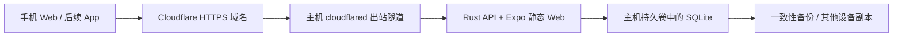

# 常开主机 + Cloudflare Tunnel 部署

日期：2026-10-13。目标是一台有出站网络、没有公网 IP 的常开主机。代码、登录和部署配置已准备；当前尚未连接用户主机或发布真实 Tunnel。

## 部署结构



Docker Compose 只有 `app`、`cloudflared` 两个服务。Rust 自带静态页面与 `/api` 路由，浏览器使用同域 API。主机端口仅映射到 `127.0.0.1`；公网入口是 Tunnel。域名必须与 `SKARMA_PUBLIC_URL` 一致。

先按 Linux + Docker Engine / Compose 准备；镜像在主机上原生构建，可用于 x86_64 / ARM64。当前实际容器验收针对 x86_64，ARM64 与用户主机网络仍需现场验收。Windows / NAS 可使用 Linux 容器，需按实际 Docker 环境调整启动方式。

需要：Docker、足够构建内存和磁盘、有出站网络的主机、Cloudflare 账号，以及由 Cloudflare 管理的域名。Tunnel 本身可使用免费计划，域名注册与主机电力、网络费用另计。计算与数据库在主机，不使用 Workers / DO 配额。

## 账号与会话

- 一个部署实例对应一个共享空间。每人独立账号；所有正常成员均可查看和填写该空间全部记录，管理员额外管理成员。尚未做多孩子档案或逐记录授权。
- 无公开注册入口，无默认账号或密码。首个管理员从主机 CLI 创建。
- 密码使用 Argon2id 加盐哈希；数据库仅保存会话令牌的 SHA-256 哈希。
- HTTPS 会话 Cookie 使用 `__Host-` 前缀、`Secure`、`HttpOnly`、`SameSite=Strict`，有效期 7 天。退出撤销当前会话；停用、密码重置与修改密码撤销该账号全部会话。
- 登录失败按账号持久限速（5 次失败后限制 15 分钟），并有短时全局失败限制。未知账号与停用账号不区分提示。
- 写请求验证来源并要求应用请求头；私有 API 返回 `Cache-Control: no-store`。Tunnel 路由无需配置缓存；对 `/api/*` 保持缓存绕过。
- 私有记录的会话校验与业务操作在同一个数据库事务中完成；排队中的请求在执行前发现会话被撤销时返回 401。
- 本机训练草稿与冲突备份按空间、账号分开。退出保留草稿；换账号不自动读取其他账号草稿。浏览器本地数据没有加密，共用设备应使用各自浏览器配置。以前的匿名草稿保留在原键中，不自动归属新账号。

## 首次启动

```bash
git clone --branch feat/tencent-informed-web https://github.com/q9good/skarmar.git
cd skarmar/deploy/host
cp .env.example .env
```

编辑 `.env`，将网址换成实际域名，例如 `https://training.your-domain.com`。空间名设置后保持稳定，本机草稿用它分组。生产设置为 `SKARMA_PRODUCTION=1`，示例数据关闭，认证必需。配置不完整时服务拒绝启动。

```bash
docker compose build
docker compose run --rm app admin-init --username owner --name 家长
docker compose up -d app
docker compose exec -T app skarma-api healthcheck
```

创建管理员时会在终端隐藏输入两次密码（至少 12 个字符）。数据库写入持久卷，容器重建后继续使用。`admin-init` 只在没有任何账号时成功，不能覆盖已有账号。首次启动不会导入腾讯记录。

## 创建并接入 Tunnel

1. 在 [Cloudflare 控制台](https://dash.cloudflare.com/?to=/:account/tunnels) 的 **Networking → Tunnels** 创建隧道，获取 connector token。
2. 在主机终端运行下列脚本，隐藏输入 token。token 保存在被 Git 忽略的私有 `secrets` 目录，不放入 `.env`、镜像或前端代码。

```bash
bash set-tunnel-token.sh
```

3. 为 Tunnel 添加 **Published application** 路由：主机名填实际域名，Service URL 填 **`http://app:3001`**。这里的 `app` 是 Compose 服务名，隧道容器通过它访问应用。
4. 启动连接器：

```bash
docker compose --profile tunnel up -d
docker compose logs --tail 50 cloudflared
```

两服务均配置 `restart: unless-stopped`；主机的 Docker 服务也需设置开机启动。Tunnel 要能出站连接 Cloudflare 的 `7844` 端口；QUIC 使用 UDP，HTTP/2 使用 TCP。若主机网络限制出站端口，先根据 [官方连接排障](https://developers.cloudflare.com/tunnel/troubleshooting/)检查。

主机无需公网 IPv4、入站端口映射或开放数据库端口。更换 token 后用 `docker compose --profile tunnel up -d --force-recreate cloudflared` 重新挂载秘密文件。

## 手机验收

打开实际 HTTPS 域名，应先看到登录页；登录后才加载记录。验证：

1. 未登录请求 `/api/state` 返回 401，`/api/health` 返回 `status=ok`。
2. 管理员创建老师账号；老师能填写记录，但不能管理成员。
3. 手机保存计划、完成训练、刷新；电脑与手机看见相同正式记录。
4. 修改密码或停用账号后，旧设备在刷新／提交时返回登录页。
5. 重启主机，隧道和应用恢复，数据库保留；分别检查手机 Wi-Fi 与蜂窝网络的访问效果。

实际 Tunnel 的 HTTPS、网络可靠性和手机访问速度，必须在用户主机与域名上验证。本机容器验证不能替代这一步。

## 备份与恢复

在线备份使用 SQLite Backup API，完整性检查后复制到主机，SHA-256 校验复制结果；无需暂停记录。

```bash
bash backup.sh
```

备份输出到 `deploy/host/backups/`，包含记录与账号哈希，权限为 0600。定期复制到另一台设备或加密的备份位置。可通过主机任务计划每日调用该脚本，随后按自己的保留策略整理备份；同机副本不足以应对主机损坏。

恢复命令先备份当前数据库，停止应用和隧道，验证输入文件并升级其私有副本，再恢复到持久卷并重启。`--replace` 是明确的替换动作；恢复撤销全部会话，成员重新登录。

```bash
bash restore.sh /绝对路径/备份.db --replace
```

输入为空、损坏或来自不支持的新数据库版本时恢复失败，当前数据保持；失败后服务保持停止，便于核对。恢复前副本保存在 `backups`。

忘记管理员密码时，在主机上使用恢复 CLI，隐藏输入新密码：

```bash
docker compose exec app skarma-api admin-reset --username owner
```

## 升级与开发验收

升级前备份，在仓库执行 `git pull --ff-only`，再进入 `deploy/host` 执行 `docker compose build` 和 `docker compose --profile tunnel up -d`。SQL 迁移保留旧记录；数据库版本高于程序支持版本时拒绝启动。

开发电脑可运行 `bash tools/start-local.sh admin-init --username owner --name 家长`，然后 `bash tools/start-local.sh`。两条命令使用同一数据库，无账号的启动页面会要求登录。仅用于合成数据的免登录示例，需显式 `SKARMA_AUTH=demo SKARMA_DEMO=1`，生产模式禁止。

自动验收：`cargo test --workspace --locked`、`npm run typecheck`、`npm run web:build`、`npm run test:host`、`npm run test:runtimes`。后两者创建临时数据库和合成账号，验证浏览器登录／草稿隔离、在线备份与离线恢复，以及原生和 Worker 的认证行为。

本机 Worker 的 `npm run cf:dev` 仍是免登录合成示例。未来正式 Worker 部署需要实际 `SKARMA_PUBLIC_URL` 和 `SKARMA_INITIAL_ADMIN_PASSWORD` 私有 secret（可设置 `SKARMA_INITIAL_ADMIN_USER` / `SKARMA_INITIAL_ADMIN_NAME`）；只在空间无账号时创建管理员，初始化后可删除该 secret。当前正式部署目标为主机 + Tunnel。

参考：[Tunnel 官方指南](https://developers.cloudflare.com/tunnel/get-started/)、[cloudflared 2026.10.0](https://github.com/cloudflare/cloudflared/releases/tag/2026.10.0)、[双运行环境](runtime-storage.md)。
