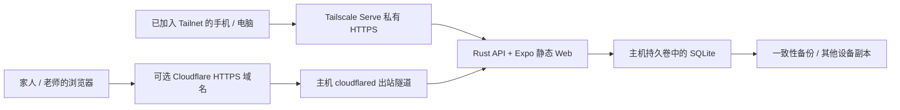

# 常开主机部署：Tailscale 验收与 Cloudflare Tunnel

日期：2026-10-19。目标是一台有出站网络、没有公网 IP 的常开主机。用户的 evo 主机原部署采用原生 Rust 服务和 SQLite，通过 Tailscale Serve 提供私有 HTTPS；临时 Cloudflare Quick Tunnel 曾由 Mac 经 Tailscale 转发，现已停止，详见 [交接状态](handoff.md)。以下 Compose 步骤保留为其他主机的可选部署方式，不表示 evo 使用 Docker。

当前主机数据连接异常，用户已选择先上线空白的 [完整 Cloudflare 托管实例](cloudflare-hosted-deployment.md)。本文保留原主机的部署与恢复步骤；旧主机数据尚未迁移。

## 部署结构



以下 Docker Compose 定义 `app` 和可选的 `cloudflared`；Tailscale 使用主机已有客户端。Rust 自带静态页面与 `/api` 路由，浏览器使用同域 API。主机端口仅映射到 `127.0.0.1`；Serve 和 Tunnel 均代理该应用。浏览器访问的网址必须匹配 `SKARMA_PUBLIC_URL` 或已明确配置的额外 HTTPS 来源。

先按 Linux + Docker Engine / Compose 准备；镜像在主机上原生构建，可用于 x86_64 / ARM64。当前实际容器验收针对 x86_64，ARM64 与用户主机网络仍需现场验收。Windows / NAS 可使用 Linux 容器，需按实际 Docker 环境调整启动方式。

需要：Docker、足够构建内存和磁盘、有出站网络的主机。私有验收使用 Tailscale 和 Tailnet 的 HTTPS 证书功能，手机／电脑也需加入 Tailnet 并通过访问规则。Cloudflare Tunnel 阶段再准备 Cloudflare 账号和由它管理的域名。Tunnel 本身可使用免费计划，域名注册与主机电力、网络费用另计；Tailscale 用户与设备额度按实际账号计划核对。计算与数据库在主机，不使用 Workers / DO 配额。

## 账号与会话

- 一个部署实例对应一个共享空间。每人独立账号；所有正常成员均可查看和填写该空间全部记录，管理员额外管理成员。尚未做多孩子档案或逐记录授权。
- 私有站点的登录页提供注册申请：申请人填写账号、称呼、邮箱和自设密码，管理员在 **我的账号 → 待审批申请** 中批准或拒绝。批准前不能登录；批准后成为普通成员。拒绝后可重新申请。首个管理员仍从主机 CLI 创建，没有默认账号或密码。
- “今天”可直接新增日常上课记录，无需训练计划。日期默认今天，可修改；课程名称和授课老师必填，上课内容、目标、问题与家庭配合事项可选。记录在“记录”页回看和修改，也包含在 Excel 导出中。
- 待审申请只保存 Argon2id 密码哈希，不向管理员或 API 返回密码。注册请求按账号和邮箱限速，并有全局速率与待审数量上限。备份包含待审申请及邮箱，须按账号数据保护。
- 当前 evo 没有邮件发送服务，申请会显示在站内待审列表，管理员可手动刷新。邮件提醒管理员需另配已验证发件地址、收件邮箱和 SMTP／邮件 API 凭证；尚未发送任何通知邮件。
- 密码使用 Argon2id 加盐哈希；数据库仅保存会话令牌的 SHA-256 哈希。
- HTTPS 会话 Cookie 使用 `__Host-` 前缀、`Secure`、`HttpOnly`、`SameSite=Strict`，有效期 7 天。退出撤销当前会话；停用、密码重置与修改密码撤销该账号全部会话。
- 登录失败按账号持久限速（5 次失败后限制 15 分钟），并有短时全局失败限制。未知账号与停用账号不区分提示。
- 写请求验证来源并要求应用请求头；私有 API 返回 `Cache-Control: no-store`。Tunnel 路由无需配置缓存；对 `/api/*` 保持缓存绕过。
- 同一实例需要从多个 HTTPS 域名访问时，可在私有配置中设置 `SKARMA_ADDITIONAL_PUBLIC_URLS`，用逗号分隔最多三个额外的精确来源，例如临时 Tunnel 网址。生产环境只接受 HTTPS，不接受通配符；每个域名的会话 Cookie 独立。临时网址失效后应从配置中移除。
- 私有记录的会话校验与业务操作在同一个数据库事务中完成；排队中的请求在执行前发现会话被撤销时返回 401。
- 本机训练草稿与冲突备份按空间、账号分开。退出保留草稿；换账号不自动读取其他账号草稿。浏览器本地数据没有加密，共用设备应使用各自浏览器配置。以前的匿名草稿保留在原键中，不自动归属新账号。

## 首次启动

远程维护可通过 Tailscale SSH 或普通 SSH 完成。服务器需要加入 Tailnet，并允许对应客户端访问 SSH；具体采用哪种认证方式按服务器已有配置决定。开始部署前核对系统／CPU、Docker、磁盘、已有服务和 Compose 项目，避免占用其他应用的端口或持久卷。

在 Codex 托管云环境中，Tailscale 由出口代理 sidecar 管理，需在环境设置配置 VPN，并为服务器的 Tailscale IPv4（精确 `/32`）或可解析域名配置 TCP 放行。HTTP 的“全部放开”不建立 VPN 或 SSH 的 TCP 授权。在工作容器安装独立 Tailscale 不能替代这项配置。

接通后使用运行环境技能提供的校验版 `socat`，通过 `proxy:8088` 把授权 SSH 目标转发到本机 loopback 端口，再用 SSH 登录。保留 SSH 主机密钥校验，先核对服务器公钥指纹；SSH 应用认证与 VPN 接入分别配置。凭证通过受支持的私有配置提供，不提交到仓库。

本次已进入实际部署阶段；远程执行前需明确服务器 Tailscale IP／完整域名、SSH 用户／端口／认证方式，并完成上述 VPN 与 TCP 配置。不要把当前 Codex 工作容器当作用户的常开主机。

```bash
git clone --branch feat/tencent-informed-web https://github.com/q9good/skarmar.git
cd skarmar/deploy/host
cp .env.example .env
```

编辑 `.env`，填写下一节的实际私有 HTTPS 网址；选择直接接 Tunnel 时则填写自己的 Cloudflare 域名。空间名设置后保持稳定，本机草稿用它分组。生产设置为 `SKARMA_PRODUCTION=1`，示例数据关闭，认证必需。配置不完整时服务拒绝启动。

```bash
docker compose build
docker compose run --rm app admin-init --username owner --name 家长
docker compose up -d app
docker compose exec -T app skarma-api healthcheck
```

创建管理员时会在终端隐藏输入两次密码（不能为空，不设最小长度）。数据库写入持久卷，容器重建后继续使用。`admin-init` 只在没有任何账号时成功，不能覆盖已有账号。首次启动不会导入腾讯记录。

## 先用 Tailscale Serve 验收

以下命令在用户常开主机执行。先查看当前 Tailnet 身份和已有 Serve 配置，取得主机的完整 `device.tailnet.ts.net` 域名：

```bash
tailscale status
tailscale serve status
```

将 `.env` 的 `SKARMA_PUBLIC_URL` 设为 `https://device.tailnet.ts.net`（使用实际域名），按上一节启动 `app`。确认主机 loopback 健康检查成功，再启用 Serve：

```bash
curl --fail http://127.0.0.1:3001/api/health
tailscale serve --bg --https=443 http://127.0.0.1:3001
tailscale serve status
```

`--bg` 让配置在客户端重启后继续生效。首次使用可能要求 Tailnet 管理员按 CLI 显示的链接启用 HTTPS 证书；完成后以 `serve status` 显示的私有 HTTPS 地址为准。主机的 Tailscale 和 Docker 服务都需开机启动。

如果已有 Serve 服务占用 443，保留它，为本应用选择空闲 HTTPS 端口，例如 `--https=8443`，并将 `SKARMA_PUBLIC_URL` 同步改为 `https://device.tailnet.ts.net:8443`。不要执行全局 `tailscale serve reset`；撤销本应用时，仅关闭对应端口的配置，例如 `tailscale serve --https=8443 off`。

手机／电脑连接同一 Tailnet 后访问该 HTTPS 地址，仍需使用应用账号登录。仅加入 Tailnet 不替代应用账号。不要用 `http://100.x.x.x:3001` 作为正式入口：生产会话需要 HTTPS，且应用端口仅绑定主机 loopback。

先完成下方手机验收与一次备份。此阶段无需 Cloudflare 账号、域名或 Tunnel token。Serve 的具体行为以主机 `tailscale serve --help` 为准，参考 [官方 Serve 指南](https://tailscale.com/kb/1312/serve) 与 [CLI](https://tailscale.com/kb/1242/tailscale-serve)。

## 再接入 Cloudflare Tunnel（可选）

### 使用固定 workers.dev 网址与主机现有数据

没有自有域名时，可使用 Workers VPC：浏览器访问固定的 `workers.dev` 网址，
Worker 通过 VPC Service 转发到主机上的命名 Tunnel，再到 `http://localhost:3001`。
应用和 SQLite 继续保留在主机上。此方式不要求把域名接入 Cloudflare；VPC 当前为 Beta。
普通公开 hostname Tunnel 的自有域名要求不适用于这条路径。

网关代码与配置示例见 [deploy/worker-gateway](../deploy/worker-gateway/README.md)。
完整操作、fake-IP DNS 排障、常驻服务、验收与回滚见
[固定 Cloudflare 网址部署手册](cloudflare-workers-vpc-deployment.md)。
连接程序需要 `cloudflared` 2025.7.0 或更新版本，必须能出站使用 UDP 7844 的 QUIC；
HTTP/2 不能承载 Workers VPC。主机可用用户级常驻服务保持连接，令牌保存在私有文件并
通过 `--token-file` 读取。为服务设置自动重启，按主机情况启用用户管理器 linger。

在 Cloudflare 创建命名 Tunnel 和目标为该主机 `localhost:3001` 的 HTTP VPC Service，
使用此 Service 的 ID 配置网关。部署时指定网关目录的配置文件；将返回的精确 HTTPS
来源加入主机应用的 `SKARMA_ADDITIONAL_PUBLIC_URLS` 并重启应用。应用继续校验登录、
请求来源和版本，账号与现有业务数据不变。最终验证应包括连接器重启后网址保持、
首页与健康检查、未登录数据拒绝、正常来源写入及陌生来源拒绝。

参考 [官方私有网站代理示例](https://developers.cloudflare.com/workers-vpc/examples/private-api/)
和 [VPC Tunnel 要求](https://developers.cloudflare.com/workers-vpc/configuration/tunnel/)。

### 使用自有域名的普通 Tunnel

需要不安装 Tailscale 的设备访问时，先备份，在 `.env` 将 `SKARMA_PUBLIC_URL` 改为实际 Cloudflare HTTPS 域名，再执行 `docker compose up -d app`。应用、持久卷与数据保持原位。网址改变后，用户改用新地址重新登录；旧地址的浏览器本机草稿不会自动迁移，应先保存。

1. 在 [Cloudflare 控制台](https://dash.cloudflare.com/?to=/:account/tunnels) 的 **Networking → Tunnels** 创建隧道，获取 connector token。
2. 在主机终端运行下列脚本，隐藏输入 token。token 保存在被 Git 忽略的私有 `secrets` 目录，不放入 `.env`、镜像或前端代码。

```bash
bash set-tunnel-token.sh
```

3. 为 Tunnel 添加 **Published application** 路由：主机名填实际域名，Service URL 填 **`http://app:3001`**。这里的 `app` 是 Compose 服务名，隧道容器通过它访问应用。
4. 启动连接器：

```bash
docker compose --profile tunnel up -d
docker compose logs --tail 50 cloudflared
```

两服务均配置 `restart: unless-stopped`；主机的 Docker 服务也需设置开机启动。Tunnel 要能出站连接 Cloudflare 的 `7844` 端口；QUIC 使用 UDP，HTTP/2 使用 TCP。若主机网络限制出站端口，先根据 [官方连接排障](https://developers.cloudflare.com/tunnel/troubleshooting/)检查。

主机无需公网 IPv4、入站端口映射或开放数据库端口。更换 token 后用 `docker compose --profile tunnel up -d --force-recreate cloudflared` 重新挂载秘密文件。

## 手机验收

打开实际 HTTPS 域名，应先看到登录页；登录后才加载记录。验证：

1. 未登录请求 `/api/state` 返回 401，`/api/health` 返回 `status=ok`。
2. 新成员提交注册申请；审批前不能登录，管理员批准后能登录、填写记录，但不能管理成员。管理员也可直接创建老师账号。
3. 手机保存计划、完成训练、刷新；电脑与手机看见相同正式记录。
4. 修改密码或停用账号后，旧设备在刷新／提交时返回登录页。
5. 建立目的与途径多对多映射，分别创建目的原则、途径细节和双重绑定经验，确认手机刷新和 Excel 导出关系一致。
6. 执行一次备份；重启主机后，应用与所选入口恢复，数据库保留。手机连接 Tailscale 后分别用 Wi-Fi 与蜂窝访问；接入 Tunnel 后还应关闭手机 Tailscale，验证新域名访问。

实际 Tunnel 的 HTTPS、网络可靠性和手机访问速度，必须在用户主机与域名上验证。本机容器验证不能替代这一步。

## 备份与恢复

查阅和归档记录可在 **我的账号 → 导出 Excel** 下载十一张工作表，包含上课记录、途径及两类经验绑定，详见 [Excel 导出](excel-export.md)。导出不包含账号凭证；系统恢复使用下述 SQLite 备份。

在线备份使用 SQLite Backup API，完整性检查后复制到主机，SHA-256 校验复制结果；无需暂停记录。

```bash
bash backup.sh
```

备份输出到 `deploy/host/backups/`，包含记录与账号哈希，权限为 0600。定期复制到另一台设备或加密的备份位置。可通过主机任务计划每日调用该脚本，随后按自己的保留策略整理备份；同机副本不足以应对主机损坏。

恢复命令先备份当前数据库，停止应用和隧道，验证输入文件并升级其私有副本，再恢复到持久卷并重启。`--replace` 是明确的替换动作；恢复撤销全部会话，成员重新登录。

```bash
bash restore.sh /绝对路径/备份.db --replace
```

输入为空、损坏或来自不支持的新数据库版本时恢复失败，当前数据保持；失败后服务保持停止，便于核对。恢复前副本保存在 `backups`。

忘记管理员密码时，在主机上使用恢复 CLI，隐藏输入新密码：

```bash
docker compose exec app skarma-api admin-reset --username owner
```

## 升级与开发验收

升级前备份，在仓库执行 `git pull --ff-only`，再进入 `deploy/host` 执行 `docker compose build` 和 `docker compose up -d app`；使用 Tunnel 时再执行 `docker compose --profile tunnel up -d`。SQL 迁移保留旧记录；数据库版本高于程序支持版本时拒绝启动。

开发电脑可运行 `bash tools/start-local.sh admin-init --username owner --name 家长`，然后 `bash tools/start-local.sh`。两条命令使用同一数据库，无账号的启动页面会要求登录。仅用于合成数据的免登录示例，需显式 `SKARMA_AUTH=demo SKARMA_DEMO=1`，生产模式禁止。

自动验收：`cargo test --workspace --locked`、`npm run typecheck`、`npm run web:build`、`npm run test:host`、`npm run test:runtimes`。后两者创建临时数据库和合成账号，验证浏览器登录／草稿隔离、在线备份与离线恢复，以及原生和 Worker 的认证行为。

本机 Worker 的 `npm run cf:dev` 仍是免登录合成示例。未来正式 Worker 部署需要实际 `SKARMA_PUBLIC_URL` 和 `SKARMA_INITIAL_ADMIN_PASSWORD` 私有 secret（可设置 `SKARMA_INITIAL_ADMIN_USER` / `SKARMA_INITIAL_ADMIN_NAME`）；只在空间无账号时创建管理员，初始化后可删除该 secret。当前正式部署目标为主机 + Tunnel。

参考：[Tunnel 官方指南](https://developers.cloudflare.com/tunnel/get-started/)、[cloudflared 2026.10.0](https://github.com/cloudflare/cloudflared/releases/tag/2026.10.0)、[双运行环境](runtime-storage.md)。
