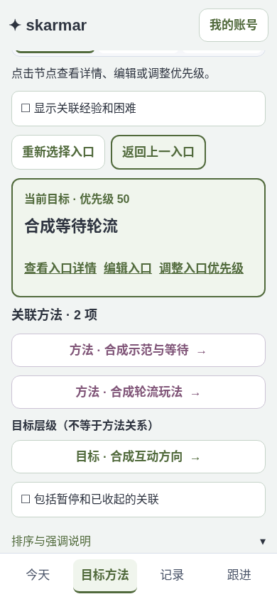
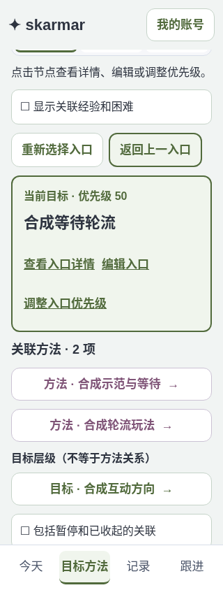
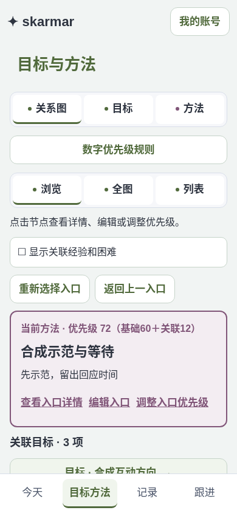
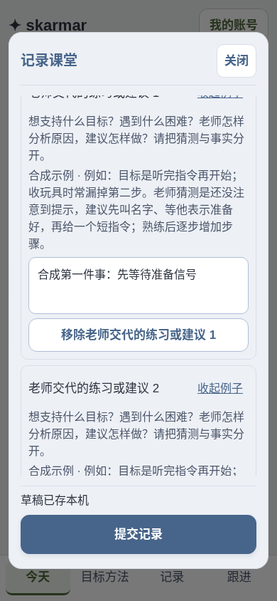
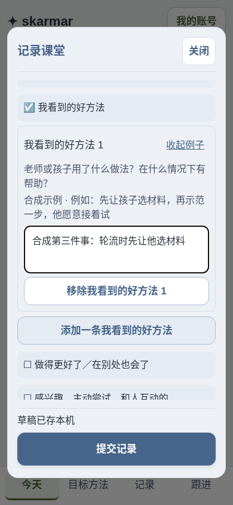
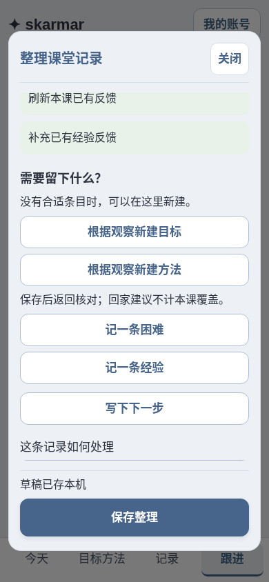
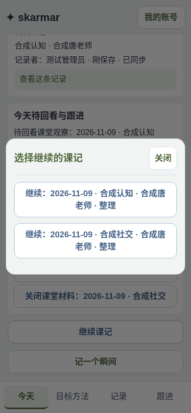
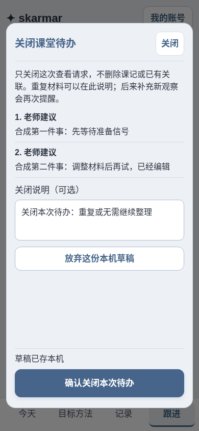
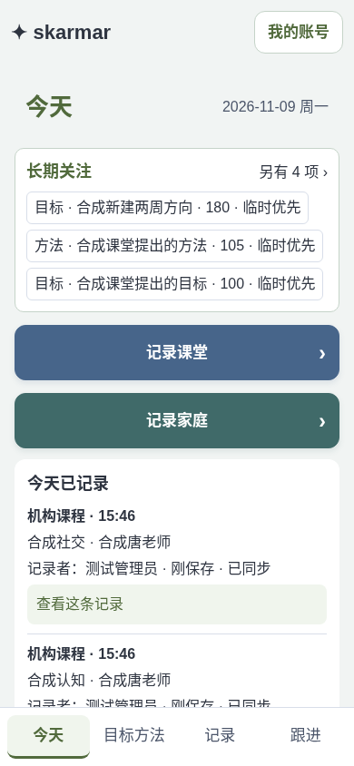

# 2026-11-09 七项迭代与发布验收

需求来源为用户本轮七项反馈；逐项实现、实际保存／刷新／跨页复核后再填写结果，并直接普通部署。保留全部正式数据、账号、旧历史和冻结引用，不复用任何清理／初始化标记。

| 编号 | 要求与验收标准 | 状态 |
| --- | --- | --- |
| U01 | 手机默认交互式关系浏览：选择目标看直接关联方法，选择方法看直接关联目标，关联节点可反复成为入口；支持返回、重新选择、空关联、关联知识，家庭计划只读 | 通过：320／390入口往返、Back／重新选择；直接关系与层级分开，计划参考不产生实际选择。图01–03。 |
| U02 | 跟进的课堂材料可明确关闭本次待办，保留课记／实际关联，新观察重新提醒；从跟进入口的组织草稿确实可放弃，刷新不复活，本机失败保留，和关闭服务端待办分清 | 通过：跟进整理草稿单项丢弃，延迟本机写入中旧输入不复活、刷新仍消失；另一草稿保留。关闭请求丢回执重放一次、保留课记／知识，新观察再次提醒。旧六项回归也验证取消／落盘失败保留。图08。 |
| U03 | 整理课堂“需要留下什么”同级提供新增目标／方法／经验／困难，目标方法正常保存后返回原整理，不自动计本课实际覆盖 | 通过：四入口同级可见，真实创建目标／方法并返回整理；API确认本课覆盖未被新建想法增加。图06。 |
| U04 | 每种课堂观察可新增、编辑、移除多条独立事项，稳定ID和顺序保存，旧整段内容不猜测拆分；例子不入值，并发／重试／来源快照保留 | 通过：真实添加两条老师建议、编辑、移除临时第三条、重开及刷新，ID稳定；旧客户端及来源冻结由Rust／双运行环境核验。图04–05。 |
| U05 | 数字优先级越大越靠前，基础分范围可设；方法按关联在用目标数加分、加分和上限可设；旧档位保留可读且不会覆盖，版本冲突和幂等保护 | 通过：0–200共享规则、每目标＋5、封顶12，方法60→72；另一家人读取一致，丢回执重放不增版，确认保存后列表503不会误报未保存；并发保护通过。图03。 |
| U06 | 今天长期关注混合长期目标和相关方法；按临时优先、有效数字优先级和新增时间排序；可开启或取消14天临时优先，届满回归原分，不改变结果／训练量 | 通过：今天类型混排，新建目标180且默认14日临时优先，可取消而不改原分；日期届满／创建时间时区／固定旧档位／基础夹取不改历史由客户端与Rust核验。图09。 |
| U07 | 今天未完成课记只有一个汇总入口，展开后按课程／日期／观察或整理选择具体草稿；两节课程、跨页、刷新及单项放弃均复核 | 通过：从UI真实录入两课，两个整理草稿只显示一个继续入口，展开可按课选择；单项丢弃不影响另一课，跨页刷新保持。图07。 |
| D01 | 普通发布原应用，确认实际激活、资源字节、匿名／来源防护、DB启动与正式代际，关闭全部维护步骤，记录回执并推送 | 待发布 |

## 实施规则

- 默认基础分范围0–100、普通50；关联每个在用目标为方法加2分，最多20分，均可调整。旧低／普通／高在显示中换算为0／50／100，不改写旧输入、原修订或冻结来源。
- 临时优先独立于基础分，交互新建默认勾选且可取消，含当天共14个家庭业务日（当天加13天）；API／导入不自动补日期。短中期目标临时优先时也进入今天关注；可在展示时开启／取消，期满不改原分。时间依据创建记录，不以最后编辑时间冒充新增。
- 关系浏览只取实际直接关系，分开显示上／下级与目标方法关联，知识按原限定路径取。继续沿用Nord、品牌及44px操作区；不调用外部绘图服务。
- 原schema v7、formal-20261101、Worker／DO／default／域名、草稿和队列键保持。新增可选JSON字段及共享设置走原持久层；不自动拆分或删除旧业务。
- Garden设计技能按Preserve定向迭代。最高风险是草稿生命周期与两种运行环境的向后读取；先用合成数据验证，不访问生产内容。

## 当前证据

从干净的`1446ad0c1f592021760c83d18cb93364c8dbaa91`开始，208项旧产物仅作基线，不作为本轮验收。本轮七项本机实现和验收已完成，普通发布待执行。

- 本轮185项Rust、94项客户端、TypeScript、Web构建、原生／Wasm Clippy及Worker release构建通过。补充旧客户端携带原items但改旧文本的3项Rust专项后重跑通过。
- SQLite与真实Rust Wasm／Durable Object完整合约及重启持久化通过：规则版本／回执／范围、创建时间、逐条观察／旧读写、冻结来源、关闭与重启提醒、认证及Excel往返均核对；不新增schema迁移。
- 12组相关浏览器通过：本轮七专项、model、lessons、workflow_updates、activity_plan、sessions、offline、draft_windows、actor_guard、formal_epoch、r15、review_1108。旧图回归显式切到仍保留的全图，新默认浏览由七专项验收，没有改应用来迎合旧选择器。
- 37项发布保护与9项示例保护通过。截图逐张检查仅合成，无真实账号／课程内容／凭据；9图和[原始检查摘要](artifacts/validation/iteration-2026-11-09/checks.json)登记后218项SHA。
- 丢弃修复以本机重建的“跟进→组织草稿→延迟删除→迟到输入→刷新”验证；没有读取用户生产会话，不能声称复现其当时浏览器。旧闭包可能继续读旧草稿的入口改为读取当前引用，并拒绝丢弃前的回调；本机丢弃与服务端待办关闭明确区分。
- 数字规则存于原prd_settings，新增JSON字段可选；旧低／普通／高固定换算，不重写历史。新建明确保存当前范围中点，改范围仅影响有效显示，避免原分随设置静默漂移。观察旧整段按一条保留，结构数组投影到原文本检索和导出；已被引用的旧来源不变。
- 未执行真机、读屏、独立Opus或生产账号业务操作；本轮不扩展AI／原生App／通知服务，不改变临床描述、实际训练量、覆盖统计或附录金标准。截图生成时deployed:false保持，不在部署后篡改。

## 合成截图

