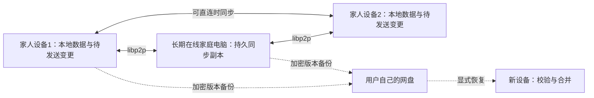

# 家庭 App：libp2p 主同步与网盘备份可行性

日期：2026-10-19，Asia/Singapore。仅家人使用，iPhone / Android 混用，主要在中国大陆。
用户提出此方向，本轮完成资料和现有代码评估，尚未实施、真机验收或替换正式架构。

## 结论

用户已补充：可以复用之前 Tailscale 出问题的长期在线电脑，作为家庭的事实中心同步节点。
该主机当前连接尚未恢复；这里确定的是设计方向，尚未确认它现在可接入。

可以把 libp2p 作为主要通信通道，网盘作为加密灾备。适合接受以下交付条件的家庭使用：
**打开 App 后尝试自动同步，后台尽力完成；尚未送达的修改保留本机，等待设备再次连通。**

网盘若仅备份，两位家人没有重叠在线时间、也没有接收过变更的第三设备时，无法自动
交换最新数据。恢复备份与日常同步是不同操作；若让另一设备自动从网盘获取变更，
网盘就额外承担了异步同步通道。

## 1. 拟议结构

libp2p 负责发现、连接和传输；应用同步层负责持久保存、对账、补传、去重和冲突。
网盘备份应保留版本，避免一次误删传播后只剩同样被误删的副本。

### 长期在线家庭电脑的职责

- 作为有持久存储的应用同步节点，收到并落盘变更后再确认，供另一位家人稍后获取。
- 手机无需彼此同时在线，只需各自有机会连接这台家庭节点。
- 保存变更日志、版本依赖与恢复所需记录；只运行 Circuit Relay 不会自动具备这些能力。
- 家庭节点暂不可达时，手机仍保留本地数据和待发送变更；可用的手机直连继续工作。
- 复用已有电脑无需另买服务器。跨网入口仍需验证：可达的 IPv6、穿透 / relay 或既有
  私有网络是候选，不能假设其他手机自动拥有 Tailscale 访问权。
- 云端开发阶段先用本地进程 / 容器模拟家庭节点，不以旧主机恢复为前置；模拟通过仍
  不等于 iPhone / Android 与真实家庭网络已验收。

## 2. 在线与交付边界

| 情况 | 预期行为 |
| --- | --- |
| 同一 Wi-Fi，双方打开 App | 尝试本地发现或已知地址连接并交换变更；仍需实测局域网隔离与系统权限 |
| 不同网络，双方可通信 | 尝试打洞直连；失败时可借可用 relay 实时转发 |
| A 先同步给 C，之后 C 再同步给 B | C 实际保存过变更时，可以完成间接传播，不要求三台同时在线 |
| 长期在线家庭电脑已收到 A 的变更，B 稍后连接 | 家庭电脑提供已持久保存的变更，双方手机无需同时在线 |
| A 与 B 从不同时在线，也无持久保存变更的 C | 修改停留在本机，等待以后连接；relay 无法替离线设备收信 |
| B 从网盘自动取得 A 先前上传的变更 | 能异步传播，但网盘承担同步功能，超出“仅备份” |

[Circuit Relay v2 规范](https://github.com/libp2p/specs/blob/master/relay/circuit-v2.md)
要求目标维持活跃 relay 连接；连接断开后 reservation 失效。relay 转接实时流，不提供
离线持久邮箱。规范允许拒绝预约、限制时长与字节数，因此不能把公共 relay 当免费永久服务保证。

## 3. 域名、发现与网络

原生 libp2p 可以使用 IP multiaddr 与 PeerId，不要求自己购买域名。
跨网发现和穿透仍需实际可达的节点：可选择已知家庭节点、会合点、引导节点或第三方 relay。
二维码配对能交换身份及初始地址，不能单独解决以后地址变化、NAT 和设备休眠。

DCUtR 通过已有 relay 连接协调打洞，不能保证所有 NAT / 防火墙都能直连。
[官方穿透说明](https://docs.libp2p.io/concepts/hole-punching)、
[Rendezvous](https://libp2p.io/docs/rendezvous/)。

无需自购服务器可以作为候选目标；可靠可用的发现 / relay 来源尚未确定。
没有完成大陆 Wi-Fi、蜂窝和跨运营商测试，不承诺零服务器费与跨网稳定性同时成立。

## 4. 当前手机技术栈的支持

当前项目为 Expo 57 / React Native 0.86。js-libp2p 官方文档有 React Native 路线，
`@libp2p/webrtc` README 明确要求安装并配置原生 `react-native-webrtc`。
这不是从浏览器 WebRTC 支持推断出来的手机支持。

依据：[React Native 接入说明](https://github.com/libp2p/js-libp2p/blob/main/doc/GETTING_STARTED.md#react-native)、
[WebRTC 原生依赖](https://github.com/libp2p/js-libp2p/blob/main/packages/transport-webrtc/README.md#react-native-installation)。

需 development build / 自己构建安装包；Expo Go 无法临时增加此原生模块。
现成社区示例使用的 Expo / RN 版本更旧，不能据此宣称本项目当前版本已经兼容。
[Expo 原生模块](https://docs.expo.dev/workflow/customizing/)、
[现成演示](https://github.com/ipfs-shipyard/js-libp2p-react-native)。

该 WebRTC transport 通常借 Circuit Relay 交换首次协商信息，直连建立后 relay 可退出数据路径。
因此不能只凭“处在同一 Wi-Fi”就断言这条具体接入路线完全不需要协调节点。
局域网完全无 relay 的连接需另外验证传输或本地协商方式。WebRTC Direct 要求目标具备可监听
地址，也不能直接当作任意 NAT 后手机间的替代方案，见上述 WebRTC README。

首个原型优先验证 js-libp2p 与原生 WebRTC。若兼容性、性能或维护性不合要求，
再比较 rust-libp2p 经 Swift / Kotlin 与 Expo Module 桥接；后者是工程组合路径，
本轮未找到针对当前项目的现成官方插件或完成构建的证据。

手机后台运行由系统调度。iPhone 用户划掉 App 后，不能依赖它继续接受 P2P 连接；
Android 也有设备厂商后台策略差异。产品应以前台同步、恢复时补传为主，
不承诺全天驻留。
[Expo 57 BackgroundTask](https://docs.expo.dev/versions/v57.0.0/sdk/background-task/)。

## 5. 数据与授权不能只交给 libp2p

当前客户端使用 HTTP API 与 Cookie，本机主要保存草稿，没有完整业务数据库和增量同步日志。
Rust `skarma-core` 可复用业务规则；单数据库内的事务与版本检查不等于多副本已经一致。

建议最小同步协议包含稳定记录 ID、设备变更 ID、版本依赖、缺失变更对账、确认与断点补传。
删除需要保留标记，避免旧设备再次上线把已删内容带回。
不同记录的新增可自动合并，同记录同时修改先保留双方版本供家人核对。

PeerId 认证设备密钥，家庭管理员另行授权设备属于哪个家庭、可读写哪些数据。
加密握手不自动生成家庭访问权限。
[libp2p 授权边界](https://docs.libp2p.io/concepts/security/security-considerations/)。

Automerge 的 Rust 同步协议可以在可靠有序流上交换消息，放在 libp2p stream 上是可评估
的实现路径，尚未验证与当前 RN 真机组合。
[Automerge 同步协议](https://automerge.org/automerge/automerge/sync/index.html)。
课程、训练与目标业务规则仍需独立判断。现有训练完成命令会同时更新训练、归档目标、
生成困难和经验；不能在每台设备简单重放并生成不同 ID。需要确定 ID 的原子事件包或
明确的业务冲突规则，不能让 CRDT 默认合并决定目标是否达成。

## 6. 网盘只备份的设计

- 各设备上传独立、不可变、带版本的加密备份包，包含本地尚未同步的变更。
- 记录数据结构版本、同步协议版本、变更摘要与删除标记；完成校验后才显示备份成功。
- 备份使用一致性数据快照，不能在运行中随意复制或让多人覆盖同一 SQLite 文件。
- 换机恢复先校验、导入临时库，再与现有设备合并；不直接覆盖期间产生的新记录。
- 恢复密钥与备份数据分别保管；新设备有独立身份，经家庭授权后加入。
- 界面区分“本机已保存”“已送达另一设备”“已备份”，不把其中一项当成另外两项。

网盘账号及 WebDAV 授权条件沿用 [基础设施调研](no-owned-infrastructure-research.md)。
仅备份模式可以先不依赖多人共享目录，但每台设备的备份位置、恢复权限及密钥仍须设计。

## 7. 建议原型与验收

只以“每日上课记录”做两个真机的原型，不立即迁移全量业务或线上数据：

1. iPhone 与 Android 配对，离线新增记录，重启后本地记录仍在。
2. 同 Wi-Fi 与 Wi-Fi / 蜂窝互通，记录直连、relay、失败与耗时，保持加密和家庭授权。
3. 断线补传、重复发送、同记录冲突、删除后旧设备再上线均不静默丢记录。
4. 锁屏、划掉 App、切换网络后正确显示待同步，并在恢复后继续。
5. 第三家庭设备接收并保存后再转交，验证间接传播。
6. 加密备份与全新设备恢复，验证备份之外尚未送达的数据边界。

这些是拟议验收，尚未执行。本轮仅确定可行路径与条件，未选择公共 relay、生成凭证、
安装原生依赖、改业务实现或发布。大陆正式分发与备案条件仍需按实际方案另行确认。
