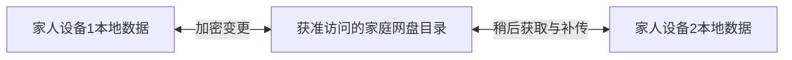

# 长期不购买自有域名与服务器的方案

调研日期：2026-10-19，Asia/Singapore。面向家庭内部共享与主要在中国大陆使用的场景。
本轮仅调研，未注册账户、开通付费资源、迁移数据或发布应用；既有暂停生产发布的要求继续有效。

后续偏好更新：用户现已倾向自有域名，当前优先入口建议见
[自有域名方案核对](cloudflare-custom-domain-options.md)。本文保留此前免自有基础设施条件下的
路线比较，不再将免域名视为当前硬约束；生产仍暂停，未实际购买或配置域名。

## 结论

可以不买域名、不采购或租用自己的服务器。以下路线分别借用托管云、用户网盘或 iCloud，
都有第三方服务依赖。需要区分：

- **不采购基础设施**：不办理域名、DNS、证书或服务器维护；可能支付托管资源费用。
- **低用量没有持续资源费**：免费配额内可能做到，但有配额、账号政策及客户端分发成本。
- **永久免费且无条件可用**：本轮没有核实到能作此承诺的方案。

用户已确认仅家人使用，老师不使用本应用；家人使用 iPhone / Android 混合设备，跨平台是必需条件。
主候选为原生 App + 网盘同步、微信小程序 + 云开发；CloudKit 仅保留作比较，不作为主路线。
成员管理按家庭管理员邀请或批准家人加入设计，不以老师账号或老师端录入为前提。
课程记录中的授课老师是业务字段，不代表该老师需要成为应用成员。
“国内服务”不等于本应用已完成大陆真实网络验收。

用户随后提出“libp2p 主同步，网盘仅备份”。其可行性与在线重叠、手机后台和 relay
边界另见 [P2P 主同步评估](libp2p-family-sync-proposal.md)；本文件中的网盘主同步仍保留作对比，
不表示已经选定或实现任一路线。

## 路线对比

| 路线 | 自有域名 / 自购服务器 | 长期成本与条件 | 适配判断 |
| --- | --- | --- | --- |
| 原生 App + 用户网盘 WebDAV | 均不需要 | 坚果云免费配额内可不付网盘费用；App 分发另计 | 最接近本地优先目标，但多人共享目录的独立授权访问尚需原型验证 |
| 微信小程序 + 微信云开发内置调用 | 均不需要 | 正式环境支付托管资源费；不能将体验环境当成长期免费生产 | 不要求用户安装独立 App，跨 iOS / Android；需小程序页面及存储适配 |
| 苹果原生 App + CloudKit 私有 / 共享数据库 | 均不需要 | 所有者 iCloud 配额；标准开发者会员 99 美元/年 | 全员苹果时有价值；Android / Web 需要另外适配，不能直接套原生同步 |
| 本地 App + 加密文件包或局域网交换 | 均不需要 | 无自建后台费；文件传递渠道仍各自有规则 | 可作备用，远程自动异步体验较弱 |
| 现有 Cloudflare / Supabase / Firebase 等免费后端 | 可使用平台地址，不用租服务器 | 免费配额、暂停策略与功能限制各异 | 没有解决目前的大陆访问验收；不能仅因有免费额度就决定搬迁 |

## 1. 原生 App + 用户自备网盘：最值得验证的低资源费路线

### 工作方式

每台手机保存自己的业务数据；App 将新增、修改、删除的加密变更包放到获准访问的网盘目录。
一位家人完成记录后可以退出，另一位家人稍后打开 App 再下载变更。双方不必同时在线。
设备间直接通信和离线文件包可以作为额外传输方式。

这是本项目拟议架构，尚未实现，不是坚果云自动提供的业务级同步。

### 已核实的坚果云能力

官方允许第三方应用通过 WebDAV 上传、下载与管理文件，并提供 iOS / Android 的应用授权入口。
免费版每月上传 1 GB、下载 3 GB；流量用完停止同步。WebDAV 免费用户每 30 分钟最多
600 次请求，目录列表单次最多 750 项，需要正确分页。

依据：[第三方授权与请求限制](https://help.jianguoyun.com/?p=2064)、[免费流量](https://help.jianguoyun.com/?p=2803)。

以文字课程记录为主的小团队有机会控制在免费范围内，这属于用量判断，不能覆盖大量照片、
视频和频繁全量下载的情况。每个参与者的具体共享权限、配额和使用条件均需核对。

### 必须先验证的门槛

1. 两个独立网盘账号能否使用各自的 WebDAV 应用授权访问同一共享目录，并符合当前套餐规则。
2. 只同步各成员获准查看的档案。网盘账号身份与应用的管理员授权分别处理。
3. 断网新增、重新连接、重复补传与换机恢复均不能丢记录或产生重复课程。
4. 同一条记录同时修改时保留双方版本；审批、目标达成和删除不能靠任意覆盖决定。
5. 撤销成员后停止分发后续数据；已下载副本不能承诺远程彻底删除，需要相应密钥与权限设计。
6. 测量真实大陆手机网络和请求量。iOS 后台执行受系统调度，按打开 App 补同步设计，
   不承诺全天实时运行。

同步使用独立的变更包和快照；运行中的 SQLite 文件不能直接由多设备覆盖同步。
[SQLite 官方网络文件使用说明](https://www.sqlite.org/useovernet.html)解释了远程文件访问与锁的风险。
现有网页登录若直接访问 WebDAV 还需确认跨域及认证支持；本方案优先针对原生客户端，
不默认新增一台代理服务器解决网页跨域。

## 2. 微信小程序 + 云开发：免基础设施采购的正式托管路线

小程序可通过 `wx.cloud.callFunction` 调用云函数，或通过 `wx.cloud.callContainer`
访问已关联环境中的云托管服务。官方明确后一方式无需在小程序后台配置服务器域名，
仅供小程序访问时可以关闭公网入口。

依据：[云函数内置调用](https://docs.cloudbase.net/recipes/add-cloud-function-wechat-miniprogram)、
[小程序访问云托管](https://docs.cloudbase.net/run/develop/access/mini)。

长期运行由平台提供数据库、存储和计算，不用自己租虚拟机。当前个人版标价为限时
19.9 元/月、每月 40,000 资源点；不是永久价格或无限资源。正式可选套餐、微信环境
适用条件、超额费用与实际总价以购买页为准。
[当前定价](https://cloudbase.net/pricing)。

后续已补充 [微信小程序成本对比](wechat-mini-program-costs.md)：区分认证、条件式年化价格、
Rust 容器与原生分发成本。下面的发布后 15 天规则来自上一轮核对；本次云端请求正式计费页
只返回 JS 校验页，未重新验证正文，不得视为本轮确认的现行规则。

尤其需要纠正“长期免费”的推断：正式计费文档将免费环境定位为开发体验，微信体验版
不适用普通控制台体验环境的半年续期规则；免费环境在小程序发布后改为上线第 15 天到期，
随后停服隔离，未转付费会销毁环境。
[正式计费文档](https://cloud.tencent.com/document/product/876/127357)。

这条路线使用微信内置调用通道，不能替换成普通默认 HTTP 地址。CloudBase 的
`*.tcloudbaseapp.com` 等默认 HTTP 域名明确限制为测试，禁止正式生产。
[默认域名限制](https://docs.cloudbase.net/service/alias)。

对现项目：小程序前端需适配；可将 Rust 服务放云托管，或将后端改为按需云函数。
容器本地 SQLite 不适合保留正式数据，需改用托管持久数据库，执行数据迁移和权限验收。
[云托管迁移要求](https://docs.cloudbase.net/run/best-practice/migration)。
小程序备案在微信平台办理，主体及类目需要实际确认；不能把原生 App 的腾讯云域名备案
表单要求直接套用到微信内置云开发通道。
[腾讯云备案路径 FAQ](https://cloud.tencent.com/document/faq/243/97691)。

## 3. 全员苹果：CloudKit

CloudKit 可把所有者私有数据库的数据分享给受邀 iCloud 用户，无需自己提供域名或运行
服务器。共享记录计入原始所有者的 iCloud 配额；普通 iCloud 提供 5 GB 免费空间，
与用户其他 iCloud 数据共用。

依据：[CloudKit 分享](https://developer.apple.com/documentation/cloudkit/sharing-cloudkit-data-with-other-icloud-users)、
[共享数据库](https://developer.apple.com/documentation/cloudkit/ckdatabase/scope/shared)、
[iCloud 配额](https://support.apple.com/zh-cn/108047)。

标准 Apple Developer Program 会员为 99 美元/年，CloudKit 官方示例要求有效会员。
因此它符合免租服务器 / 买域名，不能说开发与分发总成本为零。
[会员费用](https://developer.apple.com/help/account/membership/program-enrollment/)、
[官方示例](https://github.com/apple/sample-cloudkit-sharing)。

Apple 提供 CloudKit JS / Web Services，不能说 Android 绝对不可用；但其他平台需要
单独适配认证、共享和同步，不能直接复用苹果系统的原生自动同步体验。
[CloudKit 平台说明](https://developer.apple.com/icloud/cloudkit/)。

## 4. 为什么不将公共 P2P 中继作为长期主方案

Automerge 可用于本地优先数据合并，但其免费公共同步服务器明确是开发实验服务，没有
生产可靠性与数据安全保证；官方建议正式应用运行自己的同步服务器。
[官方说明](https://automerge.org/docs/tutorial/network-sync/)。
Syncthing 官方说明在设备同时在线时交换数据，公共中继不是替离线接收方保存记录的信箱；
iOS 也没有官方客户端。
[官方 FAQ](https://docs.syncthing.net/users/faq.html)。
因此局域网、文件包和 P2P 可以作为通道；若家人不同时在线，仍要由某个可用设备
或持久存储保存待交接的数据。

## 5. 其他免费后端的长期限制

- **现有 Cloudflare**：免费额度内可继续使用，已经免自购域名和服务器；当前 workers.dev
  的大陆访问问题仍未解决。Worker 与 DO 各自有免费限制，不能当无限资源。
  [DO 价格](https://developers.cloudflare.com/durable-objects/platform/pricing/)、
  [默认地址定位](https://developers.cloudflare.com/workers/configuration/routing/workers-dev/)。
- **Supabase Free**：默认 API 地址可用、数据库免费 500 MB，但低活跃 7 天可能暂停，
  当前恢复窗口 1 年；邮箱登录的默认 SMTP 还受生产限制。没有核实大陆稳定可达。
  [价格](https://supabase.com/pricing)、[暂停规则](https://supabase.com/docs/guides/platform/free-project-pausing)、
  [邮件限制](https://supabase.com/docs/guides/auth/auth-smtp)。
- **Firebase Spark**：Firestore 有免费存储与读写额度，并支持离线后同步；Cloud Functions
  不在 Spark 免费能力内，Cloud Storage 现要求 Blaze 付费账户。没有完成大陆可达验收，
  不将其作为本项目当前大陆访问问题的解决结论。
  [Firestore 定价](https://firebase.google.com/docs/firestore/pricing)、
  [离线同步](https://firebase.google.com/docs/firestore/manage-data/enable-offline)、
  [计划区别](https://firebase.google.com/docs/projects/billing/firebase-pricing-plans)、
  [附件存储变更](https://firebase.google.com/docs/storage/faqs-storage-changes-announced-sept-2024)。
- **Appwrite Cloud Free**：无控制台开发活动 7 天会暂停，暂停满 90 天删除；日常业务使用
  不能自动当作控制台开发活动。对长期免维护目标不占优。
  [暂停公告](https://appwrite.io/changelog/entry/2026-02-20-1)、
  [删除公告](https://appwrite.io/changelog/entry/2026-06-29)。

## 6. 本项目建议

如果希望低用量时连托管月费也省掉，优先验证 **原生 App + 用户网盘同步**，先只处理
每日上课记录；两位独立用户的授权、断网补传、冲突和换机恢复通过后再扩展。
这是下一步原型建议，本轮没有实施或验证。

如果能接受托管资源费、希望家人直接在微信中使用，优先评估 **微信小程序 +
云开发内置调用**。若确认全员苹果，再考虑 CloudKit。

本地优先和第三方网盘并不自动豁免应用发布、隐私或备案要求。原生 App 在大陆正式提供
联网服务的备案条件须按接入方式与分发渠道确认；本轮未取得“任意原生 App 无自有域名
均可通过正式备案”的结论。
[工信部 APP 备案通知](https://www.miit.gov.cn/jgsj/xgj/wjfb/art/2023/art_dd783a581c9644a4aee10afa582811db.html)。

现有线上数据保留不动；任何新路线都需要单独的数据迁移、备份和真实手机验收。
