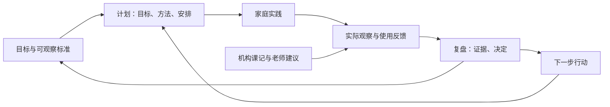
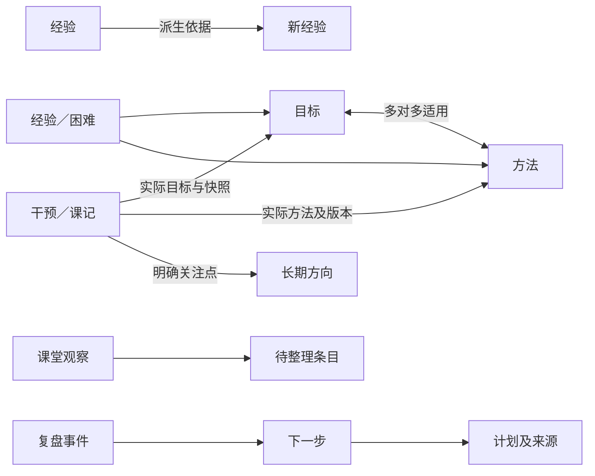

# skarmar PRD：机构课程与家庭干预的持续改进闭环

版本：0.5 实施基线；日期：2026-10-24；承接已验收的 PRD 0.4（`98c120d`），按[第三轮定案稿](prd-review-round3-2026-10-24.md)（`3899ffd`）落实最后五项裁决。前两轮依据见[第一轮](prd-review-2026-10-24.md)及[第二轮](prd-review-round2-2026-10-24.md)。

正文规定目标行为，第三轮五项设计裁决已纳入本版；实际实现进度及验收证据以 `workspace-state.json` 和交接记录为准，不以PRD条款存在推定应用已交付。进入本版前的应用实现基线为 `5eaa910`。需求编号保留 R01–R16，附录给出参数、字段文案、验收、合成数据和逐项评审处理。本版移除疾病预警及配套设计，保留干预记录与老师／医生的分享；第二轮处理记录见附录 F。

2026-10-26 用户裁决补记：新版本按未正式使用处理，开发与验收不以旧版兼容或旧数据迁移为前置任务；外部资料导入保留原文，由人确认完成状态及实际目标，采用显式映射、预览和去重。§5.1、§5.3与§8.3据此更新；R01–R16、附录A默认值、59条AC和附录D统计金标准不变。

取舍依据依次为：用户此前的明确说明、评审中记录的较新用户裁决、经核实的事实、可讨论的设计建议。评审中的缺少背景、医学归因和实现假设不能直接成为需求。家庭已在使用且观察有效的方法不退回“未尝试”；不强制为每条经验完成研究评级。此前确认的目标—方法多对多、宏观／微观经验、仅家人使用、机构与家庭分别统计、课时金额线下算及周末复盘节奏继续有效。

阅读路径：§1 目的及证据边界 → §2、§4 页面与操作 → §3、§5 数据闭环 → §6 口径与可靠性 → §7 分批实施 → §8 决定与发布前未决项。原[调研](product-discovery-2026-10-23.md)、[0.1 实现对照](prd-implementation-gap-2026-10-23.md)及评审原文作为历史资料保留；本稿的冲突修正见附录 E。

## 1. 产品目的与边界

### 1.1 要帮助家庭完成什么

帮助孩子改善影响学习、工作、社交和生活的困难，积累能力、自主性、信心与探索意愿。以兴趣和温和的成功体验支持尝试，是家庭希望打破“能力不足—受挫—不愿尝试”循环的方向，不把“缺乏内在动力”当作孩子的固定标签。

家里老人容易记清机构课程，父母能据此安排家庭干预、总结实际表现、沉淀经验、处理困难，再有计划地复盘和调整。课程节数用于线下结算，不因没有观察笔记而漏计。产品的核心价值是：**观察能影响下一次行动，复盘能留下可追溯的决定。**

家庭干预优先嵌入生活和游戏，记录有代表性的实践与观察，不要求增加专门时段，也不统计或考核每周干预时数。日常活动提供学习机会，但不能把普通陪伴时长直接换算为某种治疗剂量，或宣称可替代专业服务。具体安排结合孩子、家庭和专业建议决定；记录完整度不是家庭投入或干预效果的评分。

证据分段：利用兴趣促进参与、支持合理尝试有指南及相关干预研究支持；“成功体验—信心—主动探索—成年生活改善”的完整链条仍是长期工作假设，不能承诺因果结果。挫折韧性可通过求助、休息后再尝试等迹象观察；情绪调节相关研究不能直接证明幼儿能通过某套训练获得长期韧性。



### 1.2 发展目标与专业支持

保留用户希望孩子尽可能接近典型发展、今后更好学习生活的目的。软件以孩子自身起点、沟通、生活参与、自主能力及舒适度衡量具体进展，不制作“与 NT 差多少”的总分，不承诺统一追赶时间线。

- ASD 涉及社会沟通／互动差异及局限、重复行为或兴趣，感官与变化适应也需具体观察。“对物兴趣大于人”可能是这个孩子的表现，不是完整诊断定义。
- NICE CG170（2013 年发布；现行版本）§1.3.1 建议考虑含家长、照护者和教师参与的游戏式社交沟通干预，促进共同注意、参与和相互沟通；按发展水平调整，并提高成人理解和回应孩子的能力。同条要求由受训专业人员实施，学龄前可由家长、照护者或教师中介。AAP 2020 同样支持经过培训的家长实施干预。本产品组织家庭实践并支持专业沟通，不替代专业指导，也不把日常记录和尝试设为须经专业人员逐条批准。
- 长期方向可以是“愿意分享关注、能表达需要、参与共同活动”。看向人只是可能的观察之一，不要求持续对视。语言、手势、图片等表达均可记录。
- 既看孩子的表现，也看成人的提示、跟随与回应、任务难度、环境和孩子需要是否合适；不把所有改变责任放在孩子一方。

### 1.3 家庭实践的理解与引导

“老师建议”“家庭目前观察有效”“公开研究支持”是不同信息，可同时存在。家庭指出部分做法来自老师，但未逐项指明，不替家庭补写来源或疗效。

| 家庭表述 | 本产品采用的理解及记录要点 |
| --- | --- |
| 因果论 | 是自己的选择或行为带来的自然结果，不改写成成人额外施罚。按需记录结果是否安全、能否即时理解或提前预告、是否提供图片等支持及替代做法、之后是理解了联系还是仅感到难受；“自然结果”不是独立已证实疗法标签 |
| 兴趣、强化、温和体验 | 保留家庭已采用且观察有帮助的做法。利用兴趣支持学习是主流策略；优先让结果与活动相关，如用语言、手势表达要球后继续玩球。兴趣物也可用于支持其他学习，关注实际参与和反应，不把用户意图称为“拿兴趣当筹码” |
| 八二／七三比例 | 正／负强化不等于好／坏体验。熟悉与新任务穿插、支持合理尝试有相关实践依据；本次核对的资料不支持某个固定比例普遍最优。家庭可记录自己的做法，系统不设比例配额 |
| 用筷子的具体帮助 | 保留原描述和实际反馈，关注独立程度、帮助能否减少及孩子反应；不预置为所有家庭适用的动作限制教程 |
| 在感兴趣的活动中增加挑战 | 按下列梯度引导；目的在于支持学习和探索，不将其等同故意制造挫败 |

适度挑战的说明放在“看例子”，不变成五个必填问题：从孩子喜欢且已会的玩法建立互动；每次增加一个正在发展的小步骤，新旧穿插并回应合理尝试；提供可用的求助／休息表达方式；成人及时回应、陪伴和调整；持续哭闹、退缩、逃离、自伤或攻击时，先保障安全、暂停或降低要求。**这些表现不能单独证明“任务太难”或某种行为功能。** 韧性不等于能忍受更多失败。

## 2. 用户、权限与使用负担

| 使用者 | 主要任务 | 设计原则 |
| --- | --- | --- |
| 家里老人 | 记日期、课程和老师，有余力再写观察 | 基础课记一屏、少打字，无需理解目标和方法关系 |
| 父母 | 计划与总结、整理课堂材料、维护知识、定期复盘 | 上下文可见，下一步有出口，实际表现可比较 |
| 管理员 | 账号、删除与维护 | 不将普通编辑限于管理员 |

仅家人登录，老师只是课程字段；按任务提供“记录”和“整理”入口，不按老人／父母身份限制权限。所有有效成员可修改已完成家庭干预及其他业务记录，保留修订；物理删除仍仅管理员。评审 Q1 新确认的例外仅为**创建者当天撤销未被引用的课记**，规则见 R04；不扩展为普通成员删除或作废反馈／复盘事件。

### 2.1 可读性与手机操作

- 正文及输入框至少 16 CSS px，主按钮文字和字段标签至少 17px，辅助说明至少 14px且不独自承载必需信息。应用文字含 placeholder、导航和图例均以 4.5:1 为产品对比度底线；这是产品选择，不声称 WCAG 所有文字类别都要求相同比例。
- 账号设置提供本机“大字模式”：正文 18px，主按钮高至少 56px。基础触控目标宽高均至少 44 CSS px；日期热力格也采用 44px，避免评审“40px 格、44px 点击区”互相冲突。密集图表由整行按钮打开详情，不能制造重叠点击热区。
- 测试 360×640、430×932 CSS 视口与 200% 文本缩放，另核对 320 CSS px 下内容重排。纵向滚动允许，表单不产生横向滚动；固定操作栏不能挡输入、焦点或键盘。大字／缩放时优先可读性，不强制所有入口挤进一屏。
- 标准字号、键盘收起时，今天两个主按钮在 360×640 首屏可见。覆盖层支持读屏标题、焦点进入与返回、键盘关闭和明确“关闭”；不用颜色、悬停或手势作为唯一操作方式。
- iOS Safari 输入聚焦不应因小字号触发页面放大；不通过禁用用户缩放实现。

### 2.2 打开、登录和首次使用

提供“添加到手机桌面”说明与 skarmar 图标，不宣称安装即获得全离线能力。受信任家庭设备可主动选择约一年登录保持；采用可撤销服务器会话及安全 Cookie，不在本机保存密码。注销、管理员停用／撤销会话、关键凭据变更仍能提前使会话失效；浏览器清理存储也可能要求重新登录，不能保证一年绝不登录。

到期前显示站内续期提示；重新认证后返回原账号的表单。共享／不受信任设备不启用长期保持。缓存和草稿按账号＋空间隔离，退出后不展示给下一位用户；跨账号不得重放待上传记录。长期期限需在实现阶段做安全核对，可收紧，不新增密码长度限制。

首次记课提供可关闭的三句说明：“先选课程和老师。”“可以直接提交，也可以补充观察。”“保存成功后家人就能看到。”空列表解释用途并提供创建入口，不先强迫填长期目标才能记课。

## 3. 核心元素与关系

### 3.1 家人理解的概念

| 元素 | 回答的问题 | 内容 |
| --- | --- | --- |
| 目标 | 想发展什么、如何知道有变化？ | 名称、生活意义、长中短期、可选上级、标准与帮助条件、状态、关注节奏 |
| 方法 | 准备怎样支持目标？ | 可在计划选择、总结确认使用的具体做法；可选指导来源、适用条件、版本 |
| 经验（含想法） | 哪种做法在什么条件下可能或已经有帮助？ | 关联目标／方法、依据、使用反馈、适用范围、阶段；不必先有方法才能记宏观原则 |
| 困难 | 实际与期望有什么差距，接下来怎么办？ | 期望、观察、成人回应与情境、影响、关联、尝试、变化判断、回看安排 |
| 机构课程记录 | 哪天向哪位老师上了什么课？ | 基础信息、观察、可选整理与关联 |
| 家庭干预记录 | 本次准备做什么，实际发生什么？ | 同一 ID 的计划与总结、目标、实际方法和表现 |

复盘是操作，不增加需要维护的目录。“下一步”、反馈、观察片段等由操作自然生成，系统保存过程，家人不需要再管理一套概念。方法是可执行做法，经验是关于做法或目标的实践心得；已在用的方法可附已有帮助的经验，不为凑阶段重复录入。

活动降为可选标签，不单列活动名称、不建活动库。计划里可选择供总结预填；只对正式总结中的实际标签统计。场景／组织方式合并为折叠“补充情境”，如在哪里、和谁、材料变化、睡眠或身体情况；不保留必选“居家／一对一／小组课”及默认居家。

### 3.2 关系与来源

目标与方法多对多；经验、困难可挂多个目标或方法，正式保存至少一处明确关联。尚未整理的材料留在课记或瞬间观察中，称“未绑定”，不能凭文字猜关系。方法详情就地记心得时自动关联当前方法，并允许家人改动。

“适用关系”“计划选了”“实际用了”“观察有帮助”四件事分别保存。目标详情分直接关联与经方法关联显示知识，标注来源，按 ID 去重。解除关系不删除对象、不更改过去的目标层级或方法版本快照。来源删除后仍可保留已沉淀内容，并标“来源记录已删除”。



### 3.3 状态与复盘决定

状态与历史标签分开，不能用“逾期”当业务状态。以下为内部稳定含义，显示词见 R15。归档是独立标记，只影响默认展示和安排，不等于删除或达成。

| 对象 | 状态集合 | 决定及结果 |
| --- | --- | --- |
| 中短期目标 | 未开始、重点推进、维持、暂停、已达成 | 继续不变；调整保存新标准版本；达成需说明依据；转维持；暂停；恢复为显式选择的原有效状态；收起另改归档标记 |
| 长期方向 | 关注中、维持、暂停 | 继续、调整、维持、暂停、恢复；不提供“一次完成即达成” |
| 方法 | 使用中、暂停、停用 | 调整产生方法版本；需注意是独立标志并说明原因；暂停／停用不推荐用于新计划 |
| 经验 | 想法、可尝试、多次观察到有帮助、暂停、停用 | 家人按已有观察选择阶段；“多次观察到有帮助”限定于家庭记录的条件，不是因果证明，无自动升阶阈值 |
| 困难 | 待处理、跟进中、已解决、暂停 | 继续跟进、调整、解决、暂停、恢复；独立优先级为普通／重点。每次跟进选有改善／无变化／更困难／无法判断 |

新建中短期目标默认重点推进，长期方向默认关注中，方法默认使用中，困难默认待处理；创建时可在更多设置修改。经验阶段由家人明确选择，不根据措辞推断。保存计划不自动改目标状态，完成一条总结也不自动达成；显式选择的状态变更才产生相应事件。

修改状态须产生可追溯事件：来自正式复盘时记复盘事件；普通编辑记状态修订和原因，不把改错字虚算一次完成复盘。暂停时选择回看日期或“不排期”；暂停期间不生成常规复盘和计划建议，选择回看日期则生成一条“确认是否恢复”提醒，不自动恢复或把暂停对象当逾期。恢复、再开启和取消归档均留历史。

“停滞”仅来自可比观察与家人的变化判断；“待核对”是有待回看时的派生提示，不从缺少记录推断无进展。已达成目标可作为复习选入，但不进入重点推进建议。关键经验采用**家人手动标记关键**；详情另列最近反馈，不能把最近正面反馈自动当关键或隐藏反例。

### 3.4 系统保存的过程记录

家人不维护下列目录。共同字段为稳定 ID、空间、作者、业务日期、服务器时间、版本和来源；写入带 `operation_id`，同一次重试不得重复生成事件。

| 记录 | 产生操作及关键字段 | 唯一性／幂等及修订 |
| --- | --- | --- |
| 复盘事件 | 对象、比较期、引用证据、决定、说明、下一步、下次日期 | 操作 ID 唯一；引用一个安排 ID；修订留历史，不重算一次完成 |
| 复盘安排 | 对象、周期、锚点／手动日期、暂停、当前到期项 | 每对象一个有效安排；对象＋安排代次＋到期日去重；完成与安排下一次原子提交 |
| 下一步 | 内容、对象关联、来源事件／观察、负责人、建议日期、状态、计划 ID | 来源＋本次产出 ID 唯一；待做／已纳入计划／已完成／取消；修改带版本 |
| 经验使用反馈 | 经验、来源类型与 ID、结果、实际方法版本、条件、可选原因 | 同空间同经验同来源仅一次使用；独立记录用独立实践 ID；修订不增次数 |
| 困难跟进 | 困难、来源、尝试、观察、变化判断、条件与后续 | 同困难同来源一次跟进；无来源用独立跟进 ID；修改留历史 |
| 待整理条目 | 课记、请求人、留言、认领人、处理结果及引用 | 每课记一个当前条目；待处理／已认领／已处理；新增请求可重新打开并留历史 |
| 家庭设置 | 时区、周末日、隔周锚点、月度序次、默认参数 | 每空间一份，成员可改、带版本；显式手改日期不随设置重排 |
| 方法版本 | 做法、适用条件、指导来源、调整说明及依据 | 方法 ID＋版本唯一；旧版本不可覆写；修订生成新版本 |
| 经验派生关系 | 原经验、新经验、差异与来源 | 两端 ID＋关系类型唯一；删除关系不删除两端 |
| 计划来源 | 课记／复盘／下一步引用及提取时版本 | 计划 ID＋来源 ID 唯一；来源更新不暗改已保存计划 |
| 长期关注点 | 记录、长期方向、角色“关注”、可选观察和信号范围 | 记录类型＋ID＋方向 ID 唯一；不要求目标处理结果 |
| 瞬间观察 | 一段文字、日期、作者、可选目标与方向 | 独立 ID＋操作 ID；独立计数，不是一次干预；修订可追溯 |
| 目标测量 | 指标版本、日期、来源、条件、实际值或文字 | 来源＋目标＋测量项 ID 去重；数值修订不覆盖原版本 |
| 家人回应 | 课记、回应者、“看到了，谢谢”或处理结果引用 | 记录＋回应者去重；不增加业务次数 |
| 共享需要说明 | 沟通方式、感官需要、难受信号、帮助平静的做法、已知身体情况 | 每空间一份可选说明，成员修订留作者和版本；不推断诊断 |

下一步由家人明确保存“下一步”字段或点击“用于下次计划”生成；**不因课堂主题包含老师建议，就把整段自动转成任务**。默认负责人为填写者，可指派其他有效成员或改为家庭待认领；家庭成员可看全家的安排。纳入计划不是完成行动，总结时确认已做／还要继续；未做退回待做，继续则保留或明确建立后继行动。取消／删除未执行计划须解除其行动占用；同一待做行动不可被两个并发计划悄悄重复认领。

## 4. 页面与流程

五个底部入口保持“今天／目标／方法／记录／跟进”，标题与导航一致。设置从账号进入，不新增规划 tab。表单内详情统一用覆盖层；下文“二级查看”指覆盖层内容，不引入多层页面路由。

### R01 今天：长期方向与两个主入口

标准首屏顺序：紧凑页头和日期 → 长期方向一行 → 两个主按钮“记录上课”“家庭干预”。长期方向最多显示参数规定的名称数，超出显示“另有 N 项”，点击或下拉打开覆盖层；下拉不是唯一入口。详情先显示名称、生活意义、最近观察／参与信号，再展示关联经验和困难。首页一行不显示困难数，不展示大段宣传语或三个统计格。

家庭按钮有当天待总结计划时显示“填写今天的总结”；多个计划先选一个，同时可另建。没有时显示“记录一次家庭干预”，进入“准备去做／已经做完了”。“记一个瞬间”是次要入口，单文本＋日期／作者＋可选关联，进入相关目标观察和复盘，不计干预次数。

主入口后是今天已记录（作者、时间、刚刚记录）、一张“给我的待办”卡。卡汇总到期复盘、请查看的课记、待做下一步；我的事项醒目，其他人的只计数并可展开。复盘日卡移到主按钮下方，显示数量和“开始本周复盘”；时间估计须经试用，不预设“约十分钟”。

无长期方向时显示“先写下想长期关注的方向”；示例需明确点选后进入编辑，不自动创建。今天业务列表只列当天；跨日未提交表单用全局“继续填写”条恢复，不伪装今天记录。提醒不自动弹模态框；用户主动打开详情覆盖层仍允许，二者不混同。

### R02 干预计划：先选目标，再按需看覆盖

最短路径：日期／时段默认 → 主要练的目标 → 一句话安排 → 保存计划并退出。目标选中后的相关经验和困难必须可见，不以折叠统计为由隐藏；额外字段放“补充（可选）”。从今天页起，已有目标且无额外选择时目标是三次点击加一句话，输入次数另算。

1. 日期／时段紧凑为“今天 · 晚上 ✎”，可改；时段按家庭业务时间默认，补录其他日期时需检查时段，不把设备时区当家庭日期。
2. “这次主要练什么”：建议最多三项、每项解释原因；其后最近在练、再按层级列全部目标。可搜索、就地新建近期本领，无需离开计划；主要练／顺便练可直接交换，各自笔记跟随目标。已有达成目标时才出现“复习”。
3. 选中后展示该目标待做下一步、未解决困难、关键／可用经验和上次观察。可用覆盖层看详情；一键纳入下一步保留来源，文本可编辑。
4. “准备怎么做”：一句安排，相关方法 chips；可在当前上下文快速新增方法，不强迫先完善整套方法说明。可引用近期兴趣线索，必须带来源日期，不能声称兴趣信号必然属于所有关联目标。
5. “补充”含顺便练、复习、长期关注点、活动标签、情境。均衡总表及活动／方法分布移到“查看全部方向的近况”覆盖层，默认近30天家庭，里面才有来源、7／30／90天、层级和图表切换。

关注节奏可继承状态默认，也可明确选每周／每两周／每月／不设。重点推进继承每周、维持继承每月；暂停／归档／未开始／已达成不进入自动建议，但可手动选适当对象。显式“不设”仍可在“全部目标”按最近日期浏览，不混入比率排名。

有期望间隔的目标按“距最近一次实际记录天数 ÷ 期望天数”降序，同值按最近日期再按 ID 排序；来源默认家庭，切换机构／合计后使用相应最近记录。尚无记录时用开始关注日期作排序锚点并标“尚无记录”，不能显示伪造的最近一次；新建没有关注日期则以创建日开始。显示“比你们设定的节奏更久没记录，不表示能力落后”。每月在此按30天作提示分母，与自然月结算／月度复盘的日历算法分开。

提示新做法时，只在家人明确指定“本次开始尝试”，且本周有其他首次实际使用记录时给一次非阻断说明：“同时开始几个新做法，之后不易判断哪一个有帮助。”首次出现在数据库不等于家庭首次尝试。补充说明引用§1.3的小步挑战，不给训练时数或强化比例指标。

保存后为共享待总结计划，入口变为填写总结；仍保留从计划直接进入总结。草稿允许不完整，默认保存不替家人编写观察；“继续上次下一步”必须主动选择，不能把旧行动预填后自动重复创建。

### R03 干预总结：实际表现、方法确认、按需沉淀

有计划时复用 ID；已经做完的路径不要求补写计划。最短内容为每个实际中短期目标一句表现，旁边可折叠查看原标准和对应模板；目标处理默认继续，不自动等于达成。未实际涉及的计划目标可标“这次未做”，保留计划而不计实际覆盖；完成至少有一个实际目标。长期关注点可附带，只有可选观察，不要求处理结果。

实际方法必须明确确认：有计划方法时提供“都用上了”、逐项未用、加用了别的；也可选“本次没有使用库中方法”或“记不清”。无计划方法时同样可加选或选上述两项，不必为通过校验虚构方法。“记不清”是未记录，明确没用库中方法是已知空集合；计划选择不默认成为实际使用。确认可在总结同页完成，不增加强制长问卷。库中没有实际所用方法时，可在确认处只填名称快速新建，新方法计为本次实际使用，并继承本次明确关联的目标，做法说明以后再补；这与R02／R07计划场景的快捷新增分开实现和验收。

活动标签仅在正式总结作为实际属性保存；计划选择可见预填且可删除，提交页说明“提交表示以下为本次实际情况”。不另存标签待确认状态，也不统计计划意向；空标签只表示未分类，不等于没有干预。补充情境可空。

只新增一组可选“参与信号”：主动开始、主动表达或分享（含与人互动）、求助、受挫后再试、休息后回来再试、投入愉快、勉强或抗拒、明显不适或疲劳。不打分、不要求全填，不额外新增成人评分／情绪量表。默认是整次观察；按目标查看时只作该记录的背景，若家人明确绑定某目标或长期方向，才计作该对象信号，不能复制到每个目标。

收尾“这次还有什么想留下的？”显示相关未解决困难（默认最多三条，可展开全部），按钮为“好一些／差不多／更难了／这次没遇到”。前三项映射变化判断，最后一项保存“无法判断＋本次未观察到”，不计作R11的可比观察，不自动标困难改善或解决。已有经验提供等权“有帮助／不确定／没帮上”，再提供新增困难／经验入口。关联默认主要目标，计划内目标及实际方法在选择器前，允许多选和修改。

每次可产生0–N条新知识及对已有对象的反馈，父记录和所有产出在同一事务保存，逐项操作 ID 去重。困难描述包括成人回应；来源观察、老师原话与推测分清，不因一次使用自动提升经验阶段。修改已完成总结时更新既有产出／反馈并留修订，不重放创建或自动变更对象状态。

总结可保存共享草稿并退出；只有正式提交后计次数。提交成功回显家人本次观察的一句原文。下一步为可选，明确保存时生成可查询行动。B批前的分阶段实现只开放新建知识，不显示尚不可用的已有反馈按钮；完整目标流程按B批验收。

### R04 记录上课：基础信息即可提交

日期默认今天，提供今天／昨天／其他日期；其他日期打开单个日历。课程与老师各一个选择控件，可展开已有项、搜索并“新增”；新增成功立即选中并进入共享目录，下次能选。两个独立快捷区各最多四项：常上课程优先同星期几最近上过，再按近八周节数和最近日期；常遇老师按近八周节数、最近日期。课程不自动带出老师，无记录时不猜选择，停用项不作为新选项。

屏幕第一部分只有日期、课程和老师，老师名称与课程名称必填。页底一个主按钮“提交记录”，次按钮“补充观察”进入同一记录的可选部分；基础提交不先弹确认。最短路径为今天页→记录上课→课程→老师→提交，共四次点击，不承诺未经家庭试用的秒数。

同日同课同老师允许多节，提交前仅提示现有记录者与时间，防止误记但不阻止真实第二节。相同请求重试只保存一次。成功后滚动到成功卡“已记下：日期 · 课程 · 老师”，可“补充课堂观察”或“完成”；补充复用原 ID，不能再加一节。小链接提供修改／撤销。

撤销仅允许创建者在**服务器创建时间所属的家庭业务日**、且尚未被困难、经验、计划、下一步或其他派生事件引用时执行，补录课程日期不决定撤销期限。服务器事务中再次检查作者、日期、所有入站引用和版本；成功标记撤销并留审计，不计节数。其他成员、跨日或已被引用只可“标记记错，请管理员处理”；标记不自动从节数剔除，核对页分列待核对数量。管理员按引用规则处理，不绕过必要来源保护。尚未上传的本机记录可取消上传，不视作撤销服务器数据。

### R05 课堂观察与家人接手

观察与整理分成两个界面，所有家人均可用。记录界面不放目标、方法、规划、主副角色选择。第一块是自由文本“今天课上怎么样？”，短引导“记下看到的或老师说的”，常显“可以用输入法的话筒说话”。不建设自有录音识别、不提示粘贴老师微信、不提供照片附件；普通粘贴输入仍可用。

“想多说一点？”有四个主题，点哪个就在哪个下面展开一个输入框。短问句见附录B，详细问句与例子按需展开：

| 主题 | 展开说明及用途 |
| --- | --- |
| 老师的做法和建议 | 老师怎样帮助、提醒什么、建议回家做什么；原话用引号或明确标“老师原话”，不把家庭理解冒充原话 |
| 做得更好了／在别处也会了 | 做得更顺、帮助减少，或在不同材料／人物／生活中也出现；保留条件，不凭一次课内成功宣称掌握 |
| 感兴趣、主动尝试、和人互动的 | 什么吸引他，有无主动开始、拿给人看、指给人看、手势表达或来回游戏；无月龄达标线 |
| 遇到的困难 | 当时做什么、发生什么、大人怎样回应、后来怎样；可另填原因猜测，不能把猜测写成事实 |

全部可跳过；有内容的主题显示“已写”，可折叠但不能取消即清空，删除内容须显式操作。展开状态仅为临时界面状态，重新打开时有内容的段落可展开，不另存一套互相矛盾的主题勾选状态。主题结构替换旧四段文本，不再让老人重复写逐目标计划和表现。

“请爸爸妈妈看看”默认关，可附留言；即使无留言也能发出查看请求。父母今天待办显示请求与记录者。课记详情“整理这条记录”提供关联目标／实际方法／长期关注点、逐目标可选一句说明、转困难、补经验反馈、用于下次计划和标已处理。**这些均由家人明确操作，不根据主题或文字自动生成知识或下一步。** 原观察不因整理而被覆盖。

课记“基础与观察”“整理与关联”各自保存、各带版本；同区并发冲突需核对，跨区不相互覆盖。派生知识与整理区提交采用原子操作，引用的原观察版本固定并可见；原观察后来改变时提示父母核对，不自动重写派生内容。

待整理为待处理→已认领→已处理，显示谁认领；其他家人可接手并留记录。处理结果可为已转困难／已补经验／已用于计划／无需处理，允许多项。观察有内容但未请求查看时也可在课程列表主动整理，不给每条课记自动派任务。“看到了，谢谢”是轻量回应，不等于已整理，老人可在今天记录中看到处理结果。

### R06 目标：名称先行、标准可选

录入顺序为一句话本领名称→长期方向／近期具体本领→怎样知道有进步。近期默认短期，中期放更多设置；生活意义、上级、领域、复盘日期和期望关注频率也在更多设置。只填名称和层级即可保存，标准建议逐步补充；领域只有一个常用标签＋自定义控件，不双重录入。

观察模板为次数／机会、时长／数量、步骤／描述，也可直接写文字。短示例放空框，完整例子在“看例子”；选模板只改变提示，不生成标准值。一个标准尽量只观察一种变化；多指标分开定义。信心、好奇等仍可作为长期意义，用主动开始、求助、再次尝试等可观察迹象说明，不禁止家人表达愿望。

| 模板 | 希望看到：标准完整例子 | 实际发生：总结完整例子 |
| --- | --- | --- |
| 次数／机会 | 轮流游戏中记录每次机会需多少提醒；成人先模仿孩子，再等待回应。由家庭写适合孩子的机会数和判断条件 | 今天5次轮流机会，3次一次提醒、2次示范；我先跟随他的玩法，等他先开始 |
| 时长／数量 | 在感兴趣的绘本中，成人跟随指向并回应，记录参与多久；若帮助或任务改变应另记条件 | 一起看约4分钟；我跟着他翻页，提醒两次；换了绘本，与上次条件不同 |
| 步骤／描述 | 洗手分打开水龙头、打湿、涂皂、冲洗、擦手；成人示范需要帮助的步骤，再逐渐减少提示 | 能自己开水龙头和冲洗，涂皂需提醒；孩子着急时我暂停、陪伴后示范擦手 |

示例均为合成内容，不是治疗阈值。长期方向可附可观察迹象而不量化。目标标准、实际测量、帮助条件与指标版本分别保存；次数模板可选填机会数／做到数，分母为0不算成功率、做到数不能大于机会数。其他模板可先文字，不能从自由文本推算数值。方法目标等改变条件时，图表分段标明，不硬拼进度百分比。

列表按长中短切换，显示关联方法、经验、困难；“覆盖色阶”与“进展”分别选择，前者有日期／次数图例，后者无证据时显示待观察。详情保留记录、方法、知识、状态修订、复盘和下一步；已完成相关方法靠后，不代表删除。

### R07 方法：选择、实践和调整

方法至少有名称、做法和明确目标关联；从计划快速新增可先名称＋当前目标，具体做法按需补。可选谁示范或指导（老师／治疗师／资料／自学，允许补文字）、想改善什么和怎样观察，复用目标模板，不增加必填评级。

默认排序为手动置顶／需注意→关联未解决困难→关联超出期望间隔的在途目标→其他使用中→仅关联已达成目标；暂停／停用默认收起。排序显示原因，有困难表示检查和调整，不表示多用。只有暂停、已完成目标等时仍能搜索，不隐藏历史。

详情显示实际家庭／机构使用数、最近使用、版本、目标、“用这个方法的心得”和困难；“记一条心得”就地关联。“据此调整方法”从经验或困难生成新版本，保留来源。历史实践仍指向当时版本；只改错字也留修订，不自动产生一次新实践。

证据参考在“查看说明”静态页，不根据方法名关键词触发。内容采用§9简表，提醒循证不等于适合每个孩子、泛称感统不等于特定方案；涉及饮食限制、药物、补充剂、仪器或排毒类做法先咨询专业人员。这里不是自动禁止家庭保存方法，也不推断某次家庭做法的效果。

### R08 记录／机构课程：观察与核对分段

记录顶层为机构课程／家庭干预两个 tab。机构内默认“课堂记录”：本自然月、按课程分组，显示观察和老师建议，可整月移动。另一分段“课时核对”默认上个自然月，只有一个月份步进器，自定义区间折叠。按老师稳定 ID 汇总节数，点击看日期、课程、当时老师名与记录者；同日同课同老师两条实际课记算两节。

一条实际上过且未撤销／删除的课记算一节，没有观察和关联也算。未来课记不得正式提交；取消课程不记为已上课，不悄悄把半节或不同时长折算。待核对标记与待上传另列，待上传不计服务器正式节数。金额线下算，不加费率和支付字段。

课程／老师为独立稳定 ID 的共享目录，改名只改以后选择，历史用名称快照。完整新增／改名／停用／恢复放设置，表单选择器保留必要的“新增”快捷入口。不存在“课程类型”实体，按课程分组。停用不删除历史，不将相似名称自动合并。

关键词搜索课记观察、老师原话及明确关联的困难／经验，结果标日期、课程、老师及匹配来源，点开原记录；“只看老师建议”筛主题①，不从自由文本猜主题。通用 Excel 业务数据导出按此前明确需求保留；不另设专项课时核对导出或对账报表，对账需求出现时再评。本页按老师显示月度节数与明细的既有课时核对分段保留。

### R09 记录／家庭干预：次数与时间远近并列

保留计划／总结历史，默认本月热力月历，可整月移动。每格显示已完成次数及图例；点某天查看记录，待总结单独标识。空白是未记录，不表示没有陪伴；不做连续打卡、能力分或家长排名。手机日格点击区至少44px。

按目标视图默认近90天，每个目标一行“最近一次日期（距今）· 窗口内次数”，附13格周粒度小条；小条整体点击展开列表，不做13个狭窄按钮。宽屏才显示日粒度点图。另可看最近30次明细，不限时间跨度但必须显示实际起止日期；按同层级并列比较。

活动实际标签和实际方法分布可在二级查看；没有标签显示未分类，不影响已完成干预及目标覆盖。瞬间观察在历史和目标证据中单独标类型，不能混进干预次数或热力格。

### R10 跟进／经验：使用反馈与条件

跟进页分“要处理的”（请求查看材料、到期困难、需核对反馈）与“经验库”（按目标、方法筛选和搜索），卡片默认只读，详情再编辑。导航暂保留“跟进”，是否更名留家庭试用。

经验包括已有实践和想法。采用§3.3阶段，可直接保存家庭已有帮助的阶段及依据，不强迫从头试、不编造过去事件。“多次观察到有帮助”无自动次数门槛；依据和条件可渐进补充，来源可为老师建议、家庭实践或资料，家庭观察不是普遍疗效证明。

三个等权反馈按钮“有帮助／不确定／没帮上”，无累计点赞徽标；详情并列计数，并显示最近的相反观察与时间。没帮上可选“可能还没做到位／做到了但没有观察到变化”，允许不判断原因。前者可在复盘提出再请老师示范，不默认归咎家长。

同一来源对同一经验只计一次使用，保留修订、版本冲突和不同观察，不允许后台最后写入覆盖。成员可以修订、不能作废整条事件；误建由管理员处理，这些已确认约束继续适用。

**事件纠错与多人看法：**其他家人的看法以带作者附注保存，不改变主结果与计数；主结果更正需显式进入修订、版本核对并说明差异，统计采用最新已确认修订，保留原结果与冲突附注。记错的结果按上述修订更正；误建的整条事件由管理员处理。

改变阶段时可提示回顾同期其他变化、比较条件；不是必填因果试验，不要求为验证而撤回有益支持。派生更一般经验时保留原经验、来源与差异，新情境不自动继承有效性。依据经验调整方法时生成方法新版本。

### R11 跟进／困难：可比观察与下一步

困难可从课程／干预产生或独立新建，正式保存需关联目标或方法。提示分别写期望、发生什么、成人怎样回应和后来怎样；原因猜测独立可选。每次跟进保存尝试、观察、结构化变化判断、可选下一步和回看安排，不用最新结论覆盖历史。

比较期从上次明确调整方法／测量条件或复盘划定的起点算起，只纳入同口径、同帮助条件且经家人确认可比较的来源。至少达到参数“困难升级观察下限”，且家人判断无变化／更困难时，提示“要不要下周多留意一下”；家人确认后升重点并改每周回看。三次仅是产品提示默认，不是临床停滞标准；五次也不保证结论可靠。记录不足提示先安排观察，不阻止家人现在调整、求助或暂停。

逾期只提示可找时间回看，不推断恶化。解决困难需实际依据，可提炼经验、调整方法或暂不提炼；生成经验草稿并保留来源，由家人选择阶段，不自动验证也不一律退回未尝试。再次出现可重新开启原困难。

### R12 周末复盘：看证据、作决定、安排下一步

家庭一个共享队列，按目标聚合但按对象 ID 去重。中短期隔周；长期方向、使用中方法、可尝试／多次有帮助经验每月；普通困难隔周，重点困难每周。暂停、停用、归档及已解决困难不生成普通项；长期“维持”仍保留月度回看。手动日期优先，可暂停提醒。

默认周六、月度第一个周末，全家共用首个复盘周末为隔周锚点。下一次为**实际完成日之后**的下一个锚定日；隔周用14天相位，月度按日历的所选周末日及序次，不能按30天相加。设置变更只重排未来自动日期，手工日期和已到期项不悄悄消失；用户可批量确认重排到期项。家庭业务时区固定 Asia/Shanghai。

卡片逐项处理：顶部数量和进度→上次以来的实际次数及最近观察／困难跟进→成人做法、帮助条件与孩子表现并列→按对象提供继续／调整做法或环境／暂停／达成或解决等决定→下一步→自动算出的下次日期。卡片同时按该目标／方法只读列出比较期内明确关联的参与信号及日期和来源记录；不推断因果，不增加录入；未明确关联的整次信号不归入该对象。上次下一步作为只读参考及“沿用”按钮，不静默创建副本。主按钮“保存并下一项”，可顺延一项或整个无新证据组；顺延不是一次完成复盘。修改日期用单一控件在日历／数字输入间切换，保留此前对日期双方式的要求，不并排五组输入。

可选家长状态轻松／还行／吃力，不评分；减量、暂停、请示范或获得喘息支持都是正当决定。同期变化仅展示已记录的方法首次尝试、课程新开始标记及情境原文，不从情境文本自动抽取健康事实，首条数据只称首次记录。

可以随时退出续做；同一对象两人同时完成时事务检查版本和安排ID，后者核对现有结果，不生成两次下一期。完成区保留本周期决定及下一步，最后可选择将待做行动纳入计划。

可生成“给老师／医生的简要更新”：选时间、目标、关键观察、困难和问题，预览、删减后自行复制或下载，再由家人选择接收者发送；不自动向外发消息，不建教师账号或固定联系人。共享前明确包含哪些家庭资料。

## 5. 数据设计与实施边界

### 5.1 新基线及实体

按2026-10-26用户澄清，新设计直接以PRD新模型和独立新库为开发、验收基线，不承担旧模型或历史测试库兼容。不为旧经验类型、组织方式必填、老师更名链、旧字段兜底或旧Excel工作表格式保留产品约束，也不为满足旧迁移编号而重做已实现模型。当前实现使用 `prd_schema` 内部版本演进（现为7）；内部SQL版本组织不作为产品需求，旧001–010不属于本轮验收目标。该裁决确定开发范围，现有远端环境的发布与初始化另行实施。

| 实体组 | 必要字段与约束 | 过程模型对应 |
| --- | --- | --- |
| 目标及版本 | 生活意义、层级、上级、标准／帮助条件、模板、状态、归档、关注起点及节奏 | 状态修订、测量、复盘安排、长期关注点 |
| 方法及版本 | 做法、适用目标、指导来源、观察意图、状态、置顶／需注意及原因 | 方法版本、实际使用快照、调整依据 |
| 经验及困难 | 多目标／方法关联、阶段／优先级、影响、条件、关键标记、来源 | 经验反馈、派生关系、困难跟进、复盘事件 |
| 干预 | 计划／实际目标及角色、计划／实际方法分开、方法确认状态、实际标签、情境、参与信号、状态 | 计划来源、下一步关联、长期关注点、知识产出列表 |
| 课记 | 基础与观察段落、整理关联各带版本；目录ID＋名称快照、撤销／记错标记 | 待整理、家人回应、知识产出、长期关注点 |
| 课程／老师目录 | 稳定ID、类型、名称、启用状态、版本；名称不是主键 | 课记快照与按ID汇总；停用不删除历史 |
| 过程表 | §3.4所有过程记录及其修订表、来源、操作ID | 逐项按§3.4唯一性执行，不压成一段最新结论 |
| 家庭与可靠性 | 家庭设置、共享需要说明、会话、本机草稿／上传队列协议 | 版本门禁、操作日志、删除标记与缓存隔离 |

目标—方法关系、多目标知识关系独立存储。一次课记／干预可有多条知识产出，取消按来源唯一限制；仍以“来源＋对象＋事件类型”和操作ID防重复。方法使用快照指向明确版本；目标覆盖用记录当时层级快照，不能因后来换上级改写过去归属。状态与测量更新分别保留，不把归档当达成。

### 5.2 事件、并发与版本

父记录、知识产出、反馈、下一步及相应安排须事务保存；任何必需项失败整体回滚，不能返回“课记成功”却丢失经验。新接口使用命令／受控字段更新，省略字段不代表清空；拒绝旧API版本与明确字段更新语义是两件事，不能因去兼容而允许覆盖未编辑字段。

新客户端带API契约版本。服务端收到不兼容版本时，在写入前返回结构化“请刷新页面”；不得先执行部分写入。前端保留原输入和待上传队列，再升级／核对，不能自动刷新丢内容。API版本门禁不迁移数据库、不更新旧离线数据格式；队列跨版本须明确转换或人工核对，不盲重试。

课堂记录与整理分别使用观察版本、整理版本；修改老师课程和观察属于前一区，关系和处理状态属后一区。同区写入用版本比较，跨区独立成功；引用另一侧内容时保存其版本，后续变化只提示核对。共用删除／撤销检查读取两区当前状态并在一个事务内判断引用。

过程事件修订保留原值和修订者；普通编辑不虚增实践、反馈或完成复盘次数。成员不作废整条过程事件，管理员删除仍需确认影响与来源标记。相反观察不自动互相抵消；主结果更正与附注按R10执行，附注永不改变计数。

### 5.3 新基线与实际发布的边界

开发与验收使用隔离合成新库。旧库转换不作为本轮开发或验收的前置条件；仓库中已有的历史维护工具不因此成为必须执行的任务。实际发布仍须单独确定原Worker、DO类／绑定、default空间、域名、账号与精确来源的初始化方式，本轮不执行远端清理、转换、重设账号或替换实例。

通用Excel导出继续保留，按新实体生成有版本标识的业务数据，不承诺旧工作表完全相同；不另设专门课时核对导出。外部／腾讯工作簿导入采用已确认原则：原始字段及来源保留，稳定来源编号去重，显式选择字段与关系映射，预览确认后事务写入；家庭记录的完成状态、实际目标与表现由人确认，不从文字猜测结果。相同输入重试返回原回执，内容变化先核对而不覆盖。实际工作簿映射与对账仍需在使用时验证，不能把历史脚本直接作为新模型映射。真实数据、凭据、私密配置不进入Git或合成验收样本。

## 6. 统计、可靠性和录入规范

### R13 统一统计口径

业务日期统一Asia/Shanghai，窗口为 `[今天−N+1, 今天]`，含两端；补录不改变窗口终点。未正式完成、待上传、撤销／删除和未来日期都不计实际完成。最近一次按所选来源查询截至今天全部历史，不受当前窗口限制；未来已完成输入应被拒绝，统计层也需防御性排除。

| 指标 | 明确口径 |
| --- | --- |
| 家庭干预次数 | 不同已完成干预ID数；计划／总结草稿、瞬间观察不计；修订不新加一次 |
| 机构课程节数 | 不同正式课记ID数；无观察／目标也计一节；待核对仍计并单列，撤销不计 |
| 合计覆盖 | 家庭与机构的目标命中数相加，始终显示两分量；不是干预时数／效果折算 |
| 目标覆盖 | 一来源记录对同一目标至多一次；多目标各计。中期可统计当时下级，直接命中和下级同时出现仍按来源ID去重；展示直接／下级口径 |
| 长期关注 | 明确选择长期关注点的不同记录数；家人选取才计，不从正文猜 |
| 长期下级证据 | 按当时层级计算的下级命中来源数；与长期关注分列，不能相加成能力提升 |
| 实际方法 | 仅确认实际使用的方法，按来源类型＋记录ID＋方法ID去重；同方法多目标不重复。版本可展开，不把不同版本当多次使用 |
| 方法未记录 | 家庭“记不清”完成记录单列；明确没有库中方法为已知空集合。机构未整理方法为未记录，不能假称已知没用 |
| 活动标签 | 只计正式总结中的实际标签，单条同标签去重；多标签合计可能大于场次。无标签显示未分类，不从文字补标签 |
| 参与信号 | 展示日期、来源和明确关联范围；未选为未记录，不是未出现。全场信号是背景，不推断每个目标均出现；不作总分 |
| 经验使用 | 同经验同来源一次，三个结果并列，修订不加总量并保留原结果；他人相反看法为附注，不加使用次数、不改变分类；主结果按最新已确认修订，不能自动合并为有帮助 |
| 热力图 | 当日家庭已完成数；不用颜色代表进步、家长质量或连续打卡；格内数字可读 |
| 覆盖色阶 | 同窗口、来源、层级使用固定分档，图例写窗口，分档见附录A；筛选不改变颜色含义 |
| 目标进展 | 同一指标版本、可比条件的真实测量；无基线／不可比显示未知，不能用覆盖次数换成百分比 |
| 未覆盖／停滞 | 无记录只表示该窗口未记录；停滞需家人判断及可比证据，不因无记录自动判定 |
| 瞬间观察 | 单列数量与文本，进入复盘证据，永不计已完成干预或热力图 |

各来源范围、边界日、快照去重、改名、修订、未知方法与最近日期的金标准见附录D。两运行环境必须依据同一业务模型产出相同结果。色阶、提醒和比率是安排辅助，不是医学效果量表；零次显示“最近N天还没有记录”，不采用评审中可能把缺记录推断为缺安排的“还没安排”。

### R14 保存、共享、弱网与权限

每个表单一个保存状态：“已自动保存在这台手机”／“正在保存”／“已保存，家人可以看到”。实际响应未知时才提示核对或重试，不重现T35已修复的发送前误报。网络失败明确显示未共享、重试按钮；技术性“20秒轮询”不常驻业务页。

基础课记支持离线排队：已登录且应用此前加载成功时，用本机持久队列保存稳定ID与操作ID，显示“待上传”，联网并确认当前账号／空间后重放。只在服务器确认后计正式节数；鉴权失效、选项已停用、版本冲突或API过旧时暂停队列并保留输入。新老师／课程若尚未在线创建，必须先处理目录创建依赖，不能拿占位名称上传。页面关闭时的后台自动上传不作保证；重开联网后继续。队列和缓存不等于数据库备份。

编辑中自动刷新不得挪动手指下的列表或覆盖表单；显示“有更新，点此刷新”。初次打开可展示本账号缓存，清楚标明尚未同步。状态同步只返回当前对象、必要统计和待办，逐次反馈／复盘／修订按详情分页读取；不随事件增长全量轮询历史。聚合结果保留服务端数据版本，不能把不同同步时刻的分量拼成精确合计。

每份草稿按账号＋空间＋类型＋记录ID独立保存，不能每账号只占一个槽。全局继续条可恢复跨日期未提交内容，切tab保留编辑状态。用户主动看详情用覆盖层，关闭回原位置；“去编辑”先落本机草稿，打开子编辑，结束后明确返回原表单。

Web实现允许使用**最小的浏览器history哨兵**拦截系统返回：有覆盖层先关闭、编辑时保存草稿后回顶层，顶层才退出；不引入完整路由框架或多级详情导航栈。必须测试前进／返回、刷新重载及多次开关不积累哨兵。评审“不引入任何返回状态”与“拦截浏览器返回”不可同时成立，本稿采用这个边界；不能只实现界面关闭按钮就声称系统手势通过。

旧版请求门禁不丢草稿；409保留原输入和最新服务器版本供核对，不自动覆盖。注销或切账号须防缓存串号；所有服务端权限、版本、引用及幂等由Rust共用层校验，原生SQLite与DO一致。物理删除仅管理员，课记撤销按R04的窄例外。导出不把示例、未提交输入或临时提示当业务事实。

### R15 通用引导、控件与用词

采用三层：**常驻字段标签 → 简短常驻问句 → 空框极短示例＋可展开完整例子**。短问句原则不超过20字，placeholder约15字且在标准360px宽度下一行；放不下就移入“看例子”，不缩小字体。输入后标签、问句仍在，完整例子仍可展开。Web使用关联label与说明（如aria-describedby），RN提供对应无障碍语义。

示例和value分离：聚焦、失焦、切模板、提交空框均不保存示例；清空恢复placeholder，输入后消失。切目标时笔记跟随原目标，不能把原目标观察搬给另一个；切模板只改引导，旧内容不被覆盖。日期等真实默认值与示例不同。附录B为字段文案基线，首期代码内集中维护、家庭不可编辑；新增字段须先补矩阵，不各页面重复造文案。

控件规则：少量选项用chips或分段；7–15项显示相关项加更多，长列表用可搜索底部面板。正式老师／课程选择用单一可搜索选项面板，保留新增；快捷区只是同一个字段的快捷选择。多对多必须多选，单选不能冒充多选。数字字段调数字键盘并标单位；目标／复盘日期支持日历和手输数字切换，同一时刻只显示一种，课记快速日期按R04。

| 页面／任务 | 主操作 | 次要操作 |
| --- | --- | --- |
| 今天 | 记录上课、家庭干预（唯一双主入口例外） | 瞬间、待办、继续填写 |
| 课记 | 提交记录 | 补充观察；成功后完成／补充，不重复提交 |
| 计划 | 保存计划 | 保存后填写总结、更多 |
| 总结 | 提交总结 | 保存草稿并退出、更多 |
| 目标／方法／跟进列表 | 新建对应对象 | 筛选、搜索 |
| 目标／方法／知识编辑 | 保存 | 取消、更多 |
| 记录列表 | 记录上课或家庭干预（随当前tab） | 查看课时／导出 |
| 复盘 | 保存并下一项 | 下周再看、退出 |

长表单底部固定操作栏含主按钮与状态，处理键盘和安全区域，不能遮焦点；次要操作降低视觉权重。删除放详情底部且受权限控制。不常驻手动“刷新”主按钮；有更新／失败时仍可提供刷新和重试。

| 内部含义／旧说法 | 用户可见用词及限制 |
| --- | --- |
| 家庭训练／课前课后 | 家庭干预／计划／总结；不改写历史引文里的原话 |
| 途径、手段 | 方法 |
| 成功经验／目的原则 | 经验，允许想法和没帮上的记录 |
| 主／副目标 | 主要练／顺便练 |
| 维持／已内化 | 已经稳定，继续保持 |
| 泛化 | 在别处也会 |
| 归档 | 收起；只有已达成才附“已完成”，收起本身不等于完成 |
| 复盘／逾期 | 父母整理可说复盘；老人快速入口不出现；到期显示“可以找时间回看了（已等N天）” |
| 未覆盖／停滞 | “最近N天还没有记录”／“最近变化不明显，要不要换个做法？” |
| 优先级提高 | 要不要下周多留意一下？ |
| 未绑定／待整理 | 未明确关联的材料／已请求家人处理的课堂材料，分别使用 |

一般提醒和次数低不使用警报红橙、不做连胜计数；错误反馈可用必要的警示，但不能仅靠颜色。热力图标题为“本月已记录N次家庭干预”，不把记录数说成全部实际陪伴。

“查看说明”包含方法静态证据参考及可选共享需要说明（沟通方式、感官、难受信号、帮助平静与已知身体情况），计划／总结／课堂观察均可覆盖层打开。只记录家人明确提供的情况，不创建诊断或治疗建议。

### R16 显示名称

产品显示名统一 **skarmar**：页头、登录、Web元数据、桌面图标。域名仍`skarma.vip`，Worker、DO类／绑定、default空间、内部包名及部署资源不因显示名变化重建或替换。本次PRD采用新拼写，应用显示名仍待实施。

## 7. 分批实施与验收

本稿是实施要求，不是全部代码已完成的声明。批次是依赖顺序，能否发布新基线还取决于§5.3和§8的存储决策。每批都包含本批错误反馈、权限、幂等、手机可用性和两运行环境合约，不能把可靠性推到最后。

| 批次 | 交付范围与依赖 | 后批尚未交付时的边界 |
| --- | --- | --- |
| A0 基础 | 新基线实体与过程写入约束、核心对象基础CRUD、状态和版本、稳定目录ID、方法版本、基础导出契约、API门禁、文案／控件、可读性、覆盖层与多草稿、认证与离线队列基础 | 用合成库；不是生产自动升级；事件与行动的基础持久化、关联对象选择在此建立，避免A1依赖不存在的表或入口 |
| A1 课记与今天 | R01主入口、R04/R05及待整理最小闭环、课记分区并发、撤销、R16、记录中查看课记和基础课时列表 | 未有B批完整复盘时不显示不可执行复盘入口；整理可关联／创建知识，未交付反馈编辑不得假成功 |
| A2 计划与总结 | R02/R03、R06基础模板、实际方法及快照、长期关注、参与信号、瞬间、R13核心覆盖和金标准 | R03只开放新建知识；对已有对象反馈在B批开放；下一步基础创建／纳入已由A0支撑 |
| B 复盘与知识 | R10–R12、反馈／跟进编辑、统一日程、行动完整生命周期、结构化测量、R07完整排序和同期变化 | 反馈纠错与多人看法按R10规则验收（AC-R10-01／02） |
| C 回顾与结算 | R08搜索／分段核对／通用业务Excel导出完善、R09热力图与时间分布、R13色阶与进展、专业沟通摘要 | 基础查看在A1，丰富报表在C；不以报表形状反推未采集数据 |

每个R的独立验收见附录C，统计金标准见D。未来代码验收需要静态类型／构建及适当合约测试，SQLite与真实Rust Worker／Miniflare DO对账，移动浏览器和真机操作另记；文档内的算例通过不代表这些测试已运行。首屏高度和旧色值问题沿用0.3阶段的源码核对，不冒充用户手机实测。

产品评估看老人能否顺利记课、父母能否找到建议、能否把一次复盘决定用于下一次计划、能否回看可比较表现；记录次数和填表量本身不是孩子进展的证据。四主题／原六主题、引导词、长期方向一行和快捷老师区通过家庭试用比较，不增加远程实验平台或自动分流真实家庭数据。

## 8. 决定、明确取舍与未决项

### 8.1 已有决定继续适用

| 决定来源 | 本稿采用 |
| --- | --- |
| 此前家庭说明 | 自然结果、兴趣和温和挑战的意图；部分做法有老师建议且家庭观察有效，具体来源不臆测 |
| 此前D02–D04 | 已完成目标关联方法靠后；课时只算节数；中短期隔周、长期／方法／经验月度、重点困难每周，可改／暂停 |
| 评审D-1／D-2 | 自由文本先行＋四主题；总结只新增一组参与信号，不叠加自评或情绪量表 |
| 评审D-3／D-4 | 静态证据页，不关键词触发；NICE写作“CG170（2013 年发布；现行版本）”；据 NICE 概览页检索摘录引用2021营养评估建议；NICE §1.4 逐字原文未取得（评审环境），按§9保守引用 |
| 评审Q1／Q3 | 课记创建者当天撤销窄例外；课程老师不固定配对，不依赖微信反馈对账，不加照片 |
| 评审Q2及2026-10-26用户澄清 | 新模型与独立新库为开发验收基线，不以旧版兼容或旧数据迁移为前置；外部资料按显式映射导入，实际发布与初始化另行实施 |
| 评审Q4／Q5 | 表单内覆盖层，今天长期方向一行及两个首屏入口；仅为系统返回加最小history哨兵 |
| 评审Q6／Q7 | 专业沟通摘要由家人自选接收者，不设固定联系人（R12）；参数定值见A，三次仅产品提示默认 |
| 评审Q8／Q9 | 瞬间不计干预；受信任设备约一年会话，保留撤销及重新认证边界 |

| 评审第三轮裁决 | R-3写入R12；R-4写入R03；R-5关闭，不补入；L-1确认R10修订／附注规则；L-4保留通用Excel，不另设专项课时导出；课时核对分段保持 |

### 8.2 本稿解决的设计空白

采用分区版本处理课记并发；关键经验为家人手动标记；同源反馈只计一次，他人看法为附注，主结果按显式已确认修订；色阶按窗口固定。下一步由明确操作生成，不靠老师建议关键词自动创建。状态改变留修订，普通改错字不算复盘；暂停可有恢复确认日期。实际方法确认与可选标签区别处理；示例不能进入value。

保留目标／复盘日期的日历与数字两种方式，用切换取代重复输入；课记按快速日期设计。通用Excel导出沿用此前明确需求；不另设专项课时核对导出，对账需求出现时再评。文案使用“未记录”，不从缺记录推断没安排、没陪伴或没进步。

### 8.3 发布或试用前仍待处理

| 项目 | 当前边界与下一步 |
| --- | --- |
| 新模型发布与初始化 | 不以旧库转换为前置；实际发布时确认资源、账号及初始化步骤，本轮没有执行远端操作 |
| 实际工作簿对账 | 已确认原文留存、人工确认、显式映射、预览与去重；实际字段与关系对账在使用时验证，合成验收不替代真实工作簿验证 |
| 家庭试用 | 四主题与六主题、chip词、长期一行、跟进导航名、老师快捷区和真实操作时长尚未实测；不承诺30秒 |
| 证据未全部复核 | NICE按评审检索摘录／搜索通道及二手资料引用，NICE §1.4 逐字原文未取得（评审环境）；AAP“2025重申”及NICE“2024计划更新”不作为本稿事实，需引用时再核实 |

原生iOS／Android、语音识别／录音、游戏、AI自动分析、外部通知、libp2p、多儿童商业化与教师登录仍不在本次实施批次。系统输入法语音可直接使用，不属于自建语音能力。

## 9. 资料与证据边界

本稿核对日期2026-10-24。本轮核对评审与既有记录，来源阅读发生在前版作者会话或评审会话，按下面标注区分；没有重新做系统综述，也没有把文献数量当成独立重复验证。研究中的特定干预、年龄、专业培训、测量与实施条件不能等同家庭任意做法或本软件有效。

### 9.1 沿用的核查记录与本版引用口径

| 来源与实际阅读范围 | 核对结果及产品用途 |
| --- | --- |
| [NICE CG170建议原页][s3]；本版按评审检索摘录、搜索通道及二手资料引用，评审环境原站返回403 | CG170（2013 年发布；现行版本）。据 NICE 概览页检索摘录，页面标注“Last updated: 14 June 2021”，§1.7.9–1.7.11 含标注[2021]的进食／生长／营养评估建议。NICE §1.3.1 首句经评审检索摘录取得；专业人员实施与学龄前家长／照护者／教师中介为二手逐字转引，与[NICE摘要文章][nice-summary]一致。NICE §1.4 标题及§1.4.1内容经评审搜索核对；NICE §1.4 逐字原文未取得（指评审环境）。其中明确目标、可比测量与约定调整期针对挑战性行为，本稿推广为一般闭环是设计借鉴 |
| [AAP 2020临床报告][aap]，大学托管全文PDF，读取表9、家长中介、ABA及新疗法／家庭支持相关段落 | 支持个体可测量目标、系统记录、家庭参与、专业培训与实施质量、兴趣和选择。逐步引入新疗法有归因考虑，推广为家庭方法非阻断提示是产品判断。未独立核实2025重申，不将其写成最新修订 |
| [Rogers 2021 RCT][rogers]，Europe PMC摘要，PMID32853704 | 87名幼儿，研究人员实施15与25小时／周、两种方式，家长均有指导；四个结局未见强度或方式主效应。不能解释为所有时数等效、训练无效或专业服务可取消 |
| [WWC单一被试技术文件][wwc]，PDF有关阶段／重复／数据点段落 | 原文有多阶段重复、每阶段数据点等研究设计要求；家庭随手记录三次并不满足科研因果推断。R11的三次是家人确认的产品提示值，不能声称由WWC验证 |
| [WCAG对比度][contrast]、[重排][reflow]，原页相关正文 | placeholder在文字对比度范围；通常文字4.5:1，规范对大字等有例外。重排标准含320 CSS px及1280宽400%说明；本稿另设200%文本缩放验收，不将两者混为一条规范 |

R-1要求本版采用评审可复核的保守引用等级，故NICE按检索摘录／二手来源表述；NICE §1.4 逐字原文未取得的限制指评审环境。前版作者会话曾返回200并提取相关段落，评审会话返回403，两者不是同一次访问；本稿不把任一环境的结果说成所有环境都可复现，也不将此次调整写成此前从未取得正文。其他来源沿用0.3已记录的阅读范围，本轮未重新下载或提高等级。

### 9.2 既有研究与评审补充

| 来源与核对级别 | 能支持什么、不能支持什么 |
| --- | --- |
| [WHO ASD事实页][s1]、[CDC体征页][s2]，0.2已读；评审复核CDC | 个体差异、社会沟通及重复／局限表现。CDC页面复核日期仍2024-05-16，不能拿另一个发布时间戳改写；不按里程碑给本儿童打NT差距分 |
| [NCAEP 2020报告][ncaep]与[AFIRM][afirm]、[Hume 2021][hume]，评审全文／模块页转引 | 对自然情境、家长实施、强化、视觉支持、任务分析等类别提供证据。报告覆盖1990–2017研究；三种观察模板借鉴事件／机会、时长和任务分析，不是标准化量表 |
| [NSP2 2015副本][nsp]及[官方干预说明][nac]，评审全文与官方说明交叉核对转引 | 文献截至2012；自然教学、PRT、家长培训列Established，但分类与NCAEP不同。不存在“整个产品处于最高证据档”的结论 |
| [JASPER Kasari2010][jasper10]、[2014][jasper14]、[2015][jasper15]，评审分别全文／摘要／摘要转引 | 跟随兴趣、扩展互动、共同参与及专业指导；家长技能与家长减压是不同支持，不能以儿童进步替代照护者支持 |
| [PRT Hardan2015][prt15]、[Gengoux2019][prt19]，评审摘要转引 | 研究含家长培训及实施条件；支持合理尝试与自然强化方向，不支持固定八二／七三普遍最优 |
| ESDM研究组，评审讨论Dawson2010、Rogers2019及[Rogers2012][esdm12]摘要；[Cheng2023][cheng]摘要转引 | 有正面和未优于常规服务的结果；不能由短程方案阴性推断家长都没做到位。Cheng中家长与观察者平均效应相近，不用“家长报告一定偏高”否定家庭经验；归因与混杂仍需注意 |
| [Wetherby2014 ESI][esi]，评审摘要转引；[WHO照护者技能培训][cst]，评审正文转引 | 支持在日常活动中提供学习机会并接受指导；不据此声称自然陪伴小时可以直接满足或替代具体专业治疗剂量 |
| [Project AIM BMJ2023][aim]，0.2相关全文；[剂量荟萃分析2024][dose]，0.2摘要 | 部分干预有收益，但偏倚、泛化和不良事件监测限制解释；剂量研究未发现稳定正相关，不证明所有强度相同 |
| [EIBI／NDBI综述2025在线、2026卷期][eibi-review]，0.2相关全文；[EIBI个体数据分析2026][eibi-ipd]，0.2仅摘要 | 前者16项随机试验及9项定性研究，检索截至2023-08，部分指标有收益、确定性以低至中等为主；后者15项研究621人，检索截至2024-09，报告认知／适应收益及强度关联，但均因非随机分组有严重偏倚风险。保留支持性结果及其局限，不能只选阴性证据 |
| [中国2026版指南发布页][cn]及原扫描PDF，0.2读部分页，评审全件OCR转引 | 第2页“每周干预时间应在20小时以上”；家庭章节提出自然情境、NDBI、WHO照顾者技能培训、文字／视频记录、专业与家庭评估及调整。本轮未重新OCR全25页，不冒称全篇直接复核；与RCT剂量结果保留分歧，不替家庭设时数考核 |
| [幼儿情绪调节综述2022][emotion]、[长期PACT随访][pact]，评审／0.2摘要 | 情绪调节和成年结果证据有范围限制；不承诺“更能承受挫折”或早期训练必然带来独立就业 |
| [NDBI＋AAC综述][aac]，0.2相关全文及摘要 | 接受多种沟通表达；少量直接比较及研究差异限制普遍化，不推荐统一设备或做口语门槛 |
| [CMS ABA Toolkit2026][cms]、[TRICARE承办方页面][tri]、[NASEM2025摘要][nasem]，0.2已核查 | 没有“美国全国停止报销ABA”的依据；终止试点、建议常规保障与实际资格不同。支付政策不能单独证明疗效，也不承诺某一家庭的报销资格 |

剂量判断保留四方面：AAP引用观察性强度关联；Rogers2021的受控比较未见主效应；2024荟萃分析未见稳定剂量正相关；中国2026指南给出20小时以上建议。研究设计、对象和结局不同，不能用某一项消灭所有分歧。产品只帮助记录和复盘，专业人员与家庭确定具体强度。

静态参考页简表如下，注明年份、类别和适用范围；“证据未确立”不自动等于已证明无效。不能将泛化的家庭名称直接匹配研究方案：

| 类别 | NCAEP2020 | NSP2 2015 | 提示 |
| --- | --- | --- | --- |
| 自然情境、家长实施、强化／示范 | 有相应循证实践类别 | 自然教学／家长培训／行为干预／示范等Established | 个体化、专业示范和实际实施条件重要 |
| 功能沟通、AAC | 有相应循证类别 | 相关类别多为Emerging | AAC是辅助与替代沟通，不等同有争议的Facilitated Communication |
| 感觉相关 | 特定Ayres感觉统合方案 | 广泛感觉干预包Unestablished | 研究类别和年份不同，普通“感统课”不能直接套标签 |
| 自然结果／逻辑后果 | 无独立类别 | 无独立类别 | 不能由名称认定循证或无效，记录具体支持与反应 |

NICE（据[摘要文章PMC4316840][nice-summary]）及AAP相关段落不支持用螯合、高压氧、促胰液素治疗ASD；药物、饮食及身体问题应结合专业评估，不把治疗共存问题与治疗ASD核心特征混为一谈。参考页不根据关键词自动诊断或阻止保存，不要求家庭自行实施停药、撤回支持等试验。

产品日程、三次提示值、色阶、阶段和排序是家庭与产品设计，不是临床指南规定。没有读取孩子真实训练／健康数据，没有将资料发给外部AI。

## 附录 A：参数与默认值

以下默认值用于实现与验收；其中复盘节奏等已由用户确认，其余界面数值是本稿明确的产品取值，可在试用后版本化调整，不称为临床阈值。

| 参数 | 默认值 | 规则 |
| --- | --- | --- |
| 家庭业务时区 | Asia/Shanghai | 所有日期、撤销和窗口使用同一时区 |
| 新对象状态 | 中短期重点推进、长期关注中、方法使用中、困难待处理 | 可在创建时改；经验阶段明确选择，不自动推断 |
| 首屏长期名称／建议目标／收尾困难 | 各最多3项 | 超出可展开；不丢对象 |
| 课程／老师快捷数量与统计期 | 各4项、近8周（56天） | 仅正式课程，分别排序，不配对 |
| 计划时段 | 00–05夜间、06–11上午、12–17下午、18–23晚上 | 按家庭小时取值，可手改；只是记录标签 |
| 统计窗口 | 7／30／90天 | 默认30天家庭；目标时间分布默认90天 |
| 期望关注频率 | 每周7天／每两周14天／每月30天／不设 | 未填继承重点每周、维持每月；显式不设不进比率建议 |
| 复盘日及锚点 | 周六；首次设置当日或之后首个周六 | 月度第一个所选周末日；可选周六／周日、月内第1–4个或最后一个；下一期严格晚于完成日 |
| 复盘周期 | 中短期／普通困难14天；重点困难每周；长期／方法／经验每月 | 日历调度与期望频率30天分母分开 |
| 困难升级观察下限 | 3条可比较记录 | 5条通常信息更多但不构成证明；非求助门槛，不用于经验自动升级 |
| 7天覆盖色阶 | 0、1、2、3–4、5+ | 固定5档；写明“近7天” |
| 30天覆盖色阶 | 0、1、2–3、4–7、8+ | 同源同层级比较，不随筛选缩放 |
| 90天覆盖色阶 | 0、1–3、4–8、9–20、21+ | 自定义区间只显示数字／时间，不自动套错分档 |
| 日热力图 | 0、1、2、3+ | 固定4档，数字与颜色并列 |
| 最近明细／手机周条 | 30次／13格 | 不限时间的30次须写起止；周条裁到90天窗口，不伪称正好91天 |
| 宽屏日图断点 | 大于700 CSS px | 以下用周条和列表 |
| 复盘证据预览 | 最近3条 | 按需展开全部证据，不按预览条数判达成 |
| 课记撤销期限 | 创建当天 | 以服务器创建时间转家庭日期，不以补录上课日期判断 |
| 可信设备会话 | 最长365天，提前14天站内提示 | 可撤销、可收紧；用户主动选择，非保证永不登录 |
| 字号／热区 | 正文输入16、标签主按钮17、说明14、热区44px | 大字正文18、主按钮高56；图例及placeholder对比4.5:1 |
| 引导／短示例 | 问句不超过20字，短示例约15字 | 长例子展开；测量适配不得靠缩字体 |
| 选项控件 | ≤6直接选；7–15相关项＋更多；>15搜索面板 | 多对多用多选；课程老师始终可搜索新增 |

## 附录 B：字段级引导文案基线

标签和问句常显，表中示例仅placeholder；长例子按引用段落展开。标“条件必填”的字段只在该操作被选择时校验。选择器中的提示是空值文案，不是自动选择；真实日期默认值单独处理。纯状态、ID、作者和自动日期不伪装为需用户录入的字段。

| 字段ID | 标签／必需性 | 常驻问句 | 空框示例或空选项提示 | 完整例子／控件说明 |
| --- | --- | --- | --- | --- |
| goal.title | 本领名称／必填 | 想帮助孩子做到什么？ | 例如：自己用筷子 | 一句话能力；文本 |
| goal.level | 目标类型／必填 | 长期方向还是近期本领？ | 请选择类型 | 两按钮，中期在更多 |
| goal.meaning | 生活意义／可选 | 这会帮助哪方面生活？ | 例如：更独立地吃饭 | 愿望与测量分开 |
| goal.template | 观察方式／可选 | 怎样知道有进步？ | 直接写文字 | 三模板＋直接写；不覆盖内容 |
| goal.criteria.count | 观察标准／可选 | 看哪些机会中的表现？ | 例如：轮流时需几次提醒 | R06次数完整例子 |
| goal.criteria.duration | 观察标准／可选 | 看持续多久或做了多少？ | 例如：一起看书多久 | R06时长完整例子 |
| goal.criteria.steps | 观察标准／可选 | 哪个步骤需要什么帮助？ | 例如：涂皂需要提醒 | R06步骤完整例子 |
| goal.criteria.text | 观察标准／可选 | 希望看见什么变化？ | 例如：会主动求助 | 一个标准一种变化；写可见行为 |
| goal.parent | 上级目标／可选 | 这属于哪个方向？ | 可以不选 | 明确层级选择，不猜父子关系 |
| goal.domain | 领域／可选 | 需要标签帮助查找吗？ | 选择或自定义 | 单一标签控件 |
| goal.frequency | 关注节奏／可选 | 希望多久留意一次？ | 继承当前状态默认 | 显式不设与未填分开 |
| goal.start | 开始关注／可选 | 从哪天开始推进？ | YYYY-MM-DD | 日历／数字切换；首次进入推进状态默认当天 |
| goal.due | 目标日期／可选 | 预计何时回看目标？ | 不设截止也可以 | 不设统一发育期限 |
| method.title | 方法名称／必填 | 怎样称呼这个做法？ | 例如：示范后少提醒 | 快速创建可先名称 |
| method.steps | 具体做法／可选 | 大人具体怎样帮助？ | 例如：先跟着他的玩法 | 专业来源不作先决条件 |
| method.guidance | 示范或指导／可选 | 谁示范过这个做法？ | 老师、资料或自学 | 选项＋补充文本 |
| method.observe | 观察意图／可选 | 想改善什么，怎样观察？ | 例如：愿意再试一次 | 可引用R06模板 |
| method.scope | 适用条件／可选 | 什么时候适合使用？ | 例如：熟悉的游戏中 | 留意任务和支持条件 |
| method.caution | 需注意／条件必填 | 有什么需要先留意？ | 例如：疲劳时先休息 | 勾需注意后说明原因 |
| knowledge.title | 经验或困难名称／必填 | 想记住哪件事？ | 例如：换材料后会着急 | 经验可含想法 |
| experience.body | 做法与依据／必填 | 什么条件下有什么帮助？ | 例如：先示范更容易跟上 | 保留家庭已有实践 |
| experience.scope | 适用边界／可选 | 哪些情况还不确定？ | 例如：换场地还没试 | 不强制科学评级 |
| experience.stage | 当前阶段／必填 | 目前尝试到哪一步？ | 请选择阶段 | 不从次数自动选择 |
| difficulty.expected | 希望怎样／可选 | 原来希望发生什么？ | 例如：可以轮流玩 | 不把所有差异当问题 |
| difficulty.observation | 实际情况／必填 | 大人怎样回应，后来呢？ | 例如：换玩具后离开了 | 详例含当时任务、发生什么、成人回应与结果 |
| difficulty.hypothesis | 原因猜测／可选 | 有什么尚未确定的猜测？ | 例如：可能有些累了 | 与观察分开 |
| knowledge.links | 关联目标或方法／必填 | 这条记录适用于哪里？ | 选择目标或方法 | 多选；当前上下文优先 |
| practice.date | 日期／必填 | 哪天发生的？ | YYYY-MM-DD | 默认今天是实际值；计划可未来，完成不可未来 |
| practice.period | 时段／必填 | 大约在什么时段？ | 可修改默认时段 | 可补录；不计时数 |
| plan.targets | 本次目标／必填 | 这次主要练什么？ | 选择或新建目标 | 主、副、复习；长期另选关注 |
| plan.content | 整体安排／正式计划必填 | 准备怎样做？ | 例如：轮流拍球并求助 | 兴趣起步、小步挑战 |
| plan.methods | 准备的方法／可选 | 准备用什么做法？ | 选择或新增方法 | 多选；不计实际使用 |
| summary.observation | 实际表现／实际目标必填 | 这次发生了什么？ | 例如：示范后愿意再试 | R06对应例子，原标准可查看 |
| measure.opportunities | 机会数／可选 | 共有几次机会？ | 输入次数 | 数字键盘；与做到数成对校验 |
| measure.successes | 做到数／可选 | 其中几次达到了标准？ | 输入次数 | 不超过机会数；0机会无成功率 |
| summary.methods | 实际方法／条件必填 | 这次实际用了哪些做法？ | 选择、未用、记不清或只填名称新建 | 不默认确认计划方法；库中没有时可只填名称新建并继承本次目标 |
| summary.tags | 活动标签／可选 | 这次主要做了哪类活动？ | 可以不选 | 提交页可修改计划预填 |
| practice.context | 补充情境／可选 | 环境或身体有什么变化？ | 例如：昨晚睡得少 | 文字原样展示，不自动抽取 |
| practice.focus | 长期关注点／可选 | 顺便留意了哪个方向？ | 可选择长期方向 | 多选；不要求处理结果 |
| summary.signals | 参与信号／可选 | 这次看到了哪些表现？ | 未选表示未记录 | R03一组chips，不打分 |
| lesson.course | 课程名称／必填 | 今天上了什么课？ | 选择已有或新增 | 独立于老师 |
| lesson.teacher | 授课老师／必填 | 这节课是哪位老师？ | 选择已有或新增 | 不随课程预填 |
| lesson.free | 课堂观察／可选 | 记下看到的或老师说的 | 例如：老师示范了轮流 | 输入法语音提示常显 |
| lesson.advice | 老师做法建议／可选 | 老师怎样帮，建议了什么？ | 例如：回家换个球再试 | R05主题①详例；原话标清 |
| lesson.progress | 进步与运用／可选 | 哪里更顺，在别处也会吗？ | 例如：换老师后也会了 | R05主题② |
| lesson.interaction | 兴趣与互动／可选 | 什么吸引他，有什么互动？ | 例如：指给奶奶看小车 | R05主题③含手势等 |
| lesson.difficulty | 课上困难／可选 | 大人怎样回应，后来呢？ | 例如：暂停后又回来了 | R05主题④；原因猜测另框 |
| lesson.request | 请家人看看／可选 | 有什么想请家人留意？ | 例如：周末再一起看看 | 默认关；留言可空 |
| lesson.organize | 整理关联／可选 | 这些观察对应哪里？ | 关联目标或方法 | 整理专用，不进老人必经流程 |
| feedback.result | 使用反馈／必填 | 这次用了，感觉怎样？ | 请选择结果 | 三等权按钮；原因可不判 |
| feedback.note | 条件与说明／可选 | 有什么变化或不确定？ | 例如：需要老师再示范 | 无效原因是线索不是定论 |
| followup.change | 变化判断／必填 | 和可比较的记录相比呢？ | 有改善、无变化等 | 无法判断可选 |
| review.decision | 复盘决定／必填 | 下一步怎样调整？ | 请选择决定 | 按对象提供适当动作 |
| review.reason | 依据／条件必填 | 这个决定依据什么？ | 例如：三次都少了提醒 | 调整／达成／状态修改时说明 |
| action.content | 下一步／选择生成时必填 | 下一次具体做什么？ | 例如：请老师示范一次 | 不自动复制上次行动 |
| action.owner | 负责人／可选改 | 请谁接着处理？ | 默认填写者 | 可家庭待认领 |
| review.next_date | 下次回看／按状态 | 什么时候再看？ | 自动日期可修改 | 日历／数字切换；暂停可不排期 |
| instant.text | 记一个瞬间／必填 | 刚才看到了什么？ | 例如：主动拿书给我看 | 日期、目标可改；不计干预 |
| catalog.name | 课程／老师名称／必填 | 怎样称呼这个选项？ | 输入名称 | 新增后共享；改名保留快照 |
| revision.reason | 修订说明／变更结果必填 | 这次改了什么，为什么？ | 例如：刚才选错结果 | 不重复计一次事件 |
| family.needs | 需要与帮助／可选 | 什么信号和帮助值得记住？ | 例如：用手势表示休息 | 共享说明，可按§3.4分段 |
| auth.account | 登录账号／必填 | 使用已注册的账号 | 输入账号 | 不使用真实示例账号 |
| auth.password | 密码／必填 | 输入自己的密码 | 输入密码 | 无示例凭据，不新增12位限制 |

日期、数值、课程名等控件都保留可见标签。参数设置用附录A名称与单位，账户管理沿用既有明确字段，新增字段不得以“其他”绕过文案和可访问性核对。

## 附录 C：编号化验收清单

以下是完整实现的验收约定；逐批实际完成范围和检查结果见[实施记录](prd-implementation-2026-10-24.md)，不能把文档检查当作应用通过。SQLite／DO合约与真实手机操作需各自留证，不能互相冒充。

| 编号 | 前置／操作 | 期望断言 |
| --- | --- | --- |
| AC-R01-01 | 长期方向0／3／6个，标准360×640 | 两个主按钮无需滚动可见 |
| AC-R01-02 | 用户主动展开长期方向详情 | 详情先展示意义与最近观察 |
| AC-R01-03 | 同日两个待总结计划 | 家庭入口先选择待总结记录，不覆盖任何计划 |
| AC-R02-01 | 已有目标，使用默认日期时段 | 三次点击加一句话可保存计划 |
| AC-R02-02 | 重点9天未记，维持20天未记 | 按9/7与20/30排序，重点靠前 |
| AC-R02-03 | 目标显式不设频率／暂停 | 自动建议中不出现该目标 |
| AC-R02-04 | 目标有未解决困难及可用经验 | 选中目标即显示对应知识摘要 |
| AC-R03-01 | 已经做完路径，计划字段为空 | 填写实际目标与表现并确认方法后能提交 |
| AC-R03-02 | 方法选择记不清 | 计方法未记录，不计为已知空集合 |
| AC-R03-03 | 未选任何标签、情境或参与信号 | 不阻碍提交总结 |
| AC-R03-04 | 同一总结创建两条困难后重试 | 只保留这两条产出，不重复创建 |
| AC-R03-05 | 计划目标标本次未做 | 该目标不增加实际覆盖 |
| AC-R03-06 | 总结确认方法时，实际所用方法不在库中 | 只填名称即可新建并计为本次实际使用，新方法自动关联本次明确目标 |
| AC-R04-01 | 默认今天，常用课程和老师可见 | 今天入口到基础提交最多四次点击 |
| AC-R04-02 | 选中课程，老师尚未选择 | 老师保持未选 |
| AC-R04-03 | 基础记录已保存后补充观察 | 总节数不增加 |
| AC-R04-04 | 创建者创建当天，课记无入站引用 | 允许撤销且正式节数减少一节 |
| AC-R04-05 | 非创建者／隔日／已被引用任一成立 | 普通成员只能标记记错 |
| AC-R05-01 | 打开观察表单 | 自由文本位于四个主题之前 |
| AC-R05-02 | 主题已填后折叠再展开 | 原内容保持 |
| AC-R05-03 | 老人保存观察，父母用独立版本保存关系 | 两个不相交分区写入均成功 |
| AC-R05-04 | 同一观察区被并发修改 | 第二次写入返回可核对冲突而不覆盖 |
| AC-R05-05 | 只写老师建议，未选择生成任务 | 不自动创建下一步 |
| AC-R06-01 | 只填名称与长期／近期类型 | 可保存目标 |
| AC-R06-02 | 标准有文字后切模板 | 文字不被例子覆盖 |
| AC-R06-03 | 机会数0或做到数大于机会数 | 不显示伪造成功率 |
| AC-R07-01 | 方法详情就地记心得 | 新经验明确关联该方法 |
| AC-R07-02 | 方法从版本1修改为2 | 旧实践仍引用版本1 |
| AC-R07-03 | 方法只关联已达成目标 | 默认排在正常使用中的在途相关方法之后 |
| AC-R08-01 | 同一天同课同老师两条实际记录 | 核对计两节 |
| AC-R08-02 | 老师改名但ID不变 | 跨月按同一ID汇总 |
| AC-R08-03 | 搜索老师建议关键词 | 结果能回到有匹配主题①的原课记 |
| AC-R09-01 | 附录D的10月已完成数据 | 10/18为1、10/24为2，其余当月日为0 |
| AC-R09-02 | 360px宽目标时间分布 | 使用可展开周条，不使用狭窄逐日点击点 |
| AC-R10-01 | 同一来源另一家人补相反看法 | 附注可见而使用总数保持一 |
| AC-R10-02 | 明确修订反馈主结果并通过版本核对 | 计数移动到新分类但总量不增加 |
| AC-R10-03 | 已有家庭帮助经验补录 | 允许选择已有帮助阶段而无需虚构过去使用事件 |
| AC-R11-01 | 只有两条可比观察，判断无变化 | 不自动提示达到三条观察下限 |
| AC-R11-02 | 三条可比观察且判断无变化 | 提示可改每周回看，但不自动提高训练量 |
| AC-R12-01 | 锚点2026-10-10，隔周到期10/24，11/14补做 | 下次为2026-11-21 |
| AC-R12-02 | 同方法挂两个目标 | 复盘队列仅有该方法一项 |
| AC-R12-03 | 保存下一步后在目标下建计划 | 可查询并纳入该行动 |
| AC-R12-04 | 两个成员同时完成同一到期项 | 只生成一个下次安排 |
| AC-R12-05 | 比较期内有两条明确关联的参与信号，另有一条未关联的整次信号 | 复盘卡只读列出前两条及日期与来源，无因果表述，未关联信号不列入 |
| AC-R13-01 | 附录D全部输入 | 各窗口、来源和最近日期匹配期望值表 |
| AC-R13-02 | 仅新增瞬间I1 | 家庭已完成数和热力图不变 |
| AC-R13-03 | 记录含中期及其子目标 | 该中期按同一来源只计一次 |
| AC-R14-01 | 基础课记离线后联网重放同一请求两次 | 只产生一节正式课记 |
| AC-R14-02 | 待上传期间切换账号 | 旧账号请求不以新账号上传 |
| AC-R14-03 | 表单正编辑且收到新状态 | 当前输入与手指下列表顺序不变 |
| AC-R14-04 | 详情覆盖层打开后浏览器返回 | 只关闭覆盖层并保留表单 |
| AC-R14-05 | 跨日未提交课记后重开本账号 | 全局继续入口可恢复该草稿 |
| AC-R14-06 | 旧API版本携带写请求 | 执行前拒绝并提示升级，原输入保留 |
| AC-R15-01 | 字段空白并直接提交 | 示例不进入请求或导出 |
| AC-R15-02 | 字段已有输入 | 常驻问句与展开例子仍可读取 |
| AC-R15-03 | 200%文本缩放且键盘开启 | 操作栏不遮挡当前焦点 |
| AC-R15-04 | 标准页面的文本与点击区 | 分别按附录A尺寸及对比度测量达标 |
| AC-R16-01 | 检查页头／登录／Web元数据／桌面图标 | 产品显示名为skarmar |
| AC-R16-02 | 只做显示名改动 | Worker／DO／域名及空间标识保持原值 |

首次空库、取消保存、错误重试、用户停用和管理员引用保护均须按相关流程覆盖。

## 附录 D：合成数据与统计金标准

所有内容均为人工构造，非家庭真实记录。今天固定为2026-10-24；LG为长期方向，M1／M2为其中期子目标，S1属于M1，S2在10/10从M1改属M2，S3属于M2，S4是独立短期。每条targets为当时目标及中期快照；中期均归LG。A／B为方法ID；T1老师10/01从“测试甲”改为“测试甲新名”，T2为“测试乙”；课记中保留当时名称快照。

下列JSON是**统计契约fixture**，可由后续两运行环境适配器生成业务命令，不是假称已经是现有API可接受的格式。null方法表示未记录；[]表示已确认无库中方法。version为当前生效修订；重放／旧修订不另列成新业务记录。

```json
{
  "today": "2026-10-24",
  "records": [
    {"id": "F1","source": "family","day": "2026-09-20","status": "completed","targets": [["S1","M1"]],"methods": ["A"],"tags": ["生活自理"]},
    {"id": "F2","source": "family","day": "2026-09-30","status": "completed","targets": [["S2","M1"]],"planned_methods": ["A"],"methods": ["B"],"tags": ["阅读"]},
    {"id": "F3","source": "family","day": "2026-10-18","status": "completed","targets": [["S1","M1"],["S2","M2"]],"methods": ["B"],"tags": ["游戏","阅读"]},
    {"id": "F4","source": "family","day": "2026-10-24","status": "completed","version": 2,"targets": [["S1","M1"],["M1",null],["S3","M2"]],"planned_methods": ["A"],"methods": ["A"],"method_versions": {"A": 2},"tags": ["游戏"],"focus": ["LG"],"signals": {"LG": ["主动表达或分享"]}},
    {"id": "F5","source": "family","day": "2026-10-24","status": "draft","targets": [["S2","M2"]],"planned_methods": ["A"],"methods": null},
    {"id": "F6","source": "family","day": "2026-10-25","status": "draft","targets": [["S2","M2"]],"methods": null},
    {"id": "F7","source": "family","day": "2026-10-24","status": "completed","targets": [["S3","M2"]],"methods": null,"tags": []},
    {"id": "F8","source": "family","day": "2026-07-26","status": "completed","targets": [["S4",null]],"methods": ["A"],"tags": ["生活自理"]},
    {"id": "F9","source": "family","day": "2026-10-23","status": "deleted","targets": [["S1","M1"]],"methods": ["B"]},
    {"id": "L1","source": "lesson","day": "2026-09-30","status": "recorded","course": "C1","teacher": "T1","teacher_name": "测试甲","targets": [["S2","M1"]],"methods": ["A"]},
    {"id": "L2","source": "lesson","day": "2026-10-24","status": "recorded","course": "C1","teacher": "T1","teacher_name": "测试甲新名","targets": [["S1","M1"]],"methods": ["B"],"focus": ["LG"]},
    {"id": "L3","source": "lesson","day": "2026-10-24","status": "recorded","course": "C1","teacher": "T1","teacher_name": "测试甲新名","targets": [["S1","M1"]],"methods": ["B"]},
    {"id": "L4","source": "lesson","day": "2026-10-24","status": "recorded","course": "C2","teacher": "T2","teacher_name": "测试乙","targets": [],"methods": null},
    {"id": "L5","source": "lesson","day": "2026-10-24","status": "withdrawn","course": "C1","teacher": "T1","teacher_name": "测试甲新名","targets": [["S2","M2"]],"methods": ["A"]},
    {"id": "L6","source": "lesson","day": "2026-10-24","status": "recorded","course": "C2","teacher": "T2","teacher_name": "测试乙","marked_error": true,"targets": [["S3","M2"]],"methods": ["B"]},
    {"id": "I1","source": "moment","day": "2026-10-24","status": "recorded","targets": [["S2","M2"]],"focus": ["LG"],"methods": null}
  ]
}
```

输入与变更校验：F4曾有版本1且被重复提交，最终只按版本2计一次；F2计划A实际B；S2换上级后L1/F2仍归当时M1；L5撤销、F9删除；I1不计实践；F6为未来计划，若强改已完成则应拒绝写入而不是作为合法fixture。方法A版本变更不多算一次。

### D.1 窗口与目标覆盖

期望表中的顺序为S1／S2／S3／S4／M1／M2，中期包含当时下级并按来源记录去重。合计“记录总数”包含没有目标的L4，目标命中数可以大于或小于记录总数。

| 天数及起止 | 来源 | 正式记录总数 | S1 | S2 | S3 | S4 | M1 | M2 |
| --- | --- | --- | --- | --- | --- | --- | --- | --- |
| 7天：2026-10-18至10/24 | 家庭 | 3 | 2 | 1 | 2 | 0 | 2 | 3 |
| 7天：2026-10-18至10/24 | 机构 | 4 | 2 | 0 | 1 | 0 | 2 | 1 |
| 7天：2026-10-18至10/24 | 合计 | 7 | 4 | 1 | 3 | 0 | 4 | 4 |
| 30天：2026-09-25至10/24 | 家庭 | 4 | 2 | 2 | 2 | 0 | 3 | 3 |
| 30天：2026-09-25至10/24 | 机构 | 5 | 2 | 1 | 1 | 0 | 3 | 1 |
| 30天：2026-09-25至10/24 | 合计 | 9 | 4 | 3 | 3 | 0 | 6 | 4 |
| 90天：2026-07-27至10/24 | 家庭 | 5 | 3 | 2 | 2 | 0 | 4 | 3 |
| 90天：2026-07-27至10/24 | 机构 | 5 | 2 | 1 | 1 | 0 | 3 | 1 |
| 90天：2026-07-27至10/24 | 合计 | 10 | 5 | 3 | 3 | 0 | 7 | 4 |

最近一次不受窗口限制：

| 目标 | 家庭 | 机构 | 合计 |
| --- | --- | --- | --- |
| S1 | 10/24 | 10/24 | 10/24 |
| S2 | 10/18 | 09/30 | 10/18 |
| S3 | 10/24 | 10/24 | 10/24 |
| S4 | 07/26 | 无记录 | 07/26 |
| M1 | 10/24 | 10/24 | 10/24 |
| M2 | 10/24 | 10/24 | 10/24 |

### D.2 方法、日历、长线与结算

| 窗口 | 家庭A／B／记不清 | 机构A／B／方法未整理 | 合计A／B |
| --- | --- | --- | --- |
| 7天 | 1／1／1 | 0／3／1 | 1／4 |
| 30天 | 1／2／1 | 1／3／1 | 2／5 |
| 90天 | 2／2／1 | 1／3／1 | 3／5 |

- 10月家庭热力图：10/18＝1，10/24＝2，其他日＝0；10/23删除记录不计，10/25未来草稿不计。9月为09/20＝1、09/30＝1。
- 近7天实际标签：游戏2、阅读1、未分类1；近30天游戏2、阅读2、未分类1；近90天再加生活自理1。F3两个标签不使家庭总次数增加。
- LG明确长期关注：三个窗口均家庭1、机构1、合计2；I1另列瞬间关注1，不混进两种实践来源。LG下级证据：近7天家庭3／机构3，近30天4／4，近90天5／4；与长期关注不相加。
- 10月课时：T1＝2、T2＝2（其中1节标记待核对）；9月T1＝1且显示旧名称。L4无观察和目标仍计节数；L5撤销不计；重复同ID重试不增，L2/L3不同ID各计。
- 边界：7天含10/18；30天含09/25；90天含07/27。F8在三窗口之外，但S4最近一次仍为07/26。时间分布与Excel使用同一结果，不能因目标改上级或教师改名漂移。

## 附录 E：逐项评审核实与处理

编号对应[评审定案稿](prd-review-2026-10-24.md)，不改写原评审。“采纳”指本PRD已形成要求，“修正采纳”指吸收问题但修正假设或冲突，均不表示应用已完成。原报告共54项正文意见，其中P0-1经用户第二轮裁决作废（不在系统范围内），本表不列，现列53项；末尾实际为L-1至L-10十项，不沿用其摘要中的九项计数。

| 意见 | 处理 | 本稿落点及关键核实 |
| --- | --- | --- |
| P0-2 | 采纳 | R01、§2.1；源码确有长期卡与hero挤占入口，首屏数值需未来实测；缩放情境不强塞同屏 |
| P0-3 | 修正采纳 | R02、R13；先目标后统计，归一关注间隔；补无记录锚点和显式不设规则，缺记录不等于没练 |
| P0-4 | 采纳并消歧 | §2.1、A；源码小字号确实存在，4.5产品统一底线不冒称WCAG无例外，日格统一44px |
| P0-5 | 修正采纳 | §3.3；状态／判断／归档分开，普通状态编辑留修订但不伪装完成复盘；暂停回看不自动恢复 |
| P0-6 | 修正采纳 | §3.4、R02/R12；下一步有生命周期，老师建议须明确转任务，避免自动制造待办 |
| P1-1 | 采纳 | R15、B；保留用户空框示例要求，加常驻问句与可展开长例子；原0.2已有输入后可看例子的原则，不声称完全缺失 |
| P1-2 | 修正采纳 | R04、R12/R15；课程老师独立快捷区；课记快速日期，不删除此前确认的目标／复盘数字输入方式 |
| P1-3 | 采纳并明确 | R04；成功卡与当天撤销窄例外，创建日和引用检查写明；不改变其他数据管理员删除原则 |
| P1-4 | 采纳 | R05；自由文先行四主题，成人回应、非口语示例；用实际内容和临时折叠状态避免双重选择状态 |
| P1-5 | 采纳 | R05、§5.2；选择两部分各自版本，认领／接手可追溯；当前源码确为一条version |
| P1-6 | 采纳 | R05；系统输入法语音提示；无照片或微信专门流程，不禁普通文本粘贴 |
| P1-7 | 修正采纳 | §1.1、R01/R03；计划／事后／瞬间三入口，瞬间不计干预；日常机会不等同可替代治疗剂量 |
| P1-8 | 采纳 | R02/R03；写明最短路径，方法确认就地提供未用／记不清，不强迫虚构方法 |
| P1-9 | 采纳 | R03、§5；方法确认（含只填名称快速新建）、标签实际属性、0–N产出及去类型 |
| P1-10 | 修正采纳 | R01/R12；无自动提醒模态，但保留用户主动详情覆盖层；去未经试用的十分钟估时 |
| P1-11 | 修正采纳 | R13/R15；“还没安排”改“还没有记录”，“一起练了N次”改已记录；错误可用必要警示 |
| P1-12 | 修正采纳 | §3.3、R15；关键经验手动标记，归档不一律叫已完成；不禁历史引文正常用词 |
| P1-13 | 修正采纳 | R14；覆盖层和多草稿，最小history哨兵支持浏览器返回；不承诺无任何返回状态却拦截系统返回 |
| P1-14 | 采纳并限定 | R14；离线队列、幂等、分账号、前台重开同步、历史按需加载；不保证关闭网页后后台上传 |
| P1-15 | 采纳 | R15；主操作表、固定栏避开键盘；失败重试／有更新刷新仍可用 |
| P1-16 | 采纳 | R01/R02、§2.2；空状态和就地新建，长期示例需明确点选而非自动业务值 |
| P1-17 | 采纳 | R06、B；名称先行，可选量化；允许信心作为意义，以可观察迹象判断，三模板保留 |
| P1-18 | 修正采纳 | R12、A；共享锚点、卡片队列、照护者状态；上次行动用参考／沿用，不静默重复新建 |
| P1-19 | 采纳 | R08；默认课堂记录、月度核对、稳定ID、设置维护与选择器新增；通用Excel导出保留，不另设专项课时导出（L-4已定） |
| P1-20 | 采纳并限定 | §2.2、R14；一年可信设备会话可撤销，浏览器清数据／停用等可提前失效，重新认证恢复本账号草稿 |
| P1-21 | 采纳 | R03/R13/R12；一组信号及明确关联范围；R12只读展示明确关联信号及日期，不推断因果 |
| P1-22 | 采纳 | §3.4、§5；所有过程实体列操作、唯一性与修订，四条关系边补齐；不增加用户维护目录 |
| P1-23 | 采纳 | R03/R05/R13；0–N长期关注点，关注与下级证据分列，课记通过整理添加 |
| P1-24 | 修正采纳 | §3.1、R07/R10；方法与心得分工，但宏观经验可只挂目标，保留此前家庭已有实践 |
| P1-25 | 修正采纳 | §7；A0持久化包含行动／事件基础，A1基础列表／核对，A2核心统计，B完整事件交互，避免评审批次仍含依赖倒置 |
| P1-26 | 采纳 | A、B、C、D；参数、逐R验收与统计fixture保留；移除作废条目并补入AC-R03-06、AC-R12-05后共59条AC，均为正式验收 |
| P1-27 | 修正采纳 | §5；设计去兼容、模型新基线；上线已存在，不可跳过生产衔接或重置；API版本门禁不代替字段更新和迁移策略 |
| P1-28 | 采纳 | R10；家庭经验、阶段与三类反馈；他人看法为附注，主结果显式修订（L-1已定） |
| P1-29 | 修正采纳 | R02/R12；明确首次尝试才提示，情境展示原文，不从关键词抽健康事实，不用首次记录假称新疗法 |
| P1-30 | 修正采纳 | §1.3；温和挑战与求助信号保留；逃离／自伤不能单独证明任务太大 |
| P1-31 | 采纳 | R06/R12；三模板均含成人回应，不另加家长评分表 |
| P1-32 | 采纳，按R-1调整引证 | §1.2、§9；专业实施与家长中介同时说明，不设家庭逐条录入审批；NICE按评审检索摘录及二手资料引用，NICE §1.4 逐字原文未取得（评审环境） |
| P2-1 | 修正采纳 | R11、A；三次可比记录为产品提示值，WWC设计要求不可偷换成家庭疗效验证，不阻止提前求助 |
| P2-2 | 采纳 | R13、D；含端点窗口、按来源最近日期、记不清与已知空集合分开 |
| P2-3 | 修正采纳 | R09；手机周条整体可点，日格44px，避免13格各44px挤不下手机 |
| P2-4 | 采纳 | R15、B；选项数量和数字键盘、多选规则；日期保留必要手输切换 |
| P2-5 | 采纳 | R10；处理／经验库分区，导航名暂不新增争论，待家庭试用 |
| P2-6 | 采纳 | R08；建议主题与来源搜索，不猜全文语义 |
| P2-7 | 采纳 | R05、§3.4；看到了与已处理分开，不做积分 |
| P2-8 | 采纳 | R06/R03、B；原标准、模板问句和可选数值，期望与实际严格分离 |
| P2-9 | 采纳 | §1.3；不强制固定比例，不抹去家庭当前有帮助的做法 |
| P2-10 | 修正采纳 | §1.1/1.3；兴趣支持与具体效果分开，不把兴趣使用本身风险化；不限制为口语表达才能取得物品 |
| P2-11 | 采纳 | §1.3；自然结果的理解、安全、支持及替代方式，注明非独立疗法类别 |
| P2-12 | 采纳并限定 | R07、§9；静态年份／类别参考，不关键词匹配，不将AAC与Facilitated Communication混同 |
| P2-13 | 采纳 | §3.4、R15；全家可选需要说明，不作诊断推测，覆盖层可读 |
| P2-14 | 修正采纳 | §1.1、§9；保留好奇与韧性目标，情绪调节研究不等于长期韧性承诺 |
| P2-15 | 采纳，按R-1调整引证 | §9；CDC复核日期保留；据 NICE 概览页检索摘录引用2021营养评估建议；美国来源与中国OCR转引分开，不称系统最高证据档；R-5已关闭，不补入 |
| P2-16 | 采纳 | R12；可预览删减的专业更新，由家人自行选对象发送，无教师登录或自动消息 |

遗留项处理：L-1按用户第三轮裁决确认R10规则；L-2生产衔接、L-3导入映射仍列§8；L-4保留通用Excel，不另设专项课时导出；L-5时长与L-6可用性待家庭试用；L-7额外参与字段本批不加；L-8随第二轮范围决定取消；L-9分区版本／手动关键经验／窗口色阶已定；L-10按R-1采用保守引用，NICE §1.4 逐字原文未取得指评审环境，其余未核实的更新状态不写作事实。R-3／R-4已定案，R-5已关闭。

0.3阶段静态源码核查确认：`App.tsx`首页长卡／hero与重复提醒、小字号，`controls.web.tsx`重复日期框，`lessons.rs`课记单版本，001／010来源唯一约束，008目录按名称主键，`save_session`活动／组织方式非空，及状态枚举／当前全量state读取。该次核查仅验证评审事实基础；本次没有修改这些代码或运行应用测试。

## 附录 F：第二轮核实与整改

来源为[第二轮定案稿](prd-review-round2-2026-10-24.md)，其用户裁决优先于[裁决前验收明细](prd-review-2026-10-24/round2-verify.md)中的建议。本轮只处理文档范围和状态，不重新设计已通过的界面、统计和家庭实践原则。

| 第二轮编号 | 处理结果 |
| --- | --- |
| R-1 | 按D-4采用NICE检索摘录／二手资料的保守引用口径；明确原文未取得指评审环境，不将另一会话的403倒推为前版作者没有读取正文 |
| R-2 | 原P0-1整项及指定三处医学信号解读退出本系统；字段、流程、实体、验收、批次条件及交叉引用同步移除；保留R12家人自选对象分享记录 |
| R-3 | 已采纳：按第三轮裁决写入R12，补AC-R12-05 |
| R-4 | 已采纳：按第三轮裁决写入R03与附录B，补AC-R03-06 |
| R-5 | 已关闭：不补入；§1.2现有引用足够 |
| R-6／L-1 | 已定案：第三轮确认R10修订／附注规则，AC-R10-01／02转正式验收 |
| R-7／L-4 | 已定案：通用Excel业务导出保留，不另设专项课时导出；保留R08老师月度节数与明细分段 |
| R-8 | 三条可比观察仅用于R11困难升级提示；R10经验阶段无自动升阶门槛；本轮无需改数值 |

第三轮裁决落地后：R01–R16编号不变，第一轮有效意见53项，字段文案63项，验收59条（均为正式），统计fixture仍为原16条合成记录。附录D及其期望值保持原样，第一轮已通过的家庭实践解释、温和挑战、输入引导、日期双方式、共享版本及统计口径保留。第三轮五项裁决已落地；余下生产转换、导入映射、家庭试用及证据边界见§8.3。产品验证任务详见[第三轮定案稿第三部分](prd-review-round3-2026-10-24.md)。

[s1]: https://www.who.int/news-room/fact-sheets/detail/autism-spectrum-disorders
[s2]: https://www.cdc.gov/autism/signs-symptoms/index.html
[s3]: https://www.nice.org.uk/guidance/cg170/chapter/1-recommendations
[aap]: https://depts.washington.edu/dbpeds/ID.Eval.Mgt.Children.ASD(AAP.2020).pdf
[rogers]: https://pmc.ncbi.nlm.nih.gov/articles/PMC8057785/
[wwc]: https://ies.ed.gov/ncee/wwc/Docs/ReferenceResources/wwc_scd.pdf
[contrast]: https://www.w3.org/WAI/WCAG22/Understanding/contrast-minimum.html
[reflow]: https://www.w3.org/WAI/WCAG22/Understanding/reflow.html
[ncaep]: https://ncaep.fpg.unc.edu/wp-content/uploads/EBP-Report-2020.pdf
[afirm]: https://afirm.fpg.unc.edu/afirm-modules/
[hume]: https://pmc.ncbi.nlm.nih.gov/articles/PMC8510990/
[nsp]: https://www.autismdiagnostics.com/assets/Resources/NSP2.pdf
[nac]: https://nationalautismcenter.org/autism/autism-interventions/
[jasper10]: https://pmc.ncbi.nlm.nih.gov/articles/PMC2922697/
[jasper14]: https://pmc.ncbi.nlm.nih.gov/articles/PMC4531276/
[jasper15]: https://pmc.ncbi.nlm.nih.gov/articles/PMC4755315/
[prt15]: https://doi.org/10.1111/jcpp.12354
[prt19]: https://pmc.ncbi.nlm.nih.gov/articles/PMC6856784/
[esdm12]: https://pmc.ncbi.nlm.nih.gov/articles/PMC3487718/
[cheng]: https://pmc.ncbi.nlm.nih.gov/articles/PMC10539413/
[esi]: https://pmc.ncbi.nlm.nih.gov/articles/PMC4243066/
[cst]: https://www.who.int/teams/mental-health-and-substance-use/treatment-care/who-caregivers-skills-training-for-families-of-children-with-developmental-delays-and-disorders
[aim]: https://pmc.ncbi.nlm.nih.gov/articles/PMC10644209/
[dose]: https://pmc.ncbi.nlm.nih.gov/articles/PMC11197026/
[eibi-review]: https://pmc.ncbi.nlm.nih.gov/articles/PMC12849440/
[eibi-ipd]: https://pubmed.ncbi.nlm.nih.gov/41502379/
[cn]: https://wsjkw.nx.gov.cn/zfxxgk_279/zcfg/202609/t20260928_5358927.html
[emotion]: https://pmc.ncbi.nlm.nih.gov/articles/PMC9544248/
[pact]: https://pmc.ncbi.nlm.nih.gov/articles/PMC5121131/
[aac]: https://pmc.ncbi.nlm.nih.gov/articles/PMC12208088/
[cms]: https://www.medicaid.gov/medicaid/downloads/autism-services-aba-toolkit.pdf
[tri]: https://tricare.triwest.com/en/provider/autism-care-demonstration/
[nasem]: https://nap.nationalacademies.org/resource/29139/Highlights_Comprehensive_Autism_Care.pdf
[nice-summary]: https://pmc.ncbi.nlm.nih.gov/articles/PMC4316840/
