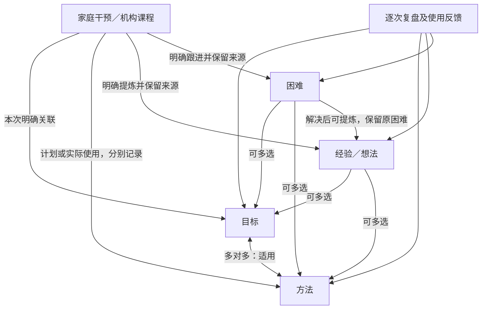

# skarmar PRD：机构课程与家庭干预的持续改进闭环

版本：0.2 家庭反馈修订稿，待评审；日期：2026-10-23；承接 T39 初稿。

用户提供的是框架和想法，不是正式 PRD。本稿由[必要调研与方案比较](product-discovery-2026-10-23.md)形成，并结合后续证据核查与家庭反馈修订。**它是供评审的完整产品提案，不是对用户每句话逐条承诺实现，也不是已经通过评审的需求基线。** [实现对照](prd-implementation-gap-2026-10-23.md)保留0.1时的核查结果；本次按用户要求只更新本文件，0.2新增项及静态实现边界见第7节。

阅读顺序：先看本稿第 1、3 节的目的和精简概念，再看 R05 课堂观察、R06 目标模板、R15 通用录入引导；决定状态见第8节，原调研与补充研究的证据边界见第9节。保留 R01–R14，新增 R15–R16。用户已授权本轮 PRD 修订与推送，不代表这些功能已经实现或允许本轮发布应用。

输入分级：用户明确的目的、家庭实践反馈和已接受的设计方向分别记录；代码及历史验收描述现状；其余阈值与交互细节仍是设计建议。0.2 修正了将家庭已在使用的方法一概称为待验证想法的表述：用户说明其中部分来自机构老师，目前观察有效。具体是哪几项、适用条件及效果依据尚未逐项提供，不替用户补写。

本版变化：补充兴趣—成功体验—信心—探索的方向；四个核心对象＋两类记录；活动标签和情境按需补充；三种观察模板；围绕整体发展目标的课堂观察；所有业务表单的示例提示；显示名称统一为 skarmar。本文件同时说明相关实现缺口、历史兼容和后续验收要求；其他文档及任务快照保持原样。

## 1. 产品目的与边界

### 1.1 要帮助家庭完成什么

通过适合孩子的支持、兴趣和温和的成功体验，帮助孩子积累能力、建立信心，逐渐愿意尝试、保持好奇并探索世界，支持今后的学习、工作和生活。家庭希望打破“能力不足、尝试受挫、不愿学习新事物”的循环；这是需要观察和调整的家庭工作假设，不给孩子贴上固定的“缺乏内在动力”标签。

让老人容易记下机构课程，让父母能据此制定家庭干预计划、记录实际尝试、发现问题、积累经验，并在固定时间调整目标和方法。除了是否完成任务，也关注是否主动开始、愿意求助、获得支持后再次尝试，以及能否将所学用于生活；这些是可选观察，不增加一组必填评分。课程结算是机构记录的独立用途，不能因为没有观察笔记而漏记课时。

产品的核心价值是：**每次观察能影响下一次行动，每次复盘能留下可追溯的决定。**

### 1.2 发展目标的表述建议

保留用户“改善核心困难、提升各方面能力、减少今后社交学习生活挑战”的目的。产品以孩子自身起点、生活参与、沟通、自主能力和舒适度为主要参照，典型发展里程碑可帮助家长与专业人员讨论支持需要，不制作“离 NT 还差多少”的总分，也不承诺赶上某条统一时间线。

根据本次实际读取的 [WHO][s1]、[CDC][s2] 和 [NICE][s3]：

- ASD 主要涉及社会沟通／互动的差异或困难，以及局限、重复的行为或兴趣；感官反应、变化适应等也值得记录。“对物兴趣大于人”可以是这个孩子的具体观察，不能替代对 ASD 的完整描述。
- 能力与支持需要因人而异，也会随时间变化。注意力困难可能需要结合任务、环境、睡眠、身体不适或共存问题理解，不把“走神”一律归因为 ASD，更不能直接认定某项困难必然终身不变。
- NICE 提及共同注意、参与、相互沟通，以及按发展水平调整的游戏和照护者参与策略。因此长期目标建议写为“愿意分享关注、能表达需要、能参与共同活动”，把“看向人”作为可能的观察之一，而非强制盯眼或单纯追求坐得久。
- 记录不只问“孩子有没有做到”，也问“成人的提示、任务难度、环境与孩子需要是否合适”。困难可能要求调整成人做法或环境。

这几项是基于资料的**产品设计建议**，不是为这个孩子制定的诊疗方案。具体目标和方法由家庭结合专业建议选择。

### 1.3 对用户所举方法／经验的处理

尊重孩子的个体差异，也保留老师建议和家庭实际观察的价值。以下按用户最新说明修订理解；“家庭目前观察有效”“来自老师建议”“有公开研究支持”是不同信息，可以同时存在，不能互相替代。来源与依据可在方法／经验中按需补充，不要求录入前先完成证据评级。

| 例子与最新理解 | PRD 中的处理 |
| --- | --- |
| “因果论”：理解、承受自己的选择或行为带来的自然结果 | 写清选择、自然结果、成人支持和孩子反应；不将“自然结果”改写成成人额外施加惩罚，也不将它单独视作已验证疗法 |
| 利用感兴趣的事物支持学习，以温和愉快的体验积累成功 | 可以保存已采用的方法、老师建议及家庭观察到的帮助，不统一降为未尝试假设。正／负强化术语与好／坏体验分开；八二／七三比例不成为系统推荐配额 |
| 用筷子时的具体辅助做法 | 保留用户描述及实际反馈，具体来源由家庭补充。复盘时留意独立程度、支持是否可减少和孩子反应；不预置为所有家庭适用的动作限制教程 |
| 在感兴趣的目标途中安排适度挑战 | 目标是让孩子在可获得帮助、体验温和的过程中克服困难、学到新技能。记录什么吸引他、挑战是什么、怎样支持、是否愿意继续；不将用户意图等同于故意制造挫败 |

经验库服务于“在什么条件下对这个孩子有帮助”。尚未尝试的才标为想法；已经尝试的保留实际结果和适用条件，后续复盘可补充、修正或暂停。家庭观察是有价值的决策资料，但不包装成对所有孩子适用的疗效证明。涉及安全、基本需要或持续明显不适时，应调整支持并结合专业意见，不靠增加训练量处理。

## 2. 用户、权限与使用负担

| 使用者 | 首要任务 | 设计要求 |
| --- | --- | --- |
| 家里老人 | 带孩子上课；记清日期、课程和老师；有余力时补充观察 | 基础记录尽量一屏完成；少填字、大按钮；不要求先懂目标层级、方法或 PDCA |
| 父母 | 制定计划、实施家庭干预、补充课程关联、跟进并复盘 | 能在安排前看到证据与薄弱覆盖；事后总结进入同一个闭环；保留历史与讨论依据 |
| 管理员 | 账号管理、错误数据删除与必要维护 | 沿用现有管理员权限；不按“老人／父母”强制划分业务编辑权限 |

只有家人登录；老师是课程业务字段。有效成员均可新增、修改和复盘，删除仍仅管理员可用。老人可以深入记录，父母也可以只记一堂课，角色不限制入口。

交互验收建议：360–430px 手机宽度下，日期默认今天，选完课程和老师即可提交；常用触控区至少 44px，不依赖颜色或悬停识别操作。目标是熟悉选项后约 30 秒完成基础课记，实际可用性需家人试用，不能先声称已达到。短必经路径、可跳过的补充步骤、清楚保存反馈与防丢失来自 W3C 可用性指导，具体取舍见[调研第6节](product-discovery-2026-10-23.md#6-老人录入缩短必经流程而不只是把字段标可选)。

## 3. 核心元素与关系

### 3.1 语义与职责

家人主要理解四个核心对象，不必先学习一套活动、场景和组织方式分类体系：

| 核心对象 | 回答的问题 | 核心内容 |
| --- | --- | --- |
| 目标 | 想支持孩子发展什么能力，如何知道有进展？ | 简短名称、解释、长期／中期／短期、可选上级、观察标准、当前状态、复盘安排 |
| 方法 | 准备用什么策略支持目标？ | 名称、作用、具体做法、适用条件、注意事项、相关目标、版本 |
| 经验／想法 | 某种做法在什么条件下可能或确实有帮助？ | 想法或已有实践、相关目标／方法、实际使用反馈、依据、适用边界、验证阶段 |
| 困难 | 实际与期望有什么差距，影响是什么，下一步试什么？ | 具体观察、情境、目标／方法关联、尝试、进展、责任人和复盘日期 |

发生过的事情放在两类记录中：

| 记录 | 回答的问题 | 核心内容 |
| --- | --- | --- |
| 机构课程 | 哪天向哪位老师上了什么课，学到了什么？ | 最少日期＋课程＋老师；可选观察、关联与结算信息 |
| 家庭干预 | 一次家庭实践计划了什么、实际发生了什么？ | 计划与总结共用稳定 ID；目标、安排、实际方法及观察 |

**复盘是围绕目标、方法、经验、困难开展的操作**，逐次留下证据、决定和下一步，不增加需要家人维护的独立业务目录。活动和情境作为记录中的轻量补充：

- **本次做什么**：一段安排说明，例如“轮流拍球”。可选活动标签，例如游戏、阅读、生活自理，用于检查使用是否过于单一；不再单列活动名称，不建设活动库或独立维护页。标签不必填写，旧类别保留；后续若需要家庭自定义标签再单独评审。
- **补充情境**：折叠的可选文本，按需说明在哪里、和谁、材料或环境有什么变化。合并原场景／组织方式的输入意图，不再要求在“居家／一对一／小组课”中必选一个，也不增加地点库和参与方式库。
- 只有明确选中的标签才参与活动分布，不能从安排文字猜测标签；机构／家庭来源由记录类型决定。情境文字帮助复盘，不用于默认排名。

例如目标是“独立连续拍球”，安排是“在游戏中轮流拍球”，方法是“示范后逐渐减少提示”，经验是“先在固定位置拍时更容易成功”。用输入提示说明差别，避免让家人为同一件事填写多份相近字段。

### 3.2 关系与展示规则

- 目标允许独立创建；建议首期沿用“中期可有一个长期上级、短期可有一个中期上级”。不强迫为了建立短期目标先造两级目标。更复杂的多父级目标图暂不引入，若实际出现跨方向目标再评审；不是从用户框架中推导出“必须单上级”。
- 长／中／短表示持续方向与预期推进尺度，不按技能名称硬分类，也不替不同孩子规定统一完成期限。“提升学习效能”需要进一步写明观察条件和具体能力。
- 经验与困难均可绑定多个目标、多个方法，至少有一个明确关联后进入正式知识库；未整理材料可以留在来源记录或待整理列表。
- 目标详情展示“直接关联”与“经方法关联”的经验／困难；方法详情展示自身关联知识，并可展开“服务目标上的原则”。注明关联来源，按 ID 去重，不能把间接展示写成直接绑定。
- 在目标／方法详情可以新建、关联已有或解除关联经验／困难，跳转后返回原位置。解除关联不删除记录，也不改变它的其他绑定。
- **适用关系、计划选择、实际使用、有效性证据是四件不同的事。** 不能从“方法服务目标”推算使用次数，也不能从一次成功认定方法有效。

## 4. 页面与功能要求

保留五个顶层入口：**今天、目标、方法、记录、跟进**。规划嵌入干预计划，复盘从今天和相关对象进入，不再增加独立顶层页面。

### R01 今天：先长期方向，再行动入口，最后待办

顺序：长期关注 → 新建计划／填写总结 → 记录今天上课 → 当天安排 → 到期及逾期复盘。

长期关注卡片显示名称、一句生活意义、最新关键经验和未解决困难数量。详情按需展开或进入详情，返回保留今天页位置。目标多时建议显示少量本期关注摘要＋“全部长期方向”，避免把记课按钮挤到很远；具体展示数量待手机试用。所有方向仍可展开查看，不因某项已熟悉而永久隐藏；“已内化”仍可作为维持与泛化关注。

今天只展示当天干预和课程。存在当天服务器计划时，主入口为“填写干预总结”，保留“另建计划”；多份计划先列出日期／时段／主目标供选择，不总是进入第一份。补录的往日记录去记录页查看。

提醒汇总展示数量和原因。逾期困难持续可见，但不反复打断填写；提醒不会盖过长期关注和主要入口。跨页查看详情的返回应恢复来源、筛选、滚动位置和草稿。

### R02 干预计划：把均衡提示放在决策发生的位置

按以下顺序组织：

1. **日期、时段。** 默认今天，可补录和计划未来；统计结束日不晚于实际今天。
2. **在途目标覆盖。** 默认近 30 天家庭干预，切换 7／30／90 天与机构／合计；中期和短期可切换。以小表为主、环形图按需展开，零次目标也要可见。展示次数、最近一次日期、距今多久、近期观察、待复盘原因，少覆盖方向靠前。明确维持目标和正在重点推进目标，均衡不要求次数相同。
3. **练习方式提示。** 按需展开已记录的活动标签／实际方法分布和最近使用时间。这里不再要求填写独立活动；活动标签随最后的安排一起选择。不为“种类越多”打高分，只提醒检查是否过于单一，允许按孩子需要保持稳定练习。
4. **本次目标。** 一个主目标，可选副目标、复习目标；直接换主目标或交换角色时，各自笔记仍随目标。选中目标即出现相关未解决困难与可用经验摘要，可展开更多；使用同一个知识详情组件，不能只给困难数量。
5. **本次准备采用的方法。** 相关方法优先，展示关键经验／限制；可选计划方法，不自动标记为已使用。可附带长期关注点，例如在拍球活动中留意轮替，不强迫增加另一个主目标。
6. **本次准备做什么。** 一两句话描述做什么、为哪个目标、准备如何支持，旁边可选活动标签。补充情境默认折叠；已有逐目标计划保持可选。示例可以提醒从孩子感兴趣的事情开始、安排可完成的小挑战、提供帮助，但不生成固定强化比例或训练时数。

保存计划并退出后是共享服务器草稿，今天入口变为总结。直接从计划切换总结仍保留。草稿可不完整，正式提交必须满足相应数据校验；不要为了看经验而丢失当前计划。

### R03 干预总结：保留熟悉流程，补齐实际使用证据

保留逐目标观察、下一步、整体观察、困难／经验分支及总结草稿。术语逐步统一为“家庭干预”，避免“课前／课后”与机构课程混淆。

- 对计划中选过的活动标签和方法进行简短确认，可显示为“待确认”，允许标记未使用／新增实际使用；未确认不计入实际分布。没有选活动标签也能正常保存和完成；不要求再填写活动名称／组织方式。情境变化可合并写在观察中。
- 逐目标观察按 R06 的方式给出实际表现示例；可选记录主动开始、求助、得到支持后再次尝试，以及不适或疲劳，不将这些变成必填评分。
- 提示“有值得保留的做法或想法吗”，允许尚未证明的想法，不只询问“成功经验”。困难／经验默认主目标，计划内目标和实际方法优先，可更改绑定。
- 优先提供“更新已有困难／为已有经验补充一次使用”，其次新建，减少每次重复复制同一个问题或想法。
- “继续／调整／达成”应结合证据；达成与归档分开确认，不把一次活动完成自动等同目标完成。长期方向可有观察，不要求每次判定掌握。
- 只有正式完成才计入已完成干预和覆盖；总结草稿不计。重复提交、编辑或刷新均不增加次数。

### R04 机构课程快速记录：先确保记账不漏，再邀请补充

第一步只显示日期（默认今天）、课程下拉、老师下拉。下拉可“新增选项”，保存后进入家庭共享目录；保留新增／改名／停用／恢复，历史名称保持原样。

选完必填项后出现两个明确按钮：**“提交记录”**和**“补充课堂观察”**，无须再加一个强制确认弹窗。“提交记录”即保存一节课并回到顶部；成功反馈可“继续补充”。“补充课堂观察”不提前额外创建第二节课，始终复用同一 ID。

日期、老师、课程相同也可能真实有两节课；提示可能重复并展示现有记录，不能仅按三者相同就合并或阻止保存。单个请求重试则必须严格去重。

### R05 课堂观察：先多选想记的方面，再显示引导问题

引导服务于能力、参与意愿、生活运用和下一步行动，不局限于最初举出的老师建议、新变化与异常处理。下面六类是回忆入口，不是六道必答题；可多选、全部跳过，另有始终可见的“随手记”。没有选中某类观察不等于没发生，不能要求老人先选择目标或理解专业术语。

| 多选主题 | 展示的问题 | 服务的目标／后续用途 |
| --- | --- | --- |
| 有了进步或更独立 | “今天什么事做得更顺了？还需要怎样的帮助？” | 比较目标表现与独立程度，决定维持、减少支持或调整目标 |
| 愿意尝试或主动探索 | “什么吸引了他？有没有主动开始、提问或再试一次？” | 了解兴趣、信心与参与意愿，帮助选择下一次安排 |
| 遇到了困难 | “当时在做什么、发生了什么？后来怎样了？” | 记录困难及任务／环境背景，父母接手复盘；原因可另记为猜测 |
| 发现有用的支持 | “老师或家人怎样帮助？孩子随后有什么变化？” | 补充方法和已有经验，保留适用条件、无效或不确定的结果 |
| 在别处也用上了 | “学过的本领是否在不同材料、人物或日常生活中出现？” | 检查泛化和保持，不能只凭课内成功宣称已掌握 |
| 值得接着做的事 | “老师提醒了什么？有什么想请家人留意或下次尝试？” | 保留老师原话，按需转下一次计划或复盘事项 |

每个选中主题只展开一个输入框和一个短问句，更详细的例子按需查看。空框内显示合成示例，输入后消失，遵循 R15。主题可折叠、改选和补填；取消主题只折叠，不删除已输入内容，显示“已有内容”，提交时仍保存，清除需显式操作。

已有明确关联目标时，可引用目标名称和所选观察口径；多个目标只为当前选中目标显示相应引导。不关联目标也能直接记录，父母之后接手；不根据老师名字或文字内容猜测目标。首期使用固定问题模板，不调用 AI、自动评价或根据未提供的儿童情况生成建议。

提交后允许父母补充目标／实际方法关联、将问题加入困难、为已有经验补反馈或将新想法提炼为经验草稿、将老师建议加入下次计划。实际观察有效的记录可以保留这一判断及条件，不统一转成“尚未尝试”。原课堂观察、老师原话和家庭推测分开保留；不通过关键词自动创建关系或验证经验。

“请父母查看”进入站内待整理队列，可认领并标记已处理；普通课堂笔记不全部变成待办。可直接“用于新计划”，形成草稿并保留来源，不自动完成计划或让老人承担完整规划工作。

### R06 目标：容易理解、可以观察、允许调整

- 名称简短，另有一段解释生活意义／预期变化；解释与达成标准分开保存。
- 长期方向不强制截止日期；中短期允许独立或关联上级。长期方向也能在复盘中调整、暂停关注，保留历史；暂停机制是新增建议，不能把现有“内化”误读为无需再关注。
- 中短期建议写明“什么情境、期待做什么、允许哪些帮助、怎样判断稳定”，可用成功次数／机会数、时长、提示程度或小步骤；不是所有目标都适合百分比。
- 观察方式先选一种即可：次数／机会、时长／数量、步骤／描述；可以先用文字，以后再量化。借鉴事前明确目标与基线的原则，不照搬 GAS 评分或构造统一量表；具体比较见[进展评估调研](product-discovery-2026-10-23.md#4-进展评估采用可观察目标暂不做标准化总分)。帮助条件、任务难度变化和未测量需可区分，不能将未记录补成失败。
- 例如“用筷子吃饭”可写成家庭共同确认的某种餐食情境下，记录独立夹取与需要提示的机会；具体数值由家庭决定，系统不预设医疗标准。
- 领域分类折叠为可选标签；已有值保留，可用于筛选。只有确实帮助检索或均衡决策才推荐填写，不设必填或强制分类任务。
- 同期／同层级列表支持切换“覆盖频次色阶”与“目标进展”。前者用统一图例显示次数及最近日期；后者展示独立定义的测量或阶段，无证据显示“待观察”。不把不同目标的时长、次数、成功率硬合成能力总分。
- 列表能看到方法、经验和未解决困难；详情展示对应记录、量化观察、逐次复盘和变更历史。

**三种观察模板**放在“怎样知道有进展”的输入区前，可选其一或“直接写文字”；默认允许直接写文字，选择模板不是保存前提。以下均为合成示例，用于帮助表达，不预设孩子应达到的数值：

| 模板 | 目标录入时的空框示例：希望看到什么 | 实践总结时的空框示例：实际发生什么 |
| --- | --- | --- |
| 次数／机会 | 例如：玩轮流游戏时，希望从目前需要多次提醒，逐步做到在多数机会中只需一次提醒；写下适合孩子的机会数和判断标准。 | 例如：今天有5次轮流机会，其中3次只需一次提醒，另外2次需要示范。 |
| 时长／数量 | 例如：在感兴趣的绘本活动中，记录目前能参与多久、需要哪些帮助，再写下下一阶段希望达到的时间或数量。 | 例如：今天共同阅读约4分钟，需要两次提醒；换了新绘本，与上次难度不同。 |
| 步骤／描述 | 例如：洗手时希望逐步独立完成打开水龙头、打湿、涂皂、冲洗和擦手，写清当前需帮助及下一步重点。 | 例如：今天能自己打开水龙头和冲洗，涂皂需要提醒，擦手需要示范。 |

模板只改变引导文案；已有内容不被覆盖，空值仍是未填写。目标标准与实际观察分别保存，不能把希望做到的表现当作已经发生。结构化数值可在需要时补充，不能从示例或自由文本自动提取出虚假的基线／成功率。跨人物、场景、材料的运用与孩子状态可按需描述，不要求一次填完三种模板。

### R07 方法：帮助选择下一次尝试

方法可以先写做法并关联目标，后续在方法详情添加／关联经验与困难；不把经验正文复制进方法当作另一份无法同步的数据。

默认排序为：已明确置顶／需注意 → 与未解决困难或复盘停滞相关 → 与近期少覆盖的在途目标相关 → 其他使用中 → 仅服务已完成目标或已归档的方法。每个优先项显示原因；仅关联已完成目标不自动停用，复习时仍可使用。用户已确认“已完成目标关联的方法靠后”，具体同级排序规则仍可在评审中细化。

“相关困难多”只表示值得**检查和调整方法**，不表示应该更频繁使用这个方法。推进慢需有复盘证据，不以次数少判定无效。已停用／发现不适合的方法默认不推荐用于新计划。

详情显示家庭／机构实际使用次数、最近使用、关联目标、相关经验和困难。修改方法保留版本，过去实践按当时版本回看；改了方法说明不能改变过去执行的是哪种做法。

### R08 记录／机构课程：结算视角与观察视角分开

第一块为**课程结算**：默认上个自然月，可上一月／下一月，也可自定义起止日期。按老师展示节数，点击进入该老师的课程明细；明细保留日期、课程和当时名称，可跳回课记。

**用户已确认首期只统计节数和明细，金额在线下计算。** 因此本期不增加单价必填、费率表、自动金额或支付状态。明细可导出供线下核算；不同老师的价格不影响节数口径。

自然月节数与目标覆盖是两个指标。一节课无论关联多少目标都只计一节；未填观察或关联也正常计课。首版仍每条实际已上的课程为一节，不静默把取消、半节或不同课长折算；实际上过的补课按发生日期记一节，线下结算差异可备注。自动计费规则留到用户另行提出。

共享老师／课程需有稳定身份和历史名称快照，才能在改名后正确汇总。旧名称和新名称是否同一老师由现有更名链或人工确认，不能按相似文字合并。按稳定身份结算时，明细仍显示当时名称。

第二块为**本月上课观察**：默认当前自然月，按课程类型分组，显示节数、最新观察、老师建议和待整理项，可整月切换。它与上方结算月份有各自清晰标题，互不悄悄改变。AI 摘要属于后续，只能带来源辅助筛选，不能自动判断方法有效。

### R09 记录／家庭干预：看规律，也能回到原记录

保留历史计划和总结列表，增加两种互补视角：

1. **自然月日历热力图**：默认本月，可整月移动。颜色按当日已完成干预次数，数字与图例同时显示；点击某天查看当日记录。待总结计划单独标记，不算完成。空白是没有记录，不能解释为没有陪伴或没有进步；未来日期不可显示成缺勤。
2. **按目标的时间分布**：默认近 90 天的日历轴／点图，目标可切换并对比同层级目标；同时显示最近一次日期、距今天数和窗口内次数。另有“最近 30 次”明细，明确实际起止日期，不能因只留 30 次而掩盖中间几个月没有记录。

活动标签／实际方法分布用于检查使用是否过于单一，与计划内口径一致。现有“居家／一对一／小组课”保留在旧记录中供回看，新录入合并为折叠的“补充情境”，不新增组织方式统计或分类目录。没有标签只表示未记录分类，不影响这次干预及明确关联目标的计数。

### R10 跟进／经验：+1 是一次使用证据，不是点赞升阶

经验包括待验证想法和已经在使用的实践。推荐阶段：**提出 → 可尝试 → 在已记录条件下验证有帮助**；另可暂停／停用。补录家庭已经观察有效的经验时，可以直接选择相应阶段并填写实际依据和条件，不强迫重走“未尝试”，不编造过去的使用事件。“泛化”是新增跨人物、场景、材料的观察与可能派生的新原则，不是点够次数自动升级。

- “这次有帮助 +1”快捷记录一次使用反馈；同样提供“效果不明确”“没有帮助／需调整”，不只收集成功样本。
- 有来源实践时自动带日期、实际方法、目标、情境和记录者，只需简短补充；无来源时可独立记实际使用与日期。仅看过／赞同不计使用。
- 同一来源实践对同一经验只计一次使用；多人可补不同观察，重试不重复计数。按操作 ID 幂等，独立反馈需可修改纠错。
- 家长根据可追溯的实际观察，人工确认阶段和适用条件；没有固定“+3 即验证”阈值。新场景不自动继承有效性。
- 派生原则保留原经验、来源与差异；原经验也继续存在。详情可看逐次反馈、相反证据、最后复盘与下次验证计划。
- 来源按需记录老师建议、家庭尝试或公开资料，可并存；老师原话与家庭对效果的判断分别保留。来源及依据是可选补充，不建立新的必填证据评级系统，也不将“老师建议”自动等同已适合本次目标。

### R11 跟进／困难：记录尝试，并推动下一步

来源可为家庭干预、机构课程，也可独立提出；关联目标／方法。描述区分“期望怎样”“实际发生了什么”“情境／影响”，不默认把不同于预期都视为应消除的行为。

每次跟进追加：这段时间尝试什么、观察到什么、是否取得变化、继续／调整／请教老师／暂停、下一步、可选负责人、下次日期。跟进历史不可被一个最新结论字段覆盖。

优先级综合影响与实际进展：建议连续两次已完成复盘仍明确“无变化／更困难”时提示提升优先级、缩短到每周回看；逾期未复盘只标为“待核对”，不能猜成没有进展。用户可确认调整、延后并说明原因、或暂停。绝不因提醒变多就自动要求提高干预强度。

解决时可选择“提炼为经验／方法调整”或“暂不提炼”；生成经验草稿并保留困难来源，由家人根据已有观察选择适当阶段，不自动标为已验证或一律退回未尝试。已解决困难保留解决证据，可重新开启；重新出现时可接续原问题而非必然复制一条。

### R12 复盘：让 Check 和 Act 成为完整操作

复盘覆盖目标、方法、经验与困难。统一流程：**看自上次以来的证据 → 判断变化与原因假设 → 作出决定 → 安排下一步和下次回看**。使用一个家庭周末复盘队列，可按目标聚合相关方法、经验与困难；每项独立保存，未处理项继续在列表。不是给每条知识各自发送一轮催促。

**用户已确认默认节奏**：中短期目标隔周；长期方向、方法及经验每月；停滞困难每周。家庭选择周六或周日作为固定复盘日，用户仍可明确选择其他日期。具体默认周末日和月度序次属于可配置细节，尚未指定。

建议普通困难先跟随隔周队列，重要问题可手动更早；没有新证据时可安排下次观察或暂停。月度方法／经验可在相关目标下集中回顾，不要求同一条稳定原则在多个地方重复填表。上述具体调度补充仍待评审。下一步至少说明做什么，负责人可默认复盘者并更改；可直接转计划草稿，不能只保存“继续跟进”四个字。

调度规则建议：

- 使用家庭业务日期 Asia/Shanghai；隔周为每 14 天锚定所选周末日，月度为每月所选序次的周末日，不能把“一月”恒定当作 30 天。
- 不因换设备或跨午夜而提前／延迟业务日。某项明确手动设定的日期优先，不强制挪至周末。
- 完成复盘后计算下一个未来计划日；记录原到期日、实际处理日。逾期只保留一项待办，不每天制造重复任务；仅打开、看过或改错字不算完成复盘。
- 今日汇总提醒在进入或回到可见网页时出现，可当天不再弹出；待办列表保留。延后、暂停与完成是不同动作，家庭共享安排，不以某个人本机关闭提示清除全家的事项。
- 正在填写时不打断。不同家人同时复盘时做版本校验，不能互相覆盖或生成两个下一次任务。
- 首期提供网页内提醒；关闭网页后的系统推送、邮件或微信通知属于后续能力，不作承诺。

## 5. 建议的数据补齐与历史兼容

这是供后续实施的模型方向，不是本轮已修改的数据库结构：

| 需要补齐 | 用途与约束 |
| --- | --- |
| 目标说明与 Observation／指标定义 | 解释、基线、测量单位、帮助条件、目标值／判断方式分开；已有自由文本不解析成虚构数值 |
| 干预计划方法／实际方法／方法快照 | 计划与实际分别保存；方法版本修改后历史不漂移；复用 T10，不用困难关联方法代替实际方法 |
| 可选活动标签、补充情境与实际确认 | 标签复用现有类别作为记录元数据，不新增活动实体；新录入取消独立组织方式必选。旧 activities／organization 原值保留并可导出，不猜测其实际执行或迁移成虚构新情境 |
| 课堂观察分段与待整理状态 | 保留原 content／goals／problems／home_cooperation；新增结构化段落与来源，不拆解猜测旧文字 |
| 稳定老师／课程 ID 与名称快照 | 当前按名称维护的目录可迁移；已知更名链关联、歧义人工确认，历史当时名称不重写 |
| 经验使用反馈、复盘事件、困难尝试与阶段历史 | 逐次追加，可引用课程／干预；作者、业务日期、来源、结果、依据、修订可追溯 |
| 统一复盘安排与下一步行动 | 对象、负责人、周期、到期日、暂停／延后／完成；可进入后续计划，去重并检查版本 |
| 观察模板选择与统一引导文案 | 模板类型可以随目标保存，帮助后续总结显示同类引导；示例文案不成为目标标准／观察值，不进入业务导出。已有自由文字原样保留 |

不把旧经验 `verified` 自动解释为经过多次或跨场景验证；保留“旧版已验证”标记和原依据，后续复盘补证据。旧困难只有最新结论时保留为迁移基线，不伪造过去几次尝试。已有草稿、导入原文、来源已删除标记、目标快照与历史更名链都要保留。

以上是后续实施方向，本次没有修改类型、API 或数据库。后续取消活动／组织方式的填写要求时，需同时检查前后端校验、旧客户端和 Excel 兼容；不能只隐藏 UI 后用“居家”等默认值伪装用户选择。旧 organization 缺省与显式清除按 R14 区分，旧值不能被无关编辑清空。

## 6. 统计、优先级和可靠性口径

### R13 统计口径

| 指标 | 规则 |
| --- | --- |
| 已完成家庭干预次数 | 窗口内 `completed` 的不同记录 ID 数；计划／总结草稿和未来日期不计 |
| 机构课程节数 | 窗口内实际课记的不同 ID 数；无目标、无笔记也计一节；机构不混入家庭干预次数 |
| 合计覆盖 | 家庭与机构各目标命中数相加，旁边保留两项分量；不是相同干预强度、课时或效果的折算 |
| 目标覆盖 | 同一记录对同一目标最多一次，多目标各计一次；中期可含当时所属短期，按历史快照去重，明确直接／下级覆盖 |
| 长期观察 | 独立标识本次明确关注点或展示下级关联证据，不把一次短期练习自动计为长期能力提升 |
| 实际方法使用 | 仅经确认实际使用的方法，按不同来源记录去重；未采集显示“未记录”，不能伪装为 0 次 |
| 活动标签分布 | 仅对明确选择且确认实际使用的标签统计，每次同一标签去重；多标签合计可大于场次数。计划意向另列；空白／旧版未确认显示未记录，不靠安排文字补标签 |
| 热力图 | 当日已完成家庭干预次数；统一色阶，例如 0／1／2／3+，显示数字和图例；颜色不表示进步或亲职质量 |
| 目标色阶 | 在同层级、同窗口、同来源下比较覆盖；建议 0／1／2–3／4–7／8+，图例固定，不因筛选悄悄变色；具体分档可评审 |
| 目标进展 | 比较同一目标、相同测量定义及帮助条件的证据。成功率需分母；没有基线或可比观察就显示未知，不造进度百分比 |
| 最近一次与频率 | 同时显示次数、窗口、最近日期；“最近一次”可查全部截至今天记录并明确不受窗口限制；不能只显示近 30 次而隐藏时间跨度 |
| 未覆盖与停滞 | 未覆盖只表示所选窗口没有记录。停滞需复盘或可比观察确认，不从记录稀疏推断 |

不建立综合“能力分”或强制平均分配所有目标。相关间接知识可提示，来源统计只能依据明确记录，不能因为展示在详情里就多算一次。

### R14 保存、共享与权限

沿用原生 SQLite 与 Cloudflare Durable Object 同一业务规则。新增能力必须维持已有事务、幂等、版本冲突、来源保护和管理员删除约束。

- 区分“仅本机草稿”“已保存共享计划”“已正式提交”。不能以加载动画结束或本机缓存成功表示服务器保存成功。
- 当前多浏览者通过可见页面约 20 秒刷新及返回窗口刷新；PRD 不将其描述为实时协同。新保存、其他家人的修改及同步失败要有明确反馈，编辑中的表单不静默被替换。
- 从计划进入目标／经验详情、返回、刷新或遇到冲突都应保留未提交内容；现有缺乏自动保存的知识编辑表单需补离开保护或草稿。
- 旧客户端省略新增字段不清空已有数据；显式清除与字段缺省必须区分。服务器拒绝无效／被删除关系，失败整体回滚。
- 修订只更新明确变更，不能重放归档、重复跟进或重复计数。来源记录删除后，已沉淀经验和困难保留并标注来源删除。
- 新增数据应能从既有 Excel 导出路径取得；保持旧工作表兼容，必要时追加新表。Excel 是业务导出，不代替数据库备份。

### R15 通用录入引导：标签常在，示例只在空框内

所有业务录入入口采用统一模式：**字段名称＋空框示例＋按需查看的说明**。示例为合成内容，用来帮助表达；不是必须照做的教程、自动填入的事实或医疗达标线。

- 文本为空时显示简短 placeholder；开始输入后消失，清空后恢复。字段名称及必填／可选说明始终显示，不只依赖占位文字或颜色传达用途。
- 示例与实际 `value` 分开。只选模板、聚焦、失焦或提交空框，都不能把示例写入草稿、请求、统计或 Excel。空白按真实空值校验，不能因为看见示例而判为已填写。
- 切换模板／目标不覆盖已写内容；已有内容保留，展开“查看示例”可以读新模板说明。编辑旧记录、返回详情、刷新恢复或处理冲突时同样保留实际输入。
- 日历／数字／下拉框提供相应格式、单位和选择提示；日期默认今天、复盘日期等有业务意义的默认值仍是实际数据，与教学示例分开。课程／老师提示“选择已有或新增”，不自动选虚构人物。
- 表单使用持续可见的标签及可访问的说明；较长示例折叠，输入后仍可展开。保留现有保存状态、错误反馈和防丢失，不用额外弹窗打断老人录入。
- 文案集中维护，按字段用途、模板和已明确关联目标选择。只引用用户已选的上下文，不从姓名或叙述猜测儿童情况，不自动生成治疗建议。

| 业务入口 | 引导重点／示例方向 |
| --- | --- |
| 目标 | 名称是一句话能力；说明写生活意义；标准按 R06 模板说明希望看到的变化 |
| 方法 | 成人怎样做、怎样提供帮助、适合什么条件；例如借助喜欢的玩具示范轮流，等待孩子尝试 |
| 经验／想法 | 哪个做法在什么条件下有帮助、尚不确定什么；允许直接记录已有实践及依据 |
| 困难 | 期望与实际表现、当时情境、尝试过的支持；不把原因猜测写成事实 |
| 计划 | 本次做什么、支持哪个目标、准备怎样帮助；活动标签／补充情境可跳过 |
| 总结 | 实际表现、帮助程度、变化或不确定；与目标期望分开，不暗示只有成功才值得记 |
| 课堂观察 | 使用 R05 六类问题及自由记录，关联可后补；主题折叠不丢内容 |
| 复盘 | 依据什么观察、下一步做什么、何时回看；没有新证据也可如实说明 |
| 课程／老师维护及其他设置 | 简短名称／格式提示；账号、密码等只提供格式与用途说明，不提供可误存的示例凭据 |

### R16 产品显示名称

用户已确定产品显示名称为 **skarmar**。本次在本 PRD 中采用该拼写；后续应用实施统一页头、登录页和 Web 显示元数据，并单独验收。README 及其他文档本轮保持原样，不能把本次 PRD 改名描述为网页已改名。

现有 `skarma.vip` 域名、Worker 名称、DO 类／绑定、空间、内部包名、环境变量、导入导出格式及历史发布证据保留。展示名修订不触发资源重建、数据迁移或全仓字符串替换。

## 7. 分批实施与验收

评审后建议分三批，顺序可调整。以下为候选实施范围，不是本轮已经获批的完整开发清单，不能把本稿标为应用已完成。先按[调研中的验证计划](product-discovery-2026-10-23.md#9-需要实测的假设与验证计划)用合成情境走通老人记课、父母接手和一次周末复盘，再确定每批必做项。

| 批次 | 重点 | 完成的用户价值 |
| --- | --- | --- |
| A：高频录入与关联 | R01–R05、R06 三种模板、R15–R16；精简标签／情境；补 T10 实际方法；上下文提示与返回；老人基础提交／引导补充；课堂材料转待整理 | 老人容易记，父母计划前能用，计划后有真实方法使用记录 |
| B：复盘与知识沉淀 | R06 结构化观察及历史、R07、R10–R12；追加复盘与使用证据、独立困难、阶段变化、可解释排序及周末日程 | 困难有下一步、经验有依据、长期方向不被掩盖 |
| C：回顾与结算 | R08–R09、R13；稳定身份、月切换／节数明细、热力图和时间轴 | 能核对课时、能比较覆盖、能看出频率与时间远近 |

R14 的可靠保存、历史兼容和导出，以及 R15 的录入引导随每批完成，不能最后补。三种模板可先辅助文字表达；结构化统计必须等真实观察数据具备，不能从示例反推数值。热力图依赖真实使用口径，老师改名后的汇总依赖稳定身份。

重点验收场景：

1. 老人只选日期／课程／老师即能保存；新增老师在另一会话可选；补充观察不增加第二节课。
2. 老人仅记老师建议，父母补关联后，从目标／方法能回到原课堂材料，下一次计划可引用；未选目标的课程不凭文字计覆盖。
3. 计划中看到近期少覆盖目标，选择后能读相关经验／困难；跳转返回不丢输入；换主目标保留各目标笔记。
4. 计划选择方法 A，但总结确认仅用 B：A 仅有计划痕迹，B 实际次数 +1；草稿、重试、修订均不重复计数。
5. 同一来源反馈重复 +1 只记一次；负面结果可保留；修改经验或派生原则不改写旧反馈。
6. 连续两次困难复盘无进展，出现有原因的升级建议；延后不算解决；解决后可提炼经验草稿并追溯。
7. 周末复盘跨月底／年底、补录、延后、两个家人同时完成均只产生正确下一次安排；关闭网页没有被宣称会推送。
8. 同一老师改名跨月、同日两节课、没有观察的课程都可核对节数和明细；旧名称保持，不展示未经计算的金额。
9. 家庭／机构／合计数量、历史层级与方法快照、月历、目标时间轴、Excel相互核对；没有观察的目标不显示虚构进度。
10. 每批在原生 SQLite 和真实 Rust Worker／Miniflare DO 跑合成数据合约、手机尺寸浏览器、并发与重启检查；生产验收单独记录，不复用历史报告冒充本轮通过。
11. 三种目标模板及直接写文字均可用：空框示例不成为输入；切换模板不覆盖内容；清空后示例恢复；目标期望不混入实际观察。所用示例数字不成为默认达标线。
12. 计划不选活动标签、不补情境仍可保存和完成；旧组织方式和活动原值可回看、导出，无关编辑不清空；未确认标签不计入实际分布，不从文字自动贴标签。
13. 老人只记兴趣／探索或生活运用也能提交；无目标关联可后补；取消主题保留已有内容。父母可以追加已有经验反馈或明确转为下一步，不能因选了主题自动创建业务记录。
14. 目标、方法、经验、困难、计划、总结、课记和复盘的标签始终可见；已有文本、返回／刷新和冲突保留输入；说明可在输入后读取。网页显示名统一 skarmar，真实域名和资源标识未改。

产品成效看：基础课记是否容易完成、家长能否找到老师建议、复盘是否产出有来源的下一步、尝试后是否留下可比较观察。孩子的主动参与、尝试意愿、独立程度与生活运用可以成为个体目标，不转成另一套必填总分。次数、填表率或使用时长本身不是儿童干预有效性证明。以上是后续应用验收场景，本轮只核对文档一致性，没有执行这些新界面测试。

### 0.2 新增项与当前实现边界

本次开始及安全同步后的基线为 `2749a64c5cd7befc2a6f8670767268166d66f46e`，应用验收仍对应 `5eaa9106277980fa36aa3a82e2714b1b0bd59868`。以下为静态源码核对，不代表新界面已通过测试；既有0.1差距表和交接快照本轮不改写。

| 新要求 | 当前状态与后续修改点 |
| --- | --- |
| R06 三种观察模板 | 目标标准及逐目标观察仍为自由文本，尚无模板类型选择；新增模板只负责引导，后续结构化测量不能从示例自动生成 |
| R15 统一录入引导 | App 的 Field 已有持续标签、accessibilityLabel及独立placeholder；尚无全局文案／模板和可展开说明。复用已有语义，不将提示变成value |
| R02／R03 可选活动标签和情境 | UI单列组织方式，草稿默认居家，Rust `save_session` 对非修订保存仍要求活动和组织方式非空；需要同时调整UI、类型及后端校验，不能仅隐藏字段或伪填默认值；Excel继续保留历史原值 |
| R05 六类观察与父母接手 | 当前课程编辑整页展示可选字段，未实现本稿的六类渐进引导；现有显式目标／方法／困难关联继续复用，不重做已发布的老师／课程下拉维护 |
| R16 显示名 | App页头、登录页与Expo显示配置仍为skarma；本次未修改应用、包名或部署资源 |

本轮交付仅为本文件，核对文档链接与锚点、需求编号，以及空白输入、已有内容、切换模板、跳过可选项、无目标关联、历史记录这六类场景的要求是否一致；检查仅单文件差异及21项既有产物。不将文档核对或历史测试描述为新功能验收。

## 8. 本轮讨论项与建议默认值

用户描述的页面、关系和流程作为产品方向输入，结合现有五页结构形成此稿。D02–D04 为此前确认，D01／D05／D06／D08–D10 按最新澄清及已接受的文档修订方案更新；“方向已确认”不表示应用已实现，也不把未讨论的阈值、具体日期或文案实测结果标为已批准：

| 编号 | 需要讨论 | 建议 |
| --- | --- | --- |
| D01 · 方向已确认 | 希望更好学习、工作、生活，同时建立探索的信心 | 用个体能力、沟通、自主、生活运用描述进展；补充兴趣、温和成功体验、好奇和尝试意愿，不制作统一 NT 差距分数 |
| D02 · 已确认 | 已完成目标关联方法的排序 | 降低默认优先级；有困难／停滞／少覆盖者靠前。具体排序理由可见 |
| D03 · 已确认 | 结算是否首期计算金额 | 只统计节数明细，金额线下算；首期不建设费率和金额功能 |
| D04 · 已确认节奏 | 周期与周末安排 | 中短期隔周，长期／方法／经验每月，停滞困难每周；日期可改、提醒可暂停。具体周末日／序次可设，先做站内提醒 |
| D05 · 方向已确认，文案待试用 | 老人观察服务整体目标 | R05 六类多选主题＋自由记录，涵盖进步、探索、困难、支持、生活运用和下一步；全部可跳过，父母可接手 |
| D06 · 精简方案已采用 | 减少需要理解和维护的元素 | 四个核心对象＋两类记录；复盘为操作；活动降为可选标签，场景／组织方式合并为折叠情境；历史原值保留 |
| D07 | 经验如何升级 | +1 是可追溯使用，人工确认验证阶段；记录无效结果，泛化形成新证据／派生关系，不按点赞自动升级 |
| D08 · 已确认 | 观察模板及全局示例引导 | 次数／机会、时长／数量、步骤／描述可选择，也可直接写文字；示例空框显示、输入后消失，不作为预填值 |
| D09 · 已确认 | 产品拼写 | 显示名 skarmar；本次改文档，网页待后续实施；真实域名与内部资源名保持 |
| D10 · 用户澄清 | 家庭方法和动机的理解 | 自然结果；用兴趣与适度挑战获得温和成功体验；部分建议来自老师且家庭目前观察有效，具体来源不臆测，条件与反馈按需保留 |

未进入本轮的范围：原生 App、语音、游戏、AI 自动摘要／建议、系统外通知、libp2p 同步、多儿童商业化、教师登录。保留当前部署、账户与存储，当前任务只修改和推送本 PRD；源码仅用于只读核对实现边界。

## 9. 资料与证据边界

2026-10-23 原 T39 经公开 HTTPS 读取以下正文；用于产品原则和观察维度，不作为每种家庭做法的临床验证。原12份采用来源、同类产品比较、测量／表单／复盘设计见[原调研报告](product-discovery-2026-10-23.md)。该报告保持0.1版本；后续同一会话已完成的方向研究摘要在本节补充，不声称本次重新执行完整系统综述。

| 编号 | 资料 | 本稿采用的内容 |
| --- | --- | --- |
| S1 | [WHO：Autism][s1]，页面日期 2025-09-17 | 差异和支持需要具有个体性；基于证据的心理社会支持可改善沟通、社会技能及生活质量 |
| S2 | [CDC：Signs and Symptoms of Autism Spectrum Disorder][s2]，页面日期 2024-05-16 | 社会沟通／互动、局限／重复兴趣行为；注意、感官等表现需要具体观察，不是人人相同 |
| S3 | [NICE CG170 Recommendations][s3]，§1.3.1、§1.4.1–1.4.9 | 共同注意／参与／相互沟通；按发展水平调整；先看情境、需要及身体环境因素；明确目标、前后测量与策略调整时间 |

补充证据核查截止2026-10-23；下表区分实际阅读范围和可支持的结论。出版年份不等于研究检索截止年份，多篇综述可能使用重叠研究，不能按篇数当作独立验证：

| 来源及阅读范围 | 能支持的判断／重要限制 | 对本产品的影响 |
| --- | --- | --- |
| [CMS ABA Toolkit，2026-08](https://www.medicaid.gov/medicaid/downloads/autism-services-aba-toolkit.pdf)，含第6—7页的相关正文；[TRICARE承办方现行页面](https://tricare.triwest.com/en/provider/autism-care-demonstration/)正文 | 没有支持“美国全国停止报销ABA”；CMS讨论医学必要服务、支付和监管，并不指定单一疗法。不是对全部保险、个人资格或具体服务的承诺 | 报销与疗效分开；不依据保险传言替家庭决定停止干预 |
| [美国国家科学院2025报告摘要](https://nap.nationalacademies.org/resource/29139/Highlights_Comprehensive_Autism_Care.pdf)及[Summary](https://www.nationalacademies.org/read/29139/chapter/2) | 委员会支持ABA达到其所评估的医学证据标准，建议结束ACD试点、转为TRICARE常规保障；建议不代表政策已落实，也不证明每项做法都适合每个孩子 | 保留专业支持与个体评估，不把“结束试点”误读为停保 |
| [Project AIM，BMJ 2023](https://pmc.ncbi.nlm.nih.gov/articles/PMC10644209/)，摘要及全文相关结果／讨论 | 252项研究、13,304人；部分干预与结果有收益，但严格排除偏倚后可支持的结论减少，泛化效果通常较直接训练结果小。不良事件监测不足，不能据此证明无害或必然有害 | 记录可观察表现、支持条件、泛化与孩子／家庭状态，不能只看次数或课内成功 |
| [EIBI／NDBI综述，2025-12发表、2026卷期](https://pmc.ncbi.nlm.nih.gov/articles/PMC12849440/)，摘要及全文相关结果／局限 | 含16项随机试验及9项定性研究，检索截至2023-08；部分语言、适应、生活技能及共同注意指标有收益，确定性以低至中等为主；家庭负担与实施条件重要 | 积极支持，同时评估条件和负担；家长参与不等于承担全部治疗责任 |
| [EIBI个体数据荟萃分析，2026](https://pubmed.ncbi.nlm.nih.gov/41502379/)，仅摘要 | 获得15项研究621人的数据，报告认知、适应等收益及强度关联；所有研究因缺少随机分组均有严重偏倚风险。检索截至2024-09 | 不忽略支持性证据，也不由摘要结论设定普遍最优方案 |
| [干预剂量荟萃分析，JAMA Pediatrics 2024](https://pmc.ncbi.nlm.nih.gov/articles/PMC11197026/)，摘要 | 144项研究、9,038人；基础研究库检索截至2021-11。调整后未发现时数与效果稳定正相关，不等于所有强度相同或所有干预无效 | 少覆盖提示触发核对，不自动增加时数；软件不规定统一剂量 |
| [中国2026版干预康复指南发布入口](https://wsjkw.nx.gov.cn/zfxxgk_279/zcfg/202609/t20260928_5358927.html)，发布页及其原版PDF第1—5页、第8页 | 强调个体化、家庭支持、可测量目标、沟通、环境与替代技能；第2页同时建议每周20小时以上，与部分剂量研究存在张力。未声称逐页读完25页 | 如实区分指南推荐与研究可证明的范围；具体强度由专业评估结合孩子和家庭安排，不将20小时写成软件达标线 |
| [PACT长期随访，2016](https://pmc.ncbi.nlm.nih.gov/articles/PMC5121131/)及[EIBI十年随访，2026](https://pubmed.ncbi.nlm.nih.gov/41721889/)，均核对摘要 | PACT整体研究轨迹有部分积极信号，单独随访时部分区间包含无差异，语言综合指标无组间差异；EIBI随访62人控制基线智力后未见显著组间差异。长期数据各有局限 | 不承诺某项早期训练必然带来成年独立生活或就业，也不将未显著解释成个体必定无效 |
| [NDBI＋AAC综述，2024在线发表](https://pmc.ncbi.nlm.nih.gov/articles/PMC12208088/)，摘要及全文相关结果／局限 | 29项研究、仅3项直接比较，加入辅助沟通可能有语言收益，设计／参与者／系统差异限制解释 | 接受语言、手势、图片等表达观察；不据此新增设备建议或强制统一沟通方式 |

这些是产品方向的依据，不是为这个孩子制定的诊疗方案。ABA包含多类策略，NDBI结合发展与行为原则，两者不是完全互斥；研究主要集中于幼龄及短中期结果，不能笼统宣称全部有效或无效。老师建议、家庭目前观察有效及研究支持分别记录，少量家庭观察不自动证明普遍因果，也不应被统一降为未尝试想法。

周末周期、色阶阈值、经验阶段、排序规则和引导式表单属于家庭需求与产品设计，不是上述指南规定的临床流程。未查询孩子真实健康或训练数据；没有新增外部 AI 数据处理。

[s1]: https://www.who.int/news-room/fact-sheets/detail/autism-spectrum-disorders
[s2]: https://www.cdc.gov/autism/signs-symptoms/index.html
[s3]: https://www.nice.org.uk/guidance/cg170/chapter/recommendations
