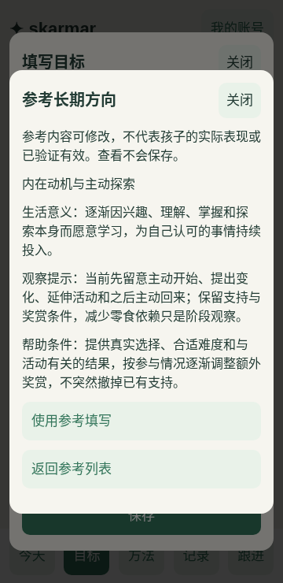

# 六个长期方向、方法参考与目录初始内容

日期：2026-10-28。按用户“实施一版并推送”执行；本轮发布范围是GitHub分支，**不部署、不操作线上数据**。
本次分支也包含前两轮尚未推送的手机界面减负及课程／老师双向历史排序。

后续更新：用户另行授权部署后，T54已完成实际发布，见[发布回执与检查](cloudflare-release-2026-10-28.md)。
本文件的“未部署”指实施推送阶段；当前线上已包含本版代码，初始定义仍需管理员明确确认创建。

## 使用入口与首版内容

- 管理员：**我的账号→初始内容与参考**。勾选内容、生成预览、核对后确认创建；默认选六个方向和十个目录项，方法默认不勾选。
- 家人新建目标：**参考长期方向**。查看不填入，明确使用后带入可编辑草稿；有核心文字时另建一份草稿，原填写保留。
- 家人新建方法：**参考做法**。可带入名称、具体步骤与说明；只保留表单已明确选择的目标，不按名称猜关联。创建后仍可正常编辑。

六个长期方向是：对人的兴趣、交往与互动；注意力与学习效能；事件理解与经历、感受、需要的表达；
自信与面对困难的应对能力；**内在动机与主动探索**；**日常生活逐渐自主**。
内在动机保留长期愿望，现阶段看主动开始、参与和再次尝试；减少零食依赖只是一项阶段观察。
注意方向先支持进入、保持及接回任务，不把表现一概解释成记忆不足，也不预置持续对视时长或固定失败比例。

十种方法参考覆盖：跟随兴趣、轮流与自然表达、建立注意、接回任务、回顾事件、小步挑战、求助休息、
真实选择与自然结果、步骤示范及渐少帮助、换条件用于生活。批量选择明确包含方法的关联方向，
单条参考则由家人自行选择当前目标。参考做法不表示实际使用或验证有效。

目录原样保存六位老师（唐唐、彭彭、邱邱、杨杨、钟老师、胖杨）和四门课程（感统、认知、社交、小组），
不固定配对、不产生课记。目录名称及排序仍沿用原管理功能。

截图来自独立测试空间，只展示通用参考内容，没有孩子实际记录或个人评估资料。

## 写入与重试

共用[data/seeds/family-starter-v1.json](../data/seeds/family-starter-v1.json)和
[目录清单](../data/seeds/initial-catalog.json)，客户端参考与Rust批量创建不另维护两份文案。

Rust通过既有`/api/data-transfer`认证、契约与事务入口生成专用预览，确认复用原`commit`接口。
利用现有来源清单和批次回执记录稳定来源键，没有新增数据库表、版本迁移、部署变量或管理员初始化流程。

- 预览不创建业务对象；确认在同一事务内提交，失败不留下部分对象、关系或来源键。
- 预览后空间有改动会拒绝提交，保留选择后可重新核对；预览绑定创建者。
- 同次确认重试返回原回执；新预览会跳过已处理来源，改名、后续编辑、停用或移除不被覆盖、恢复或重复创建。
- 单个同类型同名项目在预览明确显示“使用已有”，保留现有定义、状态和关联，不追加修订；多个同名不猜测。
  同名目标期限不是长期时拒绝使用，不改变其期限。
- 已停用目录保持停用。普通启动、重启和以后部署都不自动应用这批内容，不重设空间、账号或管理员。
- 只创建目标、方法与目录定义及其原有复盘安排，不生成课堂、家庭训练、测量、困难、经验或有效反馈。
  不从参考文字推算表现、完成状态或效果。

批量创建需管理员，普通成员仍能使用单条参考、创建和编辑业务对象。
参考不会在查看、聚焦、切观察模板或提交空框时自动成为值；只有明确“使用参考填写”才进入草稿，
并且仍须由人正式保存。这与单纯placeholder或填写例子保持区分。

## 验证

- Rust workspace 162项通过，其中新增5项初始内容检查覆盖预览、精确回执重放、改名编辑保留、停用、同名歧义／期限、权限、依赖、并发变化、来源留存及中途失败全回滚。
- 原生Clippy及Wasm Clippy、实际Rust Worker构建通过。
- 真实原生SQLite与Miniflare Rust Worker／DO执行完整PRD合约并重启通过，均运行新增初始内容HTTP合约，未SKIP。
- 客户端58项、规划14项、工作流6项、同步14项、类型检查与Web构建通过。
- 全部24组本机Chromium脚本通过。新增场景实际验证管理员预览、可选方法、26项创建、丢响应后重试、无虚构记录、普通成员参考查看与显式带入、旧草稿跨重载保留、方法只保留人工关联、后续修订不被重置以及360px布局。
- 回归中发现既有续期脚本只伪造单次认证响应，会被并发刷新覆盖；改为每个测试阶段一致的到期元数据，保留续期、真实重新登录与原表单全部断言。没有修改应用认证实现。
- 新增模型测试模拟来源指向缺失对象时，先清理引用以保持测试库外键有效，再核对不补回对象；不把该模拟当作新增删除功能或真实数据恢复演练。
- PRD0.8补初始内容与明确使用参考约定；59个原AC编号、统计口径及附录D金标准保持不变。

验证仅使用独立本地测试空间，没有读取生产账号、训练数据或真实工作簿，没有安装原生手机依赖。
桌面Chromium的手机视口不代替真机／读屏验收，Opus独立验收待办继续保留；正式`implementationCommit`不改写。

## 后续发布与使用

代码推送不代表线上已更新。以后部署仍沿用原Worker、DO、default空间、域名及来源配置；
不重复执行空白基线切换。部署新代码也不会自动创建这批定义，需管理员在上述入口预览确认。
个体化目标、方法与实际效果在日常记录及复盘中持续调整，种子内容不是完成评估或疗效证明。
