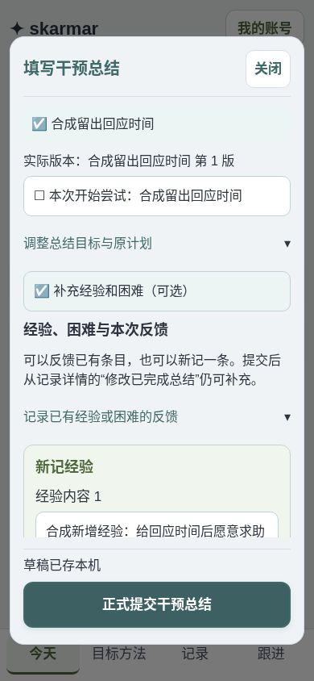
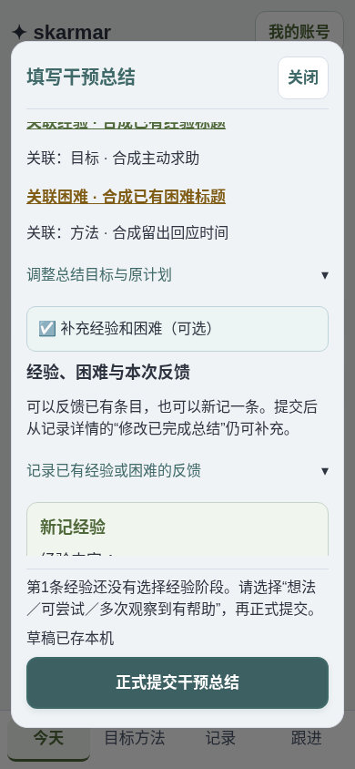
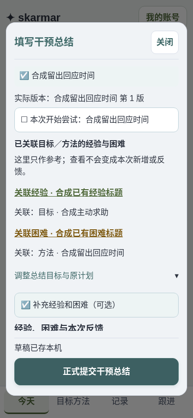
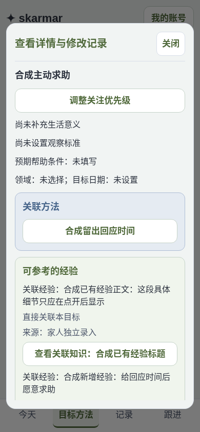
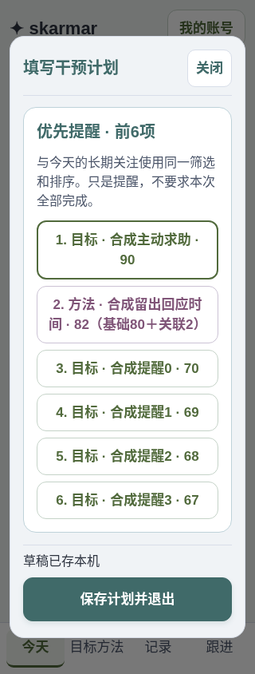
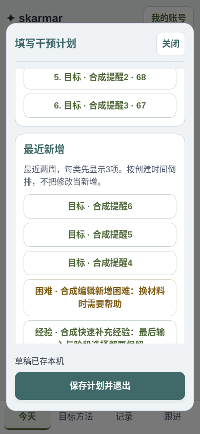
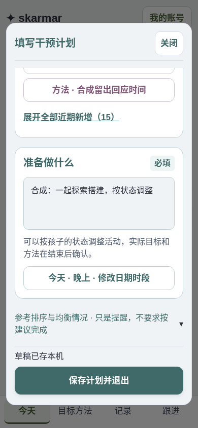
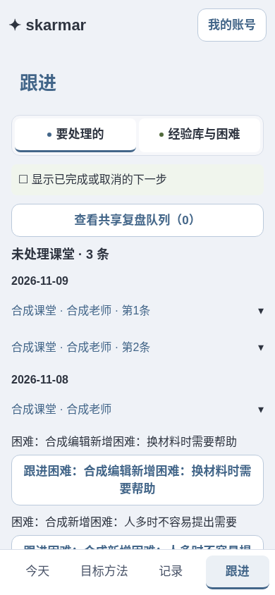
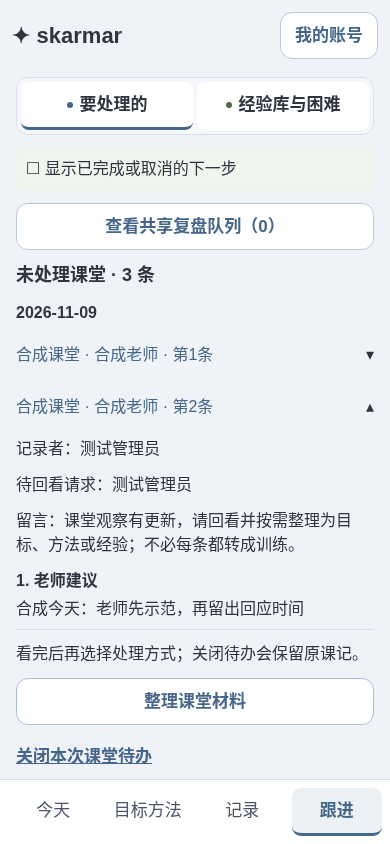

# 2026-11-09 家庭总结、计划提醒与课堂收件箱整改

来源：用户本轮四项反馈；先登记再复现、修改和逐项验收，完成后直接普通发布，保留账号、全部正式业务／历史／冻结来源、schema v7、formal-20261101及原草稿队列键。

| 编号 | 本轮验收标准 | 当前状态 |
| --- | --- | --- |
| B01 | 先复现家庭总结新增经验未录入，检查困难同链路；通过真实页面填写、提交、刷新及目标／方法／跟进查看验证。覆盖直接总结、计划后总结、编辑补充、丢回执重试、不合法内容和草稿／正式完成语义；不得凭输入字段存在声称通过 | 通过：基线422与错误不可见已复现；现在缺阶段／空困难可见阻止且保留输入，两类知识的直接、计划后、修订、多人、重试、跨页展示与共享核验均通过。见下方矩阵及图01／03。 |
| B02 | 家庭总结关联目标／方法后，相关经验困难明确标注关联来源，仅显示标题；正文按需打开，不能把推荐当本次新建或反馈 | 通过：实际关联后自动显示已有经验／困难的标题、类型和目标／方法来源；正文需点开只读查看，关闭输入保留，未产生虚假反馈。图02。 |
| B03 | 家庭计划的提醒在具体安排／做法前，共用今天关注的筛选与排序逻辑；第一组前6个优先项目，第二组最近新增目标／方法／经验／困难，按标题浏览，原活动必填及草稿保留，不把浏览计为实际覆盖 | 通过：前6项逐个与今天展开内容顺序比较一致，近期四类都有、先每类3项可展开；提醒在活动前，320px只读往返及真实保存不增加目标／方法实际计数。图04–06。 |
| B04 | 跟进课堂待看按日期分组，只显示未处理课程入口；点击展开完整课堂详情，最后提供整理和关闭，不在列表平铺处理按钮；处理后消失、新观察重开、跨页与刷新正确 | 通过：日期倒排、同日同课老师的两节独立展示，初始处理按钮隐藏；展开先观察后动作，整理和关闭均能打开原流程，关闭保留记录，新观察刷新后回到待处理。图07–08。 |
| D01 | 推送并普通部署原应用，确认实际激活版本和公开检查，所有维护／初始化／清理步骤关闭，登记脱敏回执 | 待发布 |

## 自查原则

本轮把“本机已填”“保存共享草稿”“正式完成并沉淀知识”“服务端已保存但展示未刷新”分别核对；对新增经验和困难执行同一矩阵。先保留失败证据，再修复，并重跑原失败步骤。新阶段不重写已有来源、实际覆盖、历史和独立修改的知识；不自动补写／推断用户生产数据。

计划最近新增组采用含当天最近14个家庭业务日，每类先取3项、合计至多12项，按真实创建时间倒排，可展开全部。四类都有入口，暂停／停用／已解决／已删除不自动提醒，未知创建时间不冒充新增。不改数字优先级的共享设置和旧档位兼容。UI保持Nord现有主题、可读性和44px操作区，局部调整不另做全站设计。

## 已复现的失败与修复边界

基线777b46a：手机390px，在家庭总结中只填经验内容、未选择经验阶段，正式提交返回422；知识未入库，输入仍在，但错误位置y=-358.2px、已滚出可视范围，表面看似保存按钮无效。经验阶段标签没有说明必填。随后在原表单明确选阶段，同一基线能正常沉淀经验，**没有据此声称复现数据库丢失**；未访问用户生产会话。

本轮修复：提交前逐条检查内容、明确经验阶段和关联，不静默替用户判定经验有效性；提示固定于提交按钮旁，服务器错误和冲突同样可见。草稿更新及提交读取当前引用，按知识ID更新内容／阶段／困难细节，阻止连续填写互相覆盖；未确认请求仍按原样重试。暂存明确提醒经验困难还不是正式知识，完成后才沉淀。

正式保存之后还读取共享快照核对知识ID与来源干预，不能只把保存回显中的new_knowledge当入库成功。网络失败或匹配缺项保留待核验状态，手动／后台再同步仍检查，确实匹配后才清提示；不再次提交总结。补充了“HTTP200但列表暂缺一行”的模拟响应，实际服务端记录未被删，检查不得误报成功。核验状态仅内存且按账号隔离，不更改草稿／队列键，不自动扫描或修复真实旧记录。

本轮没有Rust／schema修改。服务端仍复用已有原子事务与幂等回执，用SQLite与真实Rust Durable Object共同合约核对直接总结／共享草稿／编辑补充的经验和困难；无效经验必须整笔拒绝，不能只保存困难，重试不重复，冻结来源保持。

## 当轮验收与防复发

| 场景 | 经验／困难实测结果 |
| --- | --- |
| 漏填经验阶段／空困难 | 浏览器：不发送正式提交，错误固定可见、输入保留；Node验证无关联的逐条提示；原基线经验422而提示在屏外 |
| 直接正式总结 | 浏览器：同时新建两类，目标／方法／跟进可见，关联ID与来源干预核对；API双运行整笔原子 |
| 丢回执后刷新重试 | 浏览器及API：原请求重放，干预仍一版、两类各一条，不能重复新建 |
| 编辑已完成总结 | 浏览器：再加两类，已有冻结来源不变；快速内容和阶段在同一事件批次都保留；API核对四条产物 |
| 暂存再正式完成／另一家人接手 | 浏览器：共享总结草稿保留填写且明确尚未沉淀；正式完成才出现两条知识，另一成员能接手共享计划 |
| 保存后共享读取503 | 浏览器：写入已确认，不伪装未提交，不再PUT；全页提示与重试同步可用 |
| 共享读取200但缺知识行（模拟响应） | 浏览器：实际数据未删除；重试仍提示缺项，恢复完整响应后才确认核验成功，不把会话回显当证据 |
| 并发、账号和多窗口 | 本轮家庭总结、跟进、actor_guard、draft_windows回归通过，409保留填写，旧账号处理器不能以新身份发请求 |

- 99项客户端、TypeScript、Web构建通过；SQLite与真实Rust Wasm／DO完整合约、认证、来源快照、Excel和重启通过，新增两类知识直接／草稿／修订及无效请求无部分产物的共同合约。
- 12组相关浏览器：本轮专项、sessions、lessons、followups、actor_guard、draft_windows、r15、activity_plan、ui_redesign、workflow_updates、iteration_1109、review_1108；最终共享核验保护后针对专项／sessions／actor／多窗口／原七项／六项反馈共6组复验通过。旧计划“必须有图／处理按钮直接可见”断言按本轮明确要求更新，管理页原图和限定知识回归保留。
- 41项发布保护、9项示例保护通过。后端和schema未改，没有把旧Rust测试结果充当本轮新跑；普通发布runner会按现有流程重新跑Rust。
- 1张基线＋8张修复后截图逐张检查仅合成，配[本轮检查摘要](artifacts/validation/summary-repair-2026-11-09/checks.json)和[基线结果](artifacts/validation/summary-repair-2026-11-09/baseline.json)，登记后232项SHA。不提交数据库、完整日志、真实业务或凭据；未测试真机／读屏／Opus，也未在生产账号中写验收样本。
- AGENTS增加涉及经验／困难保存需分别核对请求、共享资料与跨页显示，以及手机错误可见的要求；不能再以表单关闭、回显或旧测试冒充沉淀完成。

## 合成截图

